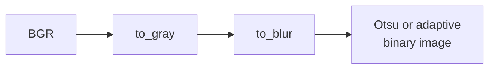

# Binarization (`p1-binary`)

Cuts the grayscale image at a threshold: pixels brighter than the threshold -> 255 (white), the rest -> 0 (black). The result is an "object/background" map, the standard input for `findContours` in `p1-count`.

## Place in the pipeline



## Theory: two thresholding strategies

A fixed threshold (`THRESH_BINARY` with a hand-picked t) is simple but breaks as soon as lighting changes. Two self-adapting approaches:

**Otsu (global threshold)**: sweeps every threshold $t$ in 0..255 over the histogram and picks the one that **maximizes the between-class variance** of background/object:

$$\max_{t}\; \sigma_B^2 = w_0\, w_1\, (\mu_0 - \mu_1)^2$$

where $w_0, w_1$ are the class probabilities and $\mu_0, \mu_1$ the class means induced by $t$. This is equivalent to minimizing the variance within each class. Intuition: a good threshold splits the histogram into two tightest clusters. Works well when the histogram has two clear peaks (bimodal); fails under uneven lighting, same-tone object/background, or when one class dominates.

**Adaptive (local threshold)**: every pixel gets its own threshold, equal to the Gaussian-weighted mean $\mu_G$ of its `blockSize × blockSize` neighborhood, minus a constant $C$:

$$T(x, y) = \mu_G\bigl(\mathcal{N}(x, y)\bigr) - C$$

where $\mathcal{N}(x, y)$ is the `blockSize × blockSize` neighborhood around the pixel.

It tolerates lighting gradients (cast shadows, a page photographed with one side lit) because the threshold "follows" each region's brightness; the cost is higher noise sensitivity and slower speed than Otsu. Defaults: `blockSize=11`, `C=2`, exposed as the advanced params `block` and `c`.

## Tech stack: OpenCV

```python
# Otsu
t, b = cv2.threshold(gray_blur, 0, 255,
                     cv2.THRESH_BINARY + cv2.THRESH_OTSU)

# Adaptive
b = cv2.adaptiveThreshold(gray_blur, 255,
                          cv2.ADAPTIVE_THRESH_GAUSSIAN_C,
                          cv2.THRESH_BINARY, 11, 2)
```

- `cv2.threshold` returns a **tuple `(actual_threshold, image)`**, so you must unpack it; with `THRESH_OTSU` the first return value is the threshold it chose itself, while the `thresh=0` argument is ignored.
- `ADAPTIVE_THRESH_GAUSSIAN_C`: Gaussian weights for the neighborhood; `ADAPTIVE_THRESH_MEAN_C`: uniform average, cheaper but more noise-sensitive.
- `THRESH_BINARY` vs `THRESH_BINARY_INV`: flips black/white. `findContours` only finds **white** regions, so the binary polarity decides whether `p1-count` counts correctly.
- `blockSize` must be odd and larger than the object's stroke width; positive `C` makes the threshold stricter (less white), negative `C` the opposite.

## Code

```python
def to_binary(img, method="otsu", ksize=5, block=11, C=2):
    if method == "adaptive":
        return cv2.adaptiveThreshold(to_blur(img, ksize), 255,
                                     cv2.ADAPTIVE_THRESH_GAUSSIAN_C,
                                     cv2.THRESH_BINARY, block, C)
    _, b = cv2.threshold(to_blur(img, ksize), 0, 255,
                         cv2.THRESH_BINARY + cv2.THRESH_OTSU)
    return b
```

Both branches run on the `to_blur` output (gray + smoothed): denoise before cutting the threshold, otherwise every noise grain becomes a white blob. `method` is the main control; the Advanced section splits the rest by pipeline stage: `ksize` tunes the pre-blur (Pre-blur group), `block` and `c` only matter when `method=adaptive` (Adaptive group).

## Tips & tricks

- To see which threshold Otsu picked: `t, b = cv2.threshold(...)` then print `t`, and compare with the histogram (`cv2.calcHist`). This is the fastest way to build Otsu intuition.
- If the result is "inverted" (object goes black, background white): switch to `THRESH_BINARY_INV`.
- A binary image almost always keeps speckles and holes: clean it with `cv2.morphologyEx` (`MORPH_OPEN` removes background specks, `MORPH_CLOSE` seals holes inside objects) before contouring.
- Strong shadows: adaptive beats Otsu, but even better is estimating the background with a very large blur and dividing (`img / background`) before Otsu.
- Order to try things to save time: Otsu first (no numbers to pick), adaptive when you clearly see uneven light/dark regions, fixed threshold only when you control the input lighting.

## Try it

- Photograph a page with text under angled lighting (one side bright, one side dark): Otsu loses strokes in the dark region, adaptive keeps them. The classic example showing a global threshold is not enough.
- Upload `examples/coins.jpg`: Otsu separates the coins from the background very cleanly, ideal input for `p1-count`.
