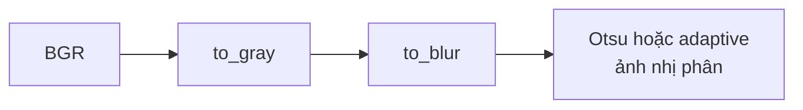

# Nhị phân hóa (`p1-binary`)

Cắt ảnh xám tại một ngưỡng: pixel sáng hơn ngưỡng -> 255 (trắng), còn lại -> 0 (đen). Kết quả là bản đồ "vật thể/nền", input chuẩn cho `findContours` trong `p1-count`.

## Vị trí trong pipeline



## Lý thuyết: hai chiến lược chọn ngưỡng

Ngưỡng cố định (`THRESH_BINARY` với $t$ tự chọn) thì đơn giản nhưng vỡ ngay khi ánh sáng thay đổi. Hai cách tự thích nghi:

**Otsu (ngưỡng toàn cục)**: quét mọi ngưỡng $t$ trong 0..255 trên histogram và chọn ngưỡng **cực đại hóa phương sai giữa hai lớp** (between-class variance) nền/vật:

$$\max_{t}\; \sigma_B^2 = w_0\, w_1\, (\mu_0 - \mu_1)^2$$

với $w_0, w_1$ là xác suất của hai lớp và $\mu_0, \mu_1$ là trung bình mỗi lớp theo ngưỡng $t$. Tương đương với cực tiểu hóa phương sai bên trong từng lớp. Trực giác: ngưỡng tốt chia histogram thành hai cụm gọn nhất. Hoạt động tốt khi histogram có hai đỉnh rõ (bimodal); thất bại khi ánh sáng không đều, vật/nền cùng tông, hoặc một lớp chiếm ưu thế.

**Adaptive (ngưỡng cục bộ)**: mỗi pixel có ngưỡng riêng, bằng trung bình trọng số Gaussian $\mu_G$ của lân cận `blockSize × blockSize` quanh nó, trừ hằng số $C$:

$$T(x, y) = \mu_G\bigl(\mathcal{N}(x, y)\bigr) - C$$

với $\mathcal{N}(x, y)$ là lân cận `blockSize × blockSize` quanh pixel. Nó chịu được gradient ánh sáng (bóng đổ, trang giấy chụp một bên sáng một bên tối) vì ngưỡng "đi theo" độ sáng từng vùng; cái giá là nhạy nhiễu hơn và chậm hơn Otsu. Mặc định: `blockSize=11`, `C=2`, lộ ra dưới dạng tham số nâng cao `block` và `c`.

## Tech stack: OpenCV

```python
# Otsu
t, b = cv2.threshold(gray_blur, 0, 255,
                     cv2.THRESH_BINARY + cv2.THRESH_OTSU)

# Adaptive
b = cv2.adaptiveThreshold(gray_blur, 255,
                          cv2.ADAPTIVE_THRESH_GAUSSIAN_C,
                          cv2.THRESH_BINARY, 11, 2)
```

- `cv2.threshold` trả **tuple `(ngưỡng_thực_tế, ảnh)`** nên phải unpack; với `THRESH_OTSU` giá trị đầu trả về là ngưỡng nó tự chọn, còn tham số `thresh=0` bị bỏ qua.
- `ADAPTIVE_THRESH_GAUSSIAN_C`: trọng số Gaussian cho lân cận; `ADAPTIVE_THRESH_MEAN_C`: trung bình đều, rẻ hơn nhưng nhạy nhiễu hơn.
- `THRESH_BINARY` vs `THRESH_BINARY_INV`: đảo trắng/đen. `findContours` chỉ tìm vùng **trắng**, nên cực của ảnh nhị phân quyết định `p1-count` đếm đúng hay sai.
- `blockSize` phải lẻ và lớn hơn độ dày nét của vật; `C` dương làm ngưỡng chặt hơn (ít trắng), `C` âm thì ngược lại.

## Code

```python
def to_binary(img, method="otsu", ksize=5, block=11, C=2):
    if method == "adaptive":
        return cv2.adaptiveThreshold(to_blur(img, ksize), 255,
                                     cv2.ADAPTIVE_THRESH_GAUSSIAN_C,
                                     cv2.THRESH_BINARY, block, C)
    _, b = cv2.threshold(to_blur(img, ksize), 0, 255,
                         cv2.THRESH_BINARY + cv2.THRESH_OTSU)
    return b
```

Cả hai nhánh đều chạy trên output của `to_blur` (xám + đã làm mượt): khử nhiễu trước khi cắt ngưỡng, nếu không mỗi hạt nhiễu thành một blob trắng. `method` là tham số chính; phần Advanced chia phần còn lại theo bước pipeline: `ksize` chỉnh blur đầu vào (nhóm Pre-blur), `block` và `c` chỉ có tác dụng khi `method=adaptive` (nhóm Adaptive).

## Mẹo & thủ thuật

- Để xem Otsu chọn ngưỡng nào: `t, b = cv2.threshold(...)` rồi in `t`, so với histogram (`cv2.calcHist`). Đây là cách nhanh nhất để xây trực giác về Otsu.
- Kết quả bị "ngược" (vật thể đen, nền trắng): đổi sang `THRESH_BINARY_INV`.
- Ảnh nhị phân hầu như luôn còn đốm nhiễu và lỗ thủng: dọn bằng `cv2.morphologyEx` (`MORPH_OPEN` xóa đốm nền, `MORPH_CLOSE` bịt lỗ trong vật) trước khi contour.
- Bóng đổ mạnh: adaptive thắng Otsu, nhưng còn tốt hơn là ước lượng nền bằng blur rất lớn rồi chia (`img / background`) trước khi Otsu.
- Thứ tự thử để tiết kiệm thời gian: Otsu trước (không cần chọn số), adaptive khi thấy rõ vùng sáng/tối không đều, ngưỡng cố định chỉ khi bạn kiểm soát được ánh sáng đầu vào.

## Thử ngay

- Chụp trang giấy có chữ với ánh sáng xiên (một bên sáng một bên tối): Otsu mất nét ở vùng tối, adaptive vẫn giữ. Ví dụ kinh điển chứng minh ngưỡng toàn cục là chưa đủ.
- Upload `examples/coins.jpg`: Otsu tách đồng xu khỏi nền rất sạch, input lý tưởng cho `p1-count`.
