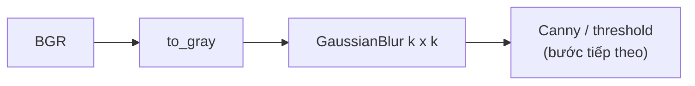

# Làm mờ Gaussian (`p1-blur`)

Tích chập (convolution) với kernel Gaussian: mỗi pixel được thay bằng trung bình có trọng số của lân cận, pixel tâm nặng nhất. Trong pipeline thực tế đây là **bước khử nhiễu trung gian**: `to_edges`, `to_binary` và `count_objects` đều gọi `to_blur` trước khi xử lý.

## Vị trí trong pipeline



## Lý thuyết: tích chập và kernel Gaussian

Lọc ảnh = trượt một ma trận nhỏ (kernel) qua mọi vị trí ảnh; mỗi pixel mới là tổng có trọng số của các pixel mà kernel phủ. Kernel Gaussian được sinh từ hàm chuông 2D:

$$G(x, y) = \exp\!\left(-\frac{x^2 + y^2}{2\sigma^2}\right)$$

Pixel gần tâm được trọng số cao, trọng số giảm dần về 0 theo khoảng cách. Khác với kernel box đồng nhất (`cv2.blur`, mọi vị trí đều $1/k^2$), Gaussian "tin" pixel gần hơn, nên làm mượt tự nhiên và ít bị khối.

Xét theo miền tần số, Gaussian là **bộ lọc thông thấp**: nó dập các dao động cường độ tần số cao (nhiễu hạt, nét mảnh) nhưng giữ cấu trúc tần số thấp (vùng đồng nhất, khối lớn). Đó là lý do threshold và Canny phải đi sau blur: nếu không mỗi hạt nhiễu sẽ thành một "vật thể" hay một đoạn cạnh giả.

Đánh đổi: blur cũng xóa chi tiết thật ở cùng dải tần số cao, và làm nhòe cạnh khiến Canny định vị kém chính xác nếu blur quá mạnh. Chọn ksize là chọn điểm cân bằng giữa sạch nhiễu và giữ chi tiết.

## Tech stack: OpenCV

```python
blur = cv2.GaussianBlur(gray, (ksize, ksize), 0)
```

- `ksize`: cạnh của kernel vuông, **phải lẻ** để có đúng một pixel tâm; `GaussianBlur` báo lỗi với giá trị chẵn. Task giới hạn 1..31.
- `sigmaX = 0`: bảo OpenCV tự suy ra $\sigma$ từ ksize theo $\sigma \approx 0.3 \cdot ((k-1) \cdot 0.5 - 1) + 0.8$. Với `ksize=5`, $\sigma \approx 1.1$. Task lộ tham số này ở phần Advanced dưới tên `sigma`: tăng nó để hàm chuông rộng hơn mà không cần tăng kernel.
- Kernel Gaussian **tách được** (separable): tách thành hai lượt 1D (ngang rồi dọc), nên chi phí là $O(H \cdot W \cdot k)$ thay vì $O(H \cdot W \cdot k^2)$. Đó là lý do ksize lớn vẫn chạy tốt trên CPU.
- Pixel biên thiếu lân cận: OpenCV mặc định `BORDER_DEFAULT` (phản chiếu `gfedcb|abcdefgh|gfedcba`), nên mép ảnh không bị tối đi như khi zero padding.

So sánh các bộ lọc blur:

| Hàm | Cơ chế | Hợp nhất cho |
|-----|--------|--------|
| `cv2.blur` | trung bình box | blur nhanh nhất, rẻ nhất |
| `cv2.GaussianBlur` | trọng số Gaussian | khử nhiễu chuẩn trước Canny/threshold |
| `cv2.medianBlur` | trung vị lân cận | nhiễu muối tiêu, giữ cạnh tốt hơn |
| `cv2.bilateralFilter` | lọc hai phía (không gian + cường độ) | mượt mà vẫn giữ cạnh, chậm hơn nhiều |

## Code

```python
def to_blur(img, ksize=5, sigma=0):
    return cv2.GaussianBlur(to_gray(img), (ksize, ksize), sigma)
```

- Blur chạy **trên ảnh xám**, nên output của task là ảnh 1 kênh kể cả khi input là ảnh màu.
- Tham số `ksize` của task (1..31, mặc định 5) phải lẻ; handler tự `+1` nếu nhận giá trị chẵn.
- `ksize` là tham số chính; `sigma` nằm trong phần Advanced (0 = tự suy ra từ ksize).

## Mẹo & thủ thuật

- Chọn ksize theo mục đích: 3-5 để khử nhiễu nhẹ trước threshold/Canny; 9-15 để làm mờ hẳn background; trên 21 chủ yếu là hiệu ứng thị giác.
- Nhiễu muối tiêu (chấm trắng/đen rải rác): Gaussian bôi nhiễu ra chứ không xóa được; `medianBlur` mới là công cụ đúng.
- Muốn da/background mượt mà vẫn giữ cạnh sắc (retouch): dùng `bilateralFilter`, nó chỉ blur các pixel có cường độ tương tự.
- Tích chập cũng là nền móng của CNN: ở đây kernel do bạn chọn, còn kernel trong Conv layer do mô hình học. Hiểu `filter2D` là hiểu một nửa của Conv layer.

## Thử ngay

- Kéo `ksize` từ 1 -> 31 trên cùng một ảnh: cạnh vật thể nhòe dần. Rồi chạy `p1-edges` để thấy Canny đặt cạnh sai và gãy khi blur quá mạnh.
- Trên ảnh nhiễu nặng: xem Gaussian không dọn sạch được, đó chính là lý do `medianBlur` tồn tại.
