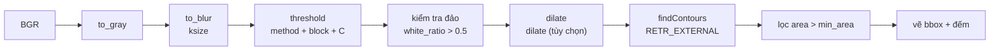

# Đếm vật thể (`p1-count`)

Pipeline dài nhất của phase 1, kết hợp mọi khái niệm của 4 task trước: xám -> blur -> nhị phân -> contours. Đây cũng là task duy nhất trả cả ảnh lẫn data (`data.count`). Trang này giải thích cách pipeline hoạt động; tab **Spec** ghi lại từng control của demo và giá trị khuyên dùng.

## Pipeline



## Pipeline: từng bước một

### 1. `to_gray`: gộp màu thành độ sáng

- `cv2.cvtColor(img, cv2.COLOR_BGR2GRAY)` gộp 3 kênh thành một kênh độ sáng: $Y = 0.299R + 0.587G + 0.114B$. Kênh xanh lá nặng nhất vì mắt người nhạy với nó nhất.
- Thuật toán threshold và contour chỉ làm việc trên **một kênh**, còn màu sắc không liên quan đến bài toán "vật vs nền", nên bỏ sớm vừa đúng bản chất vừa rẻ hơn 3 lần cho các bước sau.
- Bước này không được gọi trực tiếp trong `count_objects`: nó chạy bên trong `to_binary` thông qua `to_blur`. Không có param nào của demo điều khiển nó.

### 2. `to_blur`: khử nhiễu Gaussian

- `cv2.GaussianBlur(gray, (ksize, ksize), 0)` làm mượt ảnh xám trước khi ngưỡng hóa.
- Vì sao quan trọng riêng với việc đếm: mỗi hạt nhiễu sống sót qua threshold sẽ thành một chấm trắng nhỏ -> một contour giả -> `min_area` phải dọn sau. Blur đẩy các hạt đó xuống dưới ngưỡng nên chúng không bao giờ thành blob.
- Param demo: `ksize` (nhóm Pre-blur). Lẻ, 1..31, mặc định 5. Tăng nó cũng làm vật mảnh tan vào nền và bo tròn góc của vật thật, nên đây là đánh đổi chi tiết lấy sạch.
- Giống `to_gray`, bước này chạy bên trong `to_binary`, nên `ksize` được chia sẻ giữa bước này và bước ngưỡng hóa.

### 3. Ngưỡng hóa: Otsu hoặc adaptive

- `method=otsu`: `cv2.threshold(gray_blur, 0, 255, THRESH_BINARY + THRESH_OTSU)`. Otsu quét histogram tìm ngưỡng cực đại hóa phương sai giữa 2 lớp; đối số `thresh=0` bị bỏ qua. Một ngưỡng toàn cục cho cả ảnh.
- `method=adaptive`: `cv2.adaptiveThreshold(gray_blur, 255, ADAPTIVE_THRESH_GAUSSIAN_C, THRESH_BINARY, block, C)`. Mỗi pixel so với trung bình có trọng số Gaussian của lân cận `block x block` trừ đi `C`, nên ngưỡng "bám" theo độ sáng cục bộ.
- Param demo: `method` chọn nhánh; `block` (lẻ, 3..51) và `c` (-20..20) chỉ có tác dụng khi `method=adaptive`. Toán đầy đủ của 2 chiến lược nằm trong doc `p1-binary`.
- Kết quả bước này: ảnh `uint8` 1 kênh chỉ chứa 0 và 255. **Đây là cửa ải chất lượng**: mọi lỗi sót lại ở đây sẽ thành lỗi đếm mà không bước nào sau sửa được.

### 4. `invert`: sửa cực trắng/đen

- `findContours` chỉ đếm vùng **trắng**, nên vật thể phải trắng trên nền đen.
- `white_ratio = (binary > 0).mean()` là tỷ lệ pixel trắng. `invert=auto` đảo ảnh bằng `cv2.bitwise_not` khi trắng chiếm quá nửa khung, theo heuristic "vùng lớn hơn thường là nền". `always`/`never` ép tay.
- Trường hợp `auto` sai: khi vật thể thật sự chiếm hơn nửa ảnh (đống đồ tối màu dày đặc trên sàn sáng), heuristic chọn sai và nền bị đếm thành một vật khổng lồ.

### 5. `dilate`: nối khe hở (tùy chọn, bỏ qua khi `dilate=0`)

- `cv2.dilate(binary, kernel)` với kernel `MORPH_RECT` kích thước `dilate x dilate`: mỗi pixel trắng nở ra phủ cả kernel, nên mỗi vùng trắng lớn thêm khoảng `dilate / 2` px mỗi phía.
- Hai cách dùng: (a) nối lại các mảnh của một vật bị threshold cắt đứt, ví dụ nét chữ gãy đôi; (b) cố tình gộp các vật gần nhau để đếm nhóm thay vì đếm phần, như trò "CV" trong `sample.png`.
- Cái giá: khe nhỏ hơn ~`dilate` px giữa *các vật khác nhau* cũng bị bịt, nên đánh đổi khả năng tách lấy độ liền. Chỉ chạy 1 lần lặp; gọi `dilate` nhiều lần sẽ nở vùng tuyến tính.

### 6. `findContours`: trích biên

- `cv2.findContours(binary, RETR_EXTERNAL, CHAIN_APPROX_SIMPLE)` trả một mảng điểm cho mỗi vùng trắng: contour chính là các pixel biên theo thứ tự của vùng đó.
- Ảnh nhị phân bị dùng in-place (OpenCV có thể sửa nó), nhưng an toàn vì không cần nó nữa sau bước này.
- Chi tiết 2 cờ và các hàm đo (`contourArea`, `boundingRect`, ...) ở mục *Tech stack* bên dưới.

### 7. `min_area`: lớp lọc nhiễu cuối

- `kept = [c for c in contours if cv2.contourArea(c) > min_area]` loại các contour chấm nhiễu và blob nhỏ sót lại. Đây là lớp khử nhiễu cuối, áp trên vùng thay vì trên pixel.
- `min_area` là control **chính** của demo (luôn hiển thị) vì giá trị đúng của nó phụ thuộc độ phân giải ảnh chứ không phụ thuộc thuật toán: nó mã hóa câu hỏi "một vật chiếm bao nhiêu pixel trong ảnh này".

### 8. Vẽ chú thích và trả kết quả

- Với mỗi contour giữ lại, `cv2.boundingRect` cho `(x, y, w, h)` và `cv2.rectangle` vẽ hộp xanh lên `img.copy()`.
- Hàm trả `(annotated_bgr, len(kept))`; task gói số đếm thành `data.count`, và `result_tab="output"` khiến ảnh có chú thích là tab mặc định sau mỗi lần chạy.

## Lý thuyết: contour là gì

Contour là đường cong ôm theo biên của một **vùng trắng liên thông** trong ảnh nhị phân. `findContours` quét ảnh và trả danh sách contour, mỗi cái là mảng $N$ điểm $(x, y)$ theo thứ tự dọc biên.

Vì thuật toán làm việc trên vùng trắng liên thông:

- **Hai vật chạm nhau** hợp thành một vùng trắng -> một contour -> đếm thiếu.
- **Một vật bị vỡ mảnh** trong ảnh nhị phân thành nhiều vùng -> nhiều contour -> đếm thừa.

Nguyên tắc debug then chốt: **chất lượng đếm được quyết định ở bước nhị phân, không phải bước contour**. Nếu contour trông sai, quay lại sửa ảnh nhị phân (blur thêm, đổi threshold, morphology); đừng sửa contours.

## Tech stack: OpenCV

```python
contours, hierarchy = cv2.findContours(binary,
                                       cv2.RETR_EXTERNAL,
                                       cv2.CHAIN_APPROX_SIMPLE)
```

- `RETR_EXTERNAL`: chỉ lấy biên ngoài cùng, bỏ lỗ bên trong và vùng lồng nhau (đồng xu có lỗ vẫn đếm là 1). Dùng `RETR_TREE` hoặc `RETR_LIST` nếu cần phân cấp cha-con.
- `CHAIN_APPROX_SIMPLE`: nén các đoạn thẳng chỉ còn 2 đầu mút thay vì lưu mọi pixel, contour nhẹ hơn nhiều; đủ cho `contourArea` và `boundingRect`. Dùng `CHAIN_APPROX_NONE` nếu cần mọi điểm biên.
- OpenCV 4 trả `(contours, hierarchy)`; code mẫu OpenCV 3 cũ trên mạng trả 3 giá trị và sẽ lỗi khi unpack.

Các phép đo trên mỗi contour:

| Hàm | Trả về | Dùng cho |
|-----|--------|---------|
| `cv2.contourArea(c)` | diện tích pixel bên trong | lọc nhiễu, đo kích thước |
| `cv2.boundingRect(c)` | `(x, y, w, h)` hộp thẳng đứng | vẽ bbox, cắt vùng |
| `cv2.arcLength(c, True)` | chu vi | đặc trưng hình dạng |
| `cv2.approxPolyDP(c, eps, True)` | đa giác xấp xỉ | nhận dạng hình (3 đỉnh = tam giác...) |
| `cv2.minEnclosingCircle(c)` | tâm + bán kính | vật tròn, tracking |
| `cv2.moments(c)` | moment thống kê | tâm khối $c_x = m_{10} / m_{00}$ |

### Vẽ vùng phát hiện

- `cv2.boundingRect(c)` -> hộp đứng `(x, y, w, h)`, vẽ bằng `cv2.rectangle` (cách task này đang dùng). Nhanh và đơn giản, nhưng luôn song song trục: vật nằm nghiêng sẽ có hộp lỏng, thừa diện tích.
- `cv2.minAreaRect(c)` -> hộp xoay `((cx, cy), (w, h), angle)`, chữ nhật nhỏ nhất ở mọi góc. Không có hàm vẽ trực tiếp: đổi qua `box = cv2.boxPoints(rect)`, làm tròn bằng `np.int0`, rồi `cv2.drawContours(out, [box], 0, color, 2)`.
- `cv2.minEnclosingCircle(c)` -> `(center, radius)` cho `cv2.circle`: hợp vật tròn hoặc hình vô định mà chữ nhật trông sai.
- `cv2.drawContours(out, kept, -1, color, 2)` bỏ hẳn hộp, vẽ đúng polygon contour: tốt nhất khi cần hình dạng chính xác.

## Code

```python
def count_objects(img, min_area=500, ksize=5, method="otsu", invert="auto",
                  dilate=0, block=11, C=2):
    binary = to_binary(img, method, ksize, block, C)
    white_ratio = (binary > 0).mean()
    if invert == "always" or (invert == "auto" and white_ratio > 0.5):
        binary = cv2.bitwise_not(binary)
    if dilate > 0:
        kernel = cv2.getStructuringElement(cv2.MORPH_RECT, (dilate, dilate))
        binary = cv2.dilate(binary, kernel)
    contours, _ = cv2.findContours(binary, cv2.RETR_EXTERNAL,
                                   cv2.CHAIN_APPROX_SIMPLE)
    out = img.copy()
    kept = [c for c in contours if cv2.contourArea(c) > min_area]
    for c in kept:
        x, y, w, h = cv2.boundingRect(c)
        cv2.rectangle(out, (x, y), (x + w, y + h), (0, 255, 0), 2)
    return out, len(kept)
```

- Các param của task ánh xạ vào các bước pipeline: `ksize` -> `to_blur`, `method` -> nhánh Otsu/adaptive của `to_binary`, `block`/`c` -> blockSize/C của adaptive (chỉ dùng khi `method=adaptive`), `invert` -> có đảo nhị phân không, `dilate` -> morphology tùy chọn để nối vùng gần nhau thành 1 contour, `min_area` -> lọc contour cuối. Chỉ `min_area` luôn hiển thị; phần còn lại nằm trong Advanced, nhóm theo bước (Pre-blur / Threshold / Morphology).
- `dilate` nở mỗi vùng trắng khoảng `dilate / 2` px mỗi phía, nên các vùng cách nhau dưới ~`dilate` px sẽ dính liền. Trên `sample.png` 2 chữ "CV" cách nhau ~9px: `dilate=9` đếm chúng là một vật trong khi hình vuông và hình tròn vẫn tách.
- `findContours` chỉ đếm vùng **trắng**, nên vật thể phải trắng trên nền đen. `invert="auto"` tự đảo khi trắng chiếm quá nửa ảnh (trắng là nền); `always`/`never` ép tay. Thiếu bước này, ảnh nền sáng như `sample.png` chỉ đếm được 1 "vật" là cả nền.
- `out = img.copy()` là then chốt: `cv2.rectangle` **vẽ in-place**, và `ndarray` truyền theo tham chiếu, nên không copy sẽ sửa luôn ảnh gốc của caller.
- Vẽ trên `img.copy()` (ảnh màu BGR), không phải ảnh nhị phân: ảnh 1 kênh không chứa được màu `(0, 255, 0)`.
- `count = len(kept)` sau khi lọc, không phải tổng số contour: `min_area` là lớp khử nhiễu cuối của pipeline.

## Mẹo & thủ thuật

- `min_area` phụ thuộc kích thước ảnh: 500px hợp lý cho ảnh ~1MP nhưng quá lớn cho thumbnail. Kinh nghiệm: đặt khoảng 0.01% - 0.1% diện tích ảnh.
- **Hai vật chạm nhau = một contour**: giới hạn lớn nhất của phương pháp này. Giảm bằng `morphologyEx(MORPH_OPEN)` để tách chỗ nối mảnh, hoặc distance transform + watershed cho vật dính nặng (đồng xu xếp chồng).
- Vật bị vỡ do ảnh nhị phân hở: `MORPH_CLOSE` hoặc dilate nhẹ trước `findContours` để nối khe hở.
- Debug nhanh: `cv2.drawContours(out, kept, -1, (0,0,255), 2)` vẽ hình contour thật thay vì hộp, dễ phát hiện contour xấu.
- Màu `(0, 255, 0)` theo thứ tự BGR nên ra xanh lá; sai thứ tự sẽ vẽ sai màu.

## Thử ngay

- `coins.jpg` + `min_area=500`: đếm chính xác. Tăng lên 5000: đồng xu nhỏ biến mất. Hạ xuống 0: nhiễu nền bị đếm thành vật.
- Ảnh có vật chạm nhau (hai đồng xu sát cạnh): chứng kiến việc đếm thiếu. Đây là động lực để học morphology và watershed ở các project sau.
