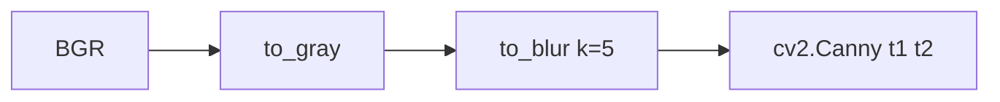

# Phát hiện cạnh Canny (`p1-edges`)

Trả về ảnh nhị phân: trắng = cạnh, đen = không phải cạnh. Đây là task "phân tích" đầu tiên: thay vì biến đổi ảnh, nó trích **cấu trúc** (biên vật thể) ra khỏi ảnh.

## Vị trí trong pipeline



## Lý thuyết: Canny gồm 4 bước

1. **Gaussian blur** để khử nhiễu (trong code: `to_blur` với ksize=5).
2. **Sobel** tính gradient: đạo hàm riêng theo $x$ ($G_x$) và $y$ ($G_y$) qua hai kernel tích chập, ví dụ

   $$G_x = \begin{bmatrix} -1 & 0 & 1 \\ -2 & 0 & 2 \\ -1 & 0 & 1 \end{bmatrix}$$

   Từ đó suy ra độ lớn $|G|$ và hướng $\theta = \operatorname{atan2}(G_y, G_x)$ tại mỗi pixel. Cạnh nằm ở chỗ cường độ đổi đột ngột, tức nơi $|G|$ lớn.
3. **Non-maximum suppression**: dọc theo hướng gradient, chỉ giữ pixel có $|G|$ lớn nhất trong lân cận. Cạnh co từ dải dày xuống còn 1px.
4. **Ngưỡng hysteresis** với 2 ngưỡng:
   - $|G| > t_2$: cạnh mạnh, chắc chắn giữ.
   - $|G| < t_1$: loại bỏ.
   - Giữa hai ngưỡng: cạnh yếu, chỉ giữ nếu **nối liền** với cạnh mạnh.

Hysteresis là ý tưởng thông minh nhất của Canny: một cạnh thật bị yếu ở vài đoạn vẫn được nối thông, còn nhiễu lẻ loi thì bị loại. Một ngưỡng đơn không phân biệt được hai trường hợp này.

Vì đạo hàm khuếch đại nhiễu tần số cao, bước blur ở bước 1 là **bắt buộc**: bỏ nó thì mỗi hạt nhiễu tạo một phản hồi gradient mạnh, làm ngập kết quả bằng cạnh giả.

## Tech stack: OpenCV

```python
edges = cv2.Canny(gray_blur, threshold1=t1, threshold2=t2)
```

- Input thực tế đã qua `to_gray` + `to_blur` bên trong `imgtool`; `cv2.Canny` nhận ảnh 1 kênh.
- Output là ảnh 1 kênh chỉ chứa 0 và 255.
- Tham số nâng cao đáng thử: `aperture` ánh xạ sang `apertureSize` (kích thước kernel Sobel, 3/5/7, mặc định 3) và `l2` ánh xạ sang `L2gradient` (`l1` dùng $|G_x| + |G_y|$, nhanh; `l2` dùng $\sqrt{G_x^2 + G_y^2}$, chính xác hơn, chậm hơn chút).
- Canny trả **cạnh, không phải vùng vật thể**: cạnh thường là contour hở nên đừng gọi `findContours` trực tiếp để đếm vật. Hãy đi qua threshold như `p1-count`.

## Code

```python
def to_edges(img, t1=50, t2=150, ksize=5, aperture=3, l2=False):
    return cv2.Canny(to_blur(img, ksize), t1, t2,
                     apertureSize=aperture, L2gradient=l2)
```

Tham số chính là `t1`, `t2` (0..255, mặc định 50/150). Phần còn lại nằm trong Advanced, nhóm theo bước pipeline: `ksize` chỉnh blur đầu vào (nhóm Pre-blur), `aperture` và `l2` chỉnh bước gradient Sobel bên trong Canny (nhóm Canny).

## Mẹo & thủ thuật

- Kinh nghiệm $t_2 : t_1 \approx 2:1$ đến $3:1$ (mặc định 50/150). Nếu mất cạnh, hạ `t1` trước vì `t1` quyết định bao nhiêu đoạn yếu được nối; ảnh nhiễu thì tăng cả hai.
- **Auto-Canny** không cần ngưỡng thủ công: lấy $v = \mathrm{median}(\text{gray})$, đặt $t_1 = 0.66\,v$, $t_2 = 1.33\,v$, clip về 0..255. Hữu ích khi xử lý hàng loạt ảnh có độ sáng khác nhau.
- `t1 >= t2` vẫn chạy nhưng gần như không ra cạnh: OpenCV không ép thứ tự giữa hai ngưỡng.
- Canny là bước đầu của `HoughLinesP`/`HoughCircles` (phát hiện đường thẳng, đường tròn) và của các pipeline đo kích thước công nghiệp.

## Thử ngay

- Giữ `t2=150`, kéo `t1` từ 0 lên 140: số đoạn cạnh được nối giảm mạnh khi `t1` tăng, cho thấy vai trò của dải "cạnh yếu".
- Giữ `t1=50`, hạ `t2` xuống 60: cạnh nhiễu xuất hiện khắp nơi vì ngưỡng "mạnh" quá dễ đạt. Đây là lý do blur phải đi trước Canny.
