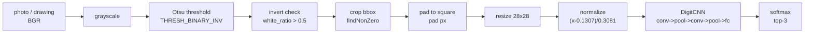

# Recognize handwritten digit (`p2-digit`)

The first deep-learning task on the app. A CNN trained on MNIST classifies a photo or drawing of a handwritten digit (0-9). The task returns the top-3 predictions with confidence bars plus the exact 28x28 image the model saw, so you can debug preprocessing visually. This page explains each pipeline component; the **Spec** tab documents the demo controls and their recommended values.

## Pipeline



Stages 1-7 are `mnist.preprocess(img, invert, pad)`; stages 8-10 are `mnist.predict(model, img28)`, both in `backend/app/cvlib/mnist.py`. Every preprocessing stage has one job: rebuild the MNIST input distribution (28x28 grayscale, **white strokes on black**, centered with a margin) out of an arbitrary photo. The model only ever saw that distribution during training; feed it anything else and it answers confidently wrong, the classic domain-shift failure.

## Pipeline: stage by stage

### 1. Input: an arbitrary BGR image

- `img` is whatever `cv2.imdecode` produced: a BGR `uint8` array of any size. It can be a photo of ink on paper, a screenshot from a drawing app, or an already-MNIST-like white-on-black render.
- Nothing is assumed about size, position, polarity, or stroke width; the next stages normalize all of it.

### 2. Grayscale: drop the color

- `cv2.cvtColor(img, cv2.COLOR_BGR2GRAY)` folds 3 channels into one luminance channel: $Y \approx 0.299R + 0.587G + 0.114B$.
- The model takes a single-channel 28x28 input, so color is dead weight. Dropping it early makes the threshold stage cheaper and removes pen color as a variable.

### 3. Otsu threshold, inverted

- `cv2.threshold(gray, 0, 255, THRESH_BINARY_INV + THRESH_OTSU)` does two things in one call. `THRESH_OTSU` scans the gray histogram and picks the cut that best separates two brightness clusters (the `thresh=0` argument is ignored), so the threshold adapts to lighting instead of relying on a hand-tuned value. `THRESH_BINARY_INV` writes 255 where the pixel is *below* that cut: dark ink becomes white, which is MNIST polarity (white digit on black).
- This stage assumes dark-on-light input, the common case for photos of ink on paper. The next stage handles the opposite case.
- **Quality gate**: everything downstream works on this binary image. Speckle noise that survives here becomes part of the "digit" and no later stage can remove it.

### 4. `invert`: fix the polarity

- `white_ratio = (binary > 0).mean()`: the fraction of white pixels. `invert="auto"` flips the image with `cv2.bitwise_not` when white covers more than half the frame. A digit occupies much less than 50% of its canvas, so a mostly-white frame means INV guessed wrong (the input was already white-on-black).
- `always`/`never` override the heuristic: `always` for dark-on-light inputs that auto misjudges, `never` for inputs already white-on-black.
- Failure mode of `auto`: a digit that fills nearly the whole frame legitimately covers > 50% white after INV, so the heuristic flips an image that was already correct.

### 5. Crop to the digit

- `cv2.findNonZero(binary)` lists every white pixel; `cv2.boundingRect(coords)` wraps them in the smallest axis-aligned box, and a slice crops it out.
- One crop removes position and most of scale at once: wherever the digit was drawn and however large, only the digit survives.
- Blank-input edge case: `findNonZero` returns `None` on an all-black frame, so the function returns a black 28x28 early instead of crashing. The task surfaces this as `data.note = "no digit detected"`.

### 6. Pad to a square canvas

- The crop keeps its aspect ratio by centering on a black square of side `max(w, h) + pad`. On the long axis that is about `pad/2` px of margin per side; on the short axis the square is filled out so the digit stays centered.
- Why square: resizing a non-square crop straight to 28x28 would stretch the digit (a tall thin "1" would become a fat blob the model has never seen).
- Why a margin at all: MNIST digits always sit centered with breathing room, never touching the border. `pad` (0-60, default 20) reproduces that convention.

### 7. Resize to 28x28

- `cv2.resize(canvas, (28, 28))` produces the fixed input size the CNN was trained on.
- Downscaling also softens the hard binary edges into grays; that is fine, MNIST strokes are soft too.
- This exact `img28` is what the task draws enlarged to 280x280 with `INTER_NEAREST` on the Output tab. **Always look at it first when a prediction is wrong**: correct input = white digit on black, centered, not touching the edges. Most inference bugs live in preprocessing, not in the model.

### 8. To tensor and normalize

```python
x = torch.tensor(img28, dtype=torch.float32).div(255)   # == ToTensor()
x = (x - 0.1307) / 0.3081                               # == Normalize
```

- `div(255)` maps 0-255 to 0-1; `(x - mean) / std` standardizes with the **exact constants used in training** (0.1307 / 0.3081, measured over the MNIST train set).
- Any other mean/std shifts the input distribution: the thresholds the weights learned no longer line up and accuracy collapses.


- The real histogram over all 47M train pixels (log y-axis): ~81% of pixels are black background, so the bar at 0 dwarfs everything. Normalize moves that bar to -0.42 and the brightest strokes to 2.82, giving mean 0 / std 1. The `[-0.42, 2.82]` range is asymmetric because the original mean (0.1307) sits near the bottom of `[0, 1]`: normalize recenters and rescales, it does not clamp to a fixed interval.

### 9. Forward pass through `DigitCNN`

- `x[None, None]` adds batch and channel dims: `28x28 -> 1x1x28x28`.
- Architecture (must match the keys saved in `models/mnist_cnn.pt`):

| Layer | Shape change | Role |
| ----- | ------------ | ---- |
| `Conv2d(1, 32, 3)` + ReLU | 1x28x28 -> 32x26x26 | 32 learned edge/stroke detectors |
| `MaxPool2d(2)` | -> 32x13x13 | halve resolution, small translation invariance |
| `Conv2d(32, 64, 3)` + ReLU | -> 64x11x11 | combine strokes into digit parts |
| `MaxPool2d(2)` | -> 64x5x5 | |
| `Flatten` + `Linear(1600, 128)` + ReLU | -> 128 | feature mixing |
| `Linear(128, 10)` | -> 10 logits | one score per digit |

- 225,034 parameters. The conv blocks build hierarchical features (edges -> stroke parts -> digit shapes); the linear head maps them to one score per class.

### 10. Softmax, top-3, return

- `torch.softmax(logits)` turns the 10 raw scores into a probability distribution: $p_i = e^{z_i} / \sum_j e^{z_j}$.
- `probs.topk(3)` picks the three best -> `data.top3 = [{"label": "7", "prob": 0.998}, ...]`, rendered as confidence bars.
- Caveat: softmax always sums to 1 and the model has no "unknown" class, so garbage input still gets a confident-looking winner. On a blank frame the bars are meaningless by design; trust `data.note`, not the bars.

## The model file

- `backend/app/cvlib/models/mnist_cnn.pt`: a 0.9 MB `state_dict` for `DigitCNN`.
- Loaded lazily on the first task call (`map_location="cpu"`, `weights_only=True`) and cached at module level: the first request pays the torch import (~1-3 s), later ones are instant. CPU only; the model is tiny and CPU inference is deterministic.

### Use your own trained weights

Set `CV_MODELS_DIR` to a directory containing `mnist_cnn.pt`. The task uses
that file when present; otherwise it falls back to the bundled weights and the
result view says why. A custom file that exists but cannot be loaded or does
not match the expected architecture produces a visible error; it does not
silently fall back.

The custom file must be a `DigitCNN` `state_dict` with the same preprocessing,
MNIST normalization constants, and 10 output classes. Training stays outside
the app. The selected source is shown after a successful run; restart the app
after replacing weights because the loaded model is cached.

## Training (already done outside the app)

`backend/app/cvlib/train.py`: MNIST train split (60,000 images, auto-downloaded to `backend/app/cvlib/data/`), `CrossEntropyLoss`, `Adam(lr=0.001)`, batch 64, 3 epochs on CPU (~1 minute). Actual run:

| Epoch | Loss | Train acc |
| ----- | ---- | --------- |
| 1 | 0.1379 | 95.78% |
| 2 | 0.0426 | 98.68% |
| 3 | 0.0290 | 99.08% |

**Test accuracy: 98.98%** (9,898 / 10,000). Per-digit: 4 is easiest (99.80%), 9 and 8 hardest (97.42% / 97.95%). To retrain: `cd backend/app/cvlib && python train.py --epochs 5`. Default device is CPU because torch 2.15 MPS crashed on macOS 14; `--device mps`/`cuda`/`auto` are available.

## Params

- **`invert`**: `auto` (default) flips when white covers > 50% of the thresholded frame; `always` for dark-on-light inputs auto misjudges; `never` for inputs already white-on-black.
- **`pad`** (Advanced, Preprocess): black margin around the cropped digit before resizing, 0-60 px, default 20 (matches the project docs). Raise it if the digit fills the whole 28x28 frame; lower it if the digit looks tiny.

## Tips & tricks

- Wrong prediction with high confidence? Check the Output image: if strokes are black on white, polarity flipped the wrong way -> set `invert` manually.
- Low confidence on a real photo: thick marker strokes work best; faint pencil and motion blur are outside the training distribution.
- The model has no "unknown" class, so a blank or non-digit input still returns a top-3. Trust `note`, not the bars.

## Try it

- `examples/digit.png`, `digit-3.png`, `digit-8.png` (real MNIST test images) -> top-1 correct at ~99.8-100%.
- `examples/digit-photo.png`: a simulated photo, dark strokes on a light paper tone -> `invert=auto` still lands "5" at ~99.99%. This is the polarity path a real photo takes.
- `examples/digit-hard.png`: a handwritten "1" with a top flag -> the model reads "7" at ~58% with "2" close behind; the true "1" barely registers. A real misclassified MNIST test sample, and the perfect illustration of why a flagged 1 and a 7 confuse everyone.
- Draw a digit in any notes app or on paper, screenshot/photo it -> watch the preprocessed 28x28 and the bars.
- A blank white image -> `no digit detected` with meaningless probabilities.
- `invert=never` on `digit.png` -> the Output image flips to black-strokes-on-white and confidence drops (~99.8% -> ~95%); on real photos the same mistake usually costs much more. Polarity is the bug to recognize in the wild.
