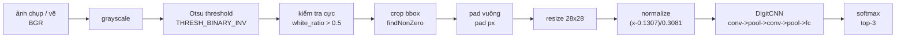

# Nhận diện chữ số viết tay (`p2-digit`)

Task deep learning đầu tiên trên app. Một CNN train trên MNIST phân loại ảnh chụp/vẽ chữ số viết tay (0-9). Task trả về top-3 dự đoán kèm thanh confidence, cộng thêm chính xác ảnh 28x28 mà model nhìn thấy để bạn debug tiền xử lý bằng mắt. Trang này giải thích từng thành phần của pipeline; tab **Spec** tài liệu các control của demo và giá trị khuyên dùng.

## Pipeline



Bước 1-7 nằm trong `mnist.preprocess(img, invert, pad)`; bước 8-10 nằm trong `mnist.predict(model, img28)`, cả hai ở `backend/app/cvlib/mnist.py`. Mỗi bước tiền xử lý có một nhiệm vụ: dựng lại phân phối input của MNIST (28x28 xám, **nét trắng trên nền đen**, canh giữa có lề) từ một ảnh bất kỳ. Model chỉ từng thấy phân phối đó lúc train; đưa thứ khác vào nó sẽ trả lời sai mà confidence vẫn cao, lỗi domain shift kinh điển.

## Pipeline: từng bước một

### 1. Input: ảnh BGR bất kỳ

- `img` là thứ `cv2.imdecode` tạo ra: mảng BGR `uint8` kích thước tùy ý. Có thể là ảnh chụp mực trên giấy, screenshot từ app vẽ, hay ảnh kiểu MNIST trắng-trên-đen có sẵn.
- Chưa giả định gì về kích thước, vị trí, cực ảnh hay độ đậm nét; các bước sau chuẩn hóa tất cả.

### 2. Grayscale: bỏ màu

- `cv2.cvtColor(img, cv2.COLOR_BGR2GRAY)` gộp 3 kênh thành một kênh độ sáng: $Y \approx 0.299R + 0.587G + 0.114B$.
- Model nhận input 1 kênh 28x28 nên màu là dữ liệu thừa. Bỏ sớm giúp bước threshold rẻ hơn và loại màu bút khỏi danh sách biến số.

### 3. Otsu threshold, ngược dấu

- `cv2.threshold(gray, 0, 255, THRESH_BINARY_INV + THRESH_OTSU)` làm hai việc trong một lời gọi. `THRESH_OTSU` quét histogram xám và chọn ngưỡng tách hai cụm độ sáng tốt nhất (tham số `thresh=0` bị bỏ qua), nên ngưỡng tự thích nghi theo ánh sáng thay vì phụ thuộc một giá trị chỉnh tay. `THRESH_BINARY_INV` ghi 255 tại pixel *dưới* ngưỡng: mực tối thành trắng, đúng cực MNIST (chữ trắng nền đen).
- Bước này giả định input nét-tối-trên-nền-sáng, trường hợp phổ biến của ảnh chụp giấy. Bước kế tiếp xử lý trường hợp ngược lại.
- **Cửa ải chất lượng**: mọi thứ phía sau làm việc trên ảnh nhị phân này. Nhiễu đốm sót lại ở đây sẽ trở thành một phần của "chữ số" và không bước nào sau gỡ được.

### 4. `invert`: sửa cực ảnh

- `white_ratio = (binary > 0).mean()`: tỷ lệ pixel trắng. `invert="auto"` lật ảnh bằng `cv2.bitwise_not` khi trắng chiếm hơn nửa khung. Một chữ số chiếm ít hơn 50% canvas rất nhiều, nên khung đa phần trắng nghĩa là INV đoán sai (input vốn đã trắng-trên-đen).
- `always`/`never` ghi đè heuristic: `always` cho input nét-tối-nền-sáng mà auto đoán sai; `never` cho input vốn đã trắng-trên-đen.
- Khi nào auto hỏng: chữ số viết kín gần hết khung có nét chiếm > 50% thật sau INV, nên heuristic lật ngược một ảnh vốn đã đúng.

### 5. Crop sát chữ số

- `cv2.findNonZero(binary)` liệt kê mọi pixel trắng; `cv2.boundingRect(coords)` bao chúng trong hộp nhỏ nhất song song trục, rồi slice crop ra.
- Một nhát cắt khử cả vị trí lẫn phần lớn tỷ lệ: chữ số nằm đâu, to cỡ nào cũng chỉ còn chữ số.
- Edge case input trắng tinh: `findNonZero` trả `None` trên khung toàn đen nên hàm trả sớm một ảnh 28x28 đen thay vì crash. Task bê lên thành `data.note = "no digit detected"`.

### 6. Pad thành canvas vuông

- Crop giữ nguyên tỷ lệ khung bằng cách đặt giữa một canvas đen cạnh `max(w, h) + pad`. Trục dài được khoảng `pad/2` px lề mỗi bên; trục ngắn được bù vừa đủ để chữ số nằm giữa.
- Vì sao vuông: resize crop chữ nhật thẳng về 28x28 sẽ kéo dãn chữ số ("1" cao mảnh thành cục béo mà model chưa từng thấy).
- Vì sao cần lề: chữ số MNIST luôn canh giữa có chỗ thở, không bao giờ chạm mép. `pad` (0-60, mặc định 20) tái tạo quy ước đó.

### 7. Resize về 28x28

- `cv2.resize(canvas, (28, 28))` cho ra kích thước input cố định mà CNN được train.
- Downscale còn làm mềm cạnh nhị phân cứng thành xám; không sao, nét MNIST cũng mềm.
- Chính `img28` này được task phóng lên 280x280 bằng `INTER_NEAREST` trên tab Output. **Luôn nhìn nó đầu tiên khi dự đoán sai**: input đúng = chữ trắng nền đen, canh giữa, không chạm mép. Phần lớn lỗi inference nằm ở tiền xử lý chứ không ở model.

### 8. Thành tensor và normalize

```python
x = torch.tensor(img28, dtype=torch.float32).div(255)   # == ToTensor()
x = (x - 0.1307) / 0.3081                               # == Normalize
```

- `div(255)` đưa 0-255 về 0-1; `(x - mean) / std` chuẩn hóa bằng **đúng hằng số lúc train** (0.1307 / 0.3081, đo trên MNIST train set).
- Dùng mean/std khác là lệch phân phối: ngưỡng mà weights đã học không còn khớp và accuracy sụp đổ.


- Histogram thật trên 47 triệu pixel của train set (trục y log): ~81% pixel là nền đen nên cột ở 0 lấn át mọi thứ. Sau normalize cột đó dời về -0.42, nét sáng nhất về 2.82, và dữ liệu có mean 0 / std 1. Khoảng `[-0.42, 2.82]` bất đối xứng vì mean gốc (0.1307) nằm sát đáy `[0, 1]`: normalize chỉ căn giữa và co giãn, không ép về một khoảng cố định.

### 9. Forward qua `DigitCNN`

- `x[None, None]` thêm chiều batch và kênh: `28x28 -> 1x1x28x28`.
- Kiến trúc (phải khớp key đã lưu trong `models/mnist_cnn.pt`):

| Tầng | Đổi shape | Vai trò |
| ---- | --------- | ------- |
| `Conv2d(1, 32, 3)` + ReLU | 1x28x28 -> 32x26x26 | 32 bộ lọc học cách phát hiện nét/cạnh |
| `MaxPool2d(2)` | -> 32x13x13 | giảm nửa độ phân giải, bất biến tịnh tiến nhỏ |
| `Conv2d(32, 64, 3)` + ReLU | -> 64x11x11 | ghép nét thành bộ phận chữ số |
| `MaxPool2d(2)` | -> 64x5x5 | |
| `Flatten` + `Linear(1600, 128)` + ReLU | -> 128 | trộn đặc trưng |
| `Linear(128, 10)` | -> 10 logits | một điểm cho mỗi chữ số |

- 225,034 tham số. Các khối conv dựng đặc trưng phân tầng (cạnh -> bộ phận nét -> hình dáng chữ số); đầu linear map chúng thành một điểm cho mỗi lớp.

### 10. Softmax, top-3, trả kết quả

- `torch.softmax(logits)` biến 10 điểm thô thành phân phối xác suất: $p_i = e^{z_i} / \sum_j e^{z_j}$.
- `probs.topk(3)` lấy ba cao nhất -> `data.top3 = [{"label": "7", "prob": 0.998}, ...]`, render thành thanh confidence.
- Lưu ý: softmax luôn cộng bằng 1 và model không có lớp "không biết", nên input rác vẫn được một winner trông tự tin. Trên khung trắng tinh các thanh bars vô nghĩa, cố ý để thấy; tin `data.note`, đừng tin bars.

## File weights

- `backend/app/cvlib/models/mnist_cnn.pt`: `state_dict` 0.9 MB của `DigitCNN`.
- Load lazy ở lần gọi task đầu tiên (`map_location="cpu"`, `weights_only=True`) và cache ở module level: request đầu trả giá import torch (~1-3 s), các request sau nhanh. Chỉ CPU; model nhỏ và inference trên CPU deterministic.

## Training (đã chạy sẵn ngoài app)

`backend/app/cvlib/train.py`: MNIST train split (60,000 ảnh, tự tải về `backend/app/cvlib/data/`), `CrossEntropyLoss`, `Adam(lr=0.001)`, batch 64, 3 epoch trên CPU (~1 phút). Kết quả chạy thật:

| Epoch | Loss | Train acc |
| ----- | ---- | --------- |
| 1 | 0.1379 | 95.78% |
| 2 | 0.0426 | 98.68% |
| 3 | 0.0290 | 99.08% |

**Test accuracy: 98.98%** (9,898 / 10,000). Theo từng số: 4 dễ nhất (99.80%), 9 và 8 khó nhất (97.42% / 97.95%). Train lại: `cd backend/app/cvlib && python train.py --epochs 5`. Device mặc định là CPU vì torch 2.15 MPS bị crash trên macOS 14; có thể thử `--device mps`/`cuda`/`auto`.

## Params

- **`invert`**: `auto` (mặc định) lật khi trắng chiếm > 50% khung sau threshold; `always` cho input nét-tối-nền-sáng mà auto đoán sai; `never` cho input vốn đã trắng-trên-đen.
- **`pad`** (Advanced, Preprocess): lề đen quanh chữ số sau crop trước khi resize, 0-60 px, mặc định 20 (đúng tài liệu project). Tăng nếu chữ số chiếm kín khung 28x28; giảm nếu chữ số trông quá nhỏ.

## Tips

- Đoán sai mà confidence cao? Nhìn ảnh Output: nếu nét đen trên nền trắng là cực ảnh bị lật ngược, đặt `invert` thủ công.
- Confidence thấp trên ảnh chụp thật: nét bút lông đậm cho kết quả tốt nhất; bút chì mờ hay ảnh rung nằm ngoài phân phối training.
- Model không có lớp "không biết", nên input trắng hay không-phải-chữ vẫn trả top-3. Tin `note`, đừng tin bars lúc đó.

## Thử ngay

- `examples/digit.png`, `digit-3.png`, `digit-8.png` (ảnh test MNIST thật) -> top-1 đúng ~99.8-100%.
- `examples/digit-photo.png`: ảnh giả lập chụp, nét tối trên nền giấy sáng -> `invert=auto` vẫn đoán "5" ~99.99%. Đây là đường cực ảnh mà một bức ảnh thật sẽ đi qua.
- `examples/digit-hard.png`: một chữ số "1" viết tay có cờ trên đầu -> model đọc thành "7" ~58%, "2" theo sát ~41%, còn "1" thật gần như bằng 0. Một mẫu test MNIST bị đoán sai thật, minh họa hoàn hảo vì sao số 1 có cờ và số 7 dễ gây nhầm lẫn cho cả người lẫn model.
- Vẽ một chữ số trong app ghi chú hoặc trên giấy, chụp lại -> xem ảnh 28x28 sau tiền xử lý và các thanh bars.
- Ảnh trắng tinh -> `no digit detected` với xác suất vô nghĩa.
- `invert=never` trên `digit.png` -> ảnh Output lật thành nét-đen-nền-trắng và confidence giảm (~99.8% -> ~95%); với ảnh chụp thật cùng lỗi này thường nặng hơn nhiều. Sai cực ảnh là bug cần nhận ra khi gặp ngoài đời.
