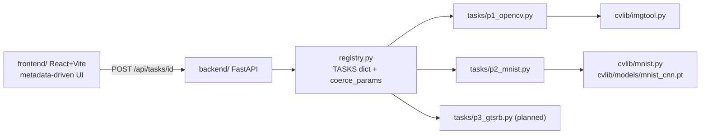

# CV Playground: spec + as-built state

This file is the design contract. Sections marked **DONE** describe what exists in code today; sections marked **TODO** are requirements for upcoming work. When the code and this file disagree, the code wins short-term but the file must be updated in the same change, so the two never drift.

## Context

I am self-studying Computer Vision (image processing and machine vision) through a roadmap of 6 projects with increasing difficulty. This repo is standalone: each project's code and weights live inside it under `backend/app/cvlib/`, and the sidebar tags below are the `project` values tasks register with:

| #   | Project tag        | Topic            | Short description                                                                 | Status                                  |
| --- | ------------------ | ---------------- | --------------------------------------------------------------------------------- | --------------------------------------- |
| 1   | `opencv-basics`    | OpenCV           | Grayscale, blur, edge detection, threshold, object counting. Pure image processing | DONE on the web app: 5 `p1-*` tasks live |
| 2   | `mnist-digits`     | MNIST            | Train a CNN in PyTorch to recognize handwritten digits (10 classes, 28x28 grayscale) | DONE on the web app: `p2-digit` live (test acc 98.98%) |
| 3   | `traffic-signs`    | GTSRB            | Transfer learning with ResNet18 to classify 43 traffic sign types                  | Not started                             |
| 4   | Hand gestures via webcam |             | MediaPipe hand landmarks, real-time gesture recognition                            | Extension, later                        |
| 5   | YOLO object detection      |             | Detect multiple objects in an image, with bounding boxes                           | Extension, later                        |
| 6   | Document scanner           |             | Photo of a tilted sheet of paper -> flat "scanned" image (perspective transform)   | Extension, later                        |

Original problem: each learning project runs through its own script/CLI, output is an image file or terminal text, hard to observe and hard to demo. Since **every task shares the same pattern**:

```
input image -> processing (OpenCV or deep learning model) -> output image and/or data (labels, counts, confidence)
```

the shared web app exists as a demo/learning layer on top of the projects, not a replacement for them. The project code itself is vendored into `backend/app/cvlib/` so the repo stands alone.

## Architecture (as built)



The **task registry** is the key piece: each task is a Python function registered with metadata. The backend has only 2 generic endpoints serving every task; the frontend reads `GET /api/tasks` to generate its UI (sidebar grouped by project, params form, docs panel). Adding a task = one file under `backend/app/tasks/` + one import line in `main.py`. No other backend or frontend changes.

### Repository layout

```
cv-playground/
  backend/app/
    main.py            # endpoints + static mount of frontend/dist
    registry.py        # Task dataclass, TASKS, register_task, coerce_params
    cvlib/
      imgtool.py       # OpenCV ops behind the p1-* tasks
      mnist.py         # DigitCNN + preprocess/predict behind p2-digit
      train.py         # standalone MNIST trainer -> ./models + ./data
      make_samples.py  # regenerates sample.png / coins.jpg
      models/          # trained weights, e.g. mnist_cnn.pt
      data/            # downloaded datasets (gitignored)
    tasks/
      p1_opencv.py     # 5 registered tasks wrapping imgtool
      p2_mnist.py      # p2-digit, lazy-loads cvlib.mnist + weights
      docs/            # <task-id>.md (en) + <task-id>.vi.md + <task-id>.spec.md per task
  frontend/
    src/App.tsx        # fetch tasks, select task, run, render
    src/types.ts       # TaskMeta, ParamSpec, TaskResult (mirror of metadata)
    src/components/    # result-view, compare-view, image-viewer, drop-zone,
                       # params-form, elastic-slider, task-sidebar, docs-panel,
                       # mermaid-block, theme-toggle + ui/ (shadcn)
  dev.sh               # one command: venv + npm install + both servers
  requirements.txt     # pinned; opencv-python-headless (no GUI deps)
  .venv/               # backend venv
```

## API contract (implemented)

- `GET /health` -> `{"status": "ok"}`
- `GET /api/tasks` -> list of task metadata dicts (see schema below).
- `POST /api/tasks/{task_id}`: `multipart/form-data` with `file` (image) + `params` (JSON string). Returns `{"image": base64 PNG | null, "data": {...}}`.
- Errors: unknown `task_id` -> 404; file not decodable as image -> 400; params failing validation -> 422 with the reason.
- The backend mounts `frontend/dist` at `/` when the directory exists (production/demo mode); in dev, Vite on :5173 proxies `/api` -> :8000.
- `TaskHandler` signature: `(img_bgr: np.ndarray, params: dict) -> (np.ndarray | None, dict)`. Images are BGR ndarrays; `params` arrives already coerced (defaults applied, int/float cast, min/max/select options enforced by `coerce_params`).

## Task metadata schema (implemented)

`@register_task(...)` fields, all mirrored into `GET /api/tasks` and `frontend/src/types.ts`:

| Field         | Type / values                                  | Notes                                                        |
| ------------- | ---------------------------------------------- | ------------------------------------------------------------ |
| `id`          | `p<N>-<slug>`, e.g. `p1-blur`                  | unique key in `TASKS`                                        |
| `name`        | str                                            | sidebar label                                                |
| `project`     | str, e.g. `opencv-basics`                    | sidebar groups tasks by this value                           |
| `description` | str                                            | shown under the task title and as sidebar tooltip            |
| `params`      | list, see below                                | drives the generated params form                             |
| `input`       | `"image"` (only value so far)                  |                                                              |
| `output`      | `"image"` \| `"data"` \| `"image+data"`        |                                                              |
| `result_tab`  | `"auto"` \| `"input"` \| `"compare"` \| `"output"` | which result tab the frontend selects after a run          |
| `docs`        | `Path` to a `.md` file (or inline str)         | file -> `{"en": text}`; sibling `.<lang>.md` adds languages, `.spec.md` adds a Spec tab |

`params` item: `{name, label?, type: "int"|"float"|"select", min?, max?, step?, default?, options?, group?}`. `label` is the human-readable form label; `step` drives the slider granularity (default 1 for int, 0.1 for float); `options` is required for `select`. `group` marks a param as secondary: params without `group` are the main always-visible controls; params sharing a `group` name are rendered inside a collapsed "Advanced" disclosure under that group's heading (one heading per group, in declaration order).

## Conventions (keep these to avoid drift)

1. **Task ids** are `p<N>-<slug>`; task modules are `backend/app/tasks/p<N>_*.py`. A new module must be imported in `main.py` to register its tasks.
2. **CV logic lives in `backend/app/cvlib/`**; task files are thin wrappers importing it as a normal package (`from app.cvlib import imgtool`). Standalone scripts (`train.py`, `make_samples.py`) still run on their own; datasets land in `cvlib/data/` and trained weights in `cvlib/models/`.
3. **Docs per task live in `backend/app/tasks/docs/`**: English `<task-id>.md` plus Vietnamese `<task-id>.vi.md` plus an English `<task-id>.spec.md` (demo tuning reference: I/O contract, param table, recommended presets, symptom fixes). Docs files are re-read on every `GET /api/tasks`, so editing them needs no backend restart. Content pattern used by p1 docs: what the op does, its place in the pipeline, the theory with math, the OpenCV call, param meanings, tips, "try it" suggestions.
4. **The docs renderer supports GFM, mermaid code blocks and KaTeX math** (`$..$` inline, `$$..$$` display); bilingual docs give the user an EN/VI tab switcher.
5. **`data` shape**: return a flat dict. The frontend renders scalars as badges and arrays of objects as `key: value` rows. Keep keys short (`count`, `top3`, `boxes`).
6. **No per-task endpoints and no frontend changes per task**: the UI must keep working off metadata alone. If a task needs new UI behavior, extend the shared metadata (like `result_tab` and `group`) rather than special-casing a task id in the frontend.
7. **Main vs Advanced params**: keep the 1-3 controls a user touches most ungrouped (always visible); push stage-level knobs into `group`s named after the pipeline stage (`Pre-blur`, `Threshold`, `Adaptive`, `Morphology`, `Canny`, `Gaussian`). Groups render inside the shared "Advanced" disclosure in declaration order.
8. **No GPU**; all inference on CPU/MPS. Backend uses `opencv-python-headless`.
9. Frontend lint is **oxlint** (`npm run lint`), build is `tsc -b && vite build`, styling is Tailwind 4 + shadcn (`base-nova` style, `@base-ui/react`), `cn` comes from the `cn` package.

## Phase 0: Scaffold - DONE

Delivered: FastAPI + uvicorn on a dedicated `.venv` with pinned `requirements.txt`; the 2 generic endpoints above; React + Vite + TypeScript frontend; `dev.sh` running both with one command; backend serving `frontend/dist` at `/`. The original "demo grayscale task" merged into the real task `p1-grayscale`, so no throwaway demo code remains.

## Phase 1: Project 1 - OpenCV - DONE

All functions of `app/cvlib/imgtool.py` are wrapped as tasks in `backend/app/tasks/p1_opencv.py`. Every task beyond `p1-grayscale` grew params past the original spec because the underlying `imgtool` functions support them; secondary knobs sit under the Advanced disclosure via the `group` key, named after pipeline stages. Actual registered set:

| Task           | Params (main / Advanced groups)                                                         | Output                              |
| -------------- | --------------------------------------------------------------------------------------- | ----------------------------------- |
| `p1-grayscale` | none                                                                                    | grayscale image                     |
| `p1-blur`      | main `ksize` int 1-31 step 2 (even bumped +1); Advanced `sigma` float 0-10 (0 = auto), group "Gaussian" | blurred image                       |
| `p1-edges`     | main `t1`, `t2` int 0-255 default 50/150; Advanced `ksize` (Pre-blur), `aperture` 3-7 step 2 + `l2` select l1/l2 (Canny) | Canny image                         |
| `p1-binary`    | main `method` select `otsu`/`adaptive`; Advanced `ksize` (Pre-blur), `block` 3-51 step 2 + `c` float -20..20 (Adaptive) | binary image                        |
| `p1-count`     | main `min_area` int 0-20000; Advanced `ksize` (Pre-blur), `method`, `invert` auto/always/never, `block`, `c` (Threshold), `dilate` int 0-31 (Morphology) | bbox-annotated image + `data.count`, `result_tab="output"` |

Each task has bilingual docs plus an English `.spec.md` tuning tab under `backend/app/tasks/docs/`. `p1-count` is the dual-output reference case (annotated image + number).

## Phase 2: Project 2 - MNIST - DONE

First deep-learning task on the app: `p2-digit` classifies a photo/drawing of a handwritten digit and shows `data.top3` as confidence bars plus the exact 28x28 tensor the model saw (enlarged to 280x280).

As built:

- `app/cvlib/mnist.py`: `DigitCNN` (225,034 params), `preprocess(img, invert, pad)` (Otsu INV + polarity check + crop + square pad + 28x28), `load_model` (CPU, `weights_only=True`), `predict` (MNIST normalize + softmax top-3).
- `app/cvlib/train.py`: standalone trainer, MNIST auto-downloaded to `cvlib/data/`, saves `cvlib/models/mnist_cnn.pt` (0.9 MB). Actual run: 3 epochs CPU, test acc **98.98%**. `--device` defaults to `cpu` because torch 2.15 MPS crashes on macOS 14 (`-[MPSNDArray arrayViewWithShape:]` abort).
- `backend/app/tasks/p2_mnist.py`: lazy `_get_model()` (torch import + weight load deferred to first call, cached at module level). Params: `invert` select auto/always/never (main) + `pad` int 0-60 default 20 (group "Preprocess"). `output="image+data"`, `result_tab="output"`. Blank input returns `data.note = "no digit detected"`.
- Frontend: `ConfidenceBars` renderer in `result-view.tsx`, keyed on the `{label, prob}` data shape (reused by `p3-sign` later); `digit.png` (a real MNIST test 7) added to `EXAMPLES`.
- `torch==2.15.0` + `torchvision==0.29.2` pinned in `requirements.txt` (torch 2.15 supports Python 3.14).
- Docs triple `p2-digit.md` / `.vi.md` / `.spec.md` including the training procedure and measured results.

Verified: first call ~2 s (lazy load), later calls ~40 ms; `invert=auto` fixes dark-on-light inputs; docs render EN/Spec/VI.

## Phase 3: Project 3 - traffic signs - TODO

**Goal:** real-world 43-class classification on the app, the hardest step of the 3 documented projects.

Context: project 3 uses GTSRB (~50,000 real color traffic sign images, 43 imbalanced classes), fine-tuning a pretrained ResNet18 instead of training from scratch. Nothing exists yet; like the earlier projects the code gets vendored into `app/cvlib/` (e.g. `gtsrb.py` + a trainer) when this phase starts.

### Requirements

- Train/fine-tune ResNet18 on GTSRB, saving weights + a `CLASS_NAMES` map (43 classes, Vietnamese names) under `app/cvlib/models/`.
- Task `p3-sign`: image -> `data.top3` sign names + confidence (same `{label, prob}` shape as p2 so confidence bars are reused); keep the input image for comparison.
- Side task `p3-augment` (recommended): input 1 image -> grid of augmented versions (rotation, brightness, noise), visualizing data augmentation.
- Lazy model loading like phase 2; weights must not load at import time (would slow every task).

### Acceptance criteria

- GTSRB test-set sign images -> reasonable top-3, correct class names.
- A real-world photo of a sign (different conditions from the dataset) still returns a result with lower confidence, demonstrating domain shift.

## Extension phases (build as you learn)

| Phase | Content                           | Additional architecture requirements                                                |
| ----- | --------------------------------- | ----------------------------------------------------------------------------------- |
| 4     | Real-time hand gestures (MediaPipe) | WebSocket or `getUserMedia` + frame sending; outside the current upload-image pattern |
| 5     | YOLO detection                    | Output annotated image + `data.boxes` (label, conf, coordinates); box drawing can live in the frontend |
| 6     | Document scanner                  | Task `p6-scan`: tilted photo -> flattened warp image; pure existing pattern         |

## What NOT to do (scope guard)

- No auth, no database, no deployment; the app runs locally for learning.
- No training inside the app: training runs via the standalone scripts in `cvlib/` (e.g. `train.py`), the app only does inference + image processing.
- No per-task special cases in the frontend; extend metadata instead.
- No new param types or endpoints unless a phase genuinely requires them; today only `image` input and `image`/`data`/`image+data` output exist.
- Keep `requirements.txt` pinned and the UI minimal; no state management library or router until needed.
