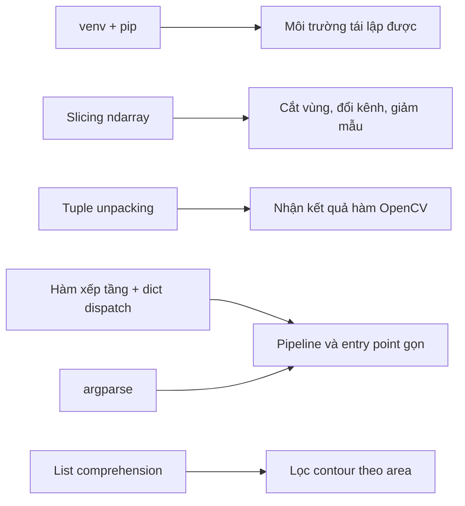
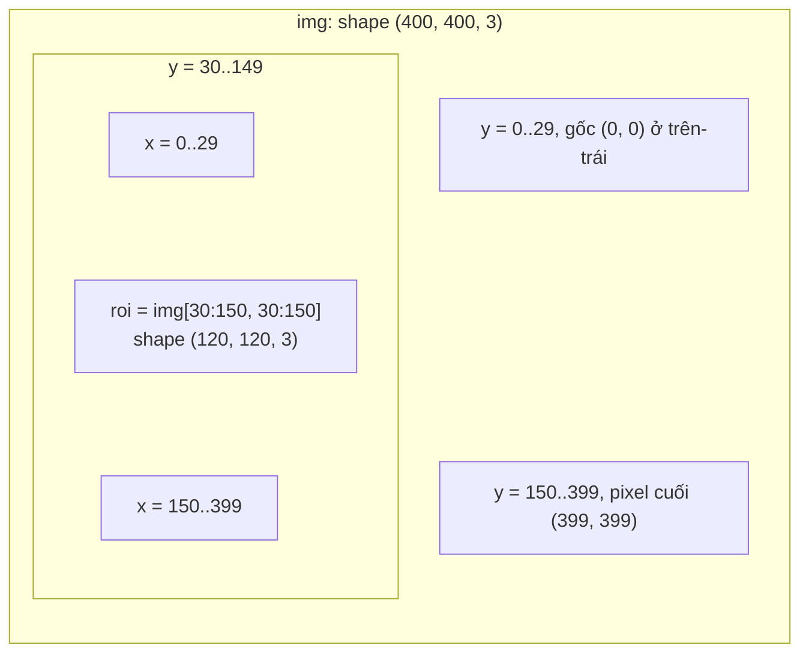

# Python cho Computer Vision: Những gì thực sự cần nắm

Trong Computer Vision, bạn không cần decorator, metaclass hay async. Bạn cần **sáu kỹ năng rất cụ thể**, và cả sáu đều xuất hiện trong `cvlib/imgtool.py`, module xử lý ảnh đứng sau các task `p1-*` của CV Playground. Trang này ôn lại từng kỹ năng, kèm lý do nó quan trọng và bẫy hay gặp. Phần cuối có thêm một mục về **task handler**, điểm vào kết nối code của bạn với web app.

Đọc lướt một lần trước khi vào [lý thuyết](./01-ly-thuyet), rồi quay lại tra khi code [thực hành](./02-thuc-hanh) bị lỗi.



## 1. Môi trường: venv và pip

Mỗi project một môi trường riêng. Lý do không phải hình thức: `opencv-python`, `torch`, `numpy` có ràng buộc phiên bản chéo nhau, cài chung vào Python hệ thống sẽ sớm tạo ra lỗi `ImportError` hoặc kết quả tính toán sai mà không rõ nguyên nhân.

```bash
cd cv-playground
python3 -m venv .venv
source .venv/bin/activate
python -m pip install --upgrade pip
python -m pip install -r requirements.txt
```

Kiểm tra nhanh sau khi cài:

```python
import cv2
import numpy as np

print(cv2.__version__, np.__version__)
```

Ba quy tắc nhỏ nhưng tiết kiệm nhiều giờ:

1. Luôn dùng `python -m pip` thay vì `pip`, để chắc chắn pip thuộc đúng interpreter đang active.
2. Ghi phiên bản vào `requirements.txt` (`pip freeze > requirements.txt`) ngay khi pipeline chạy được.
3. Thêm `.venv/` vào `.gitignore`.

### requirements.txt làm việc thế nào

`requirements.txt` là file text thuần, mỗi dòng khai báo **một package cần cài**. `pip install -r` đọc file và cài tất cả cùng lúc, thay vì gõ `pip install` từng package một. File của CV Playground pin sẵn toàn bộ phiên bản, gồm cả web (`fastapi`, `uvicorn`) lẫn CV (`opencv-python-headless`, `torch`, `numpy`):

Cú pháp đầy đủ cho từng dòng:

```
numpy                    # bản mới nhất
numpy==2.3.1             # đúng y chang phiên bản này
numpy>=1.26,<3.0         # trong khoảng
# đây là comment
```

Phân biệt hai cách tạo file:

| Cách | Nội dung | Khi nào dùng |
|------|----------|--------------|
| Viết tay | `opencv-python` (không kèm bản) | Mới bắt đầu project, khai báo ý định |
| `pip freeze > requirements.txt` | `opencv-python==4.12.0.88` | Pipeline đã chạy ổn, cần tái lập y chang |

`pip freeze` in ra **mọi package trong venv kèm phiên bản chính xác**, kể cả dependency phụ mà bạn không tự cài (`opencv-python` tự kéo theo `numpy`). File freeze vì thế luôn dài hơn file viết tay, và đó là điểm mạnh: môi trường được mô tả trọn vẹn, không phụ thuộc cụm "bản mới nhất" vốn thay đổi theo thời gian.

> [!WARNING]
> File rỗng vẫn hợp lệ: `pip install -r` chạy êm và không cài gì. Nếu sau đó `import cv2` vẫn báo `ModuleNotFoundError`, hãy kiểm tra nội dung file và thư mục đang đứng. pip chỉ báo `Could not open requirements file` khi không tìm thấy file, còn file rỗng thì im lặng.

> [!WARNING]
> `opencv-python` và `opencv-contrib-python` **ghi đè lên nhau** cùng thư mục `cv2`. Cài cả hai sẽ ra trạng thái không xác định. Chọn một: bản thường cho nhu cầu của project này, bản `contrib` khi cần module mở rộng, bản `headless` khi chạy trên server không có màn hình.

> [!TIP]
> Trên macOS, `cv2.imshow` thường crash hoặc treo do xung đột GUI backend. Tài liệu này dùng `plt.imshow` để hiển thị - vừa ổn định vừa dễ chèn vào notebook. Khi cần xem nhanh trong terminal, lưu ảnh ra file rồi mở bằng Preview cũng đủ. Còn trong CV Playground thì kết quả hiển thị ngay trên trình duyệt, không cần `imshow` hay `plt` gì cả.

## 2. Slicing: kỹ năng dùng nhiều nhất

Ảnh trong OpenCV là `np.ndarray`. Mọi thao tác "cắt, thu nhỏ, đổi kênh, tô vùng" đều là slicing - không cần hàm riêng.

```python
img = cv2.imread("sample.png")      # shape (400, 400, 3), dtype uint8

roi = img[30:150, 30:150]           # cắt vùng: img[y1:y2, x1:x2]
half = img[::2, ::2]                # giảm một nửa kích thước, không nội suy
blue = img[:, :, 0]                 # một kênh, shape (400, 400)
rgb = img[:, :, ::-1]               # đảo thứ tự kênh: BGR -> RGB
```

`cv2.imread` đọc file ảnh thành `ndarray`. Chữ ký đầy đủ:

```python
img = cv2.imread(filename, flags=cv2.IMREAD_COLOR)
# filename: đường dẫn file (png, jpg, bmp, tiff, webp...)
# flags:    cách đọc, mặc định cv2.IMREAD_COLOR
# trả về:   np.ndarray shape (H, W, C) dtype uint8
#           hoặc None nếu đọc thất bại, KHÔNG raise exception
```

| `flags` | Kết quả |
|---------|---------|
| `cv2.IMREAD_COLOR` (mặc định) | Ép về 3 kênh BGR, bỏ kênh alpha |
| `cv2.IMREAD_GRAYSCALE` | 1 kênh xám, shape `(H, W)` |
| `cv2.IMREAD_UNCHANGED` | Giữ nguyên số kênh của file; PNG có alpha thành BGRA 4 kênh |

> [!TIP]
> Đường dẫn tương đối được tính từ thư mục đang chạy lệnh, không phải thư mục chứa file `.py`. Trên Windows, đường dẫn có ký tự Unicode (tiếng Việt có dấu) có thể khiến `imread` trả `None` dù file tồn tại; đọc qua buffer bằng `cv2.imdecode(np.fromfile(path, dtype=np.uint8), cv2.IMREAD_COLOR)`.

Toạ độ trong ví dụ trên: gốc `(0, 0)` ở góc trên-trái, `x` chạy theo cột (`shape[1]`), `y` chạy theo hàng (`shape[0]`):



Lát cắt `img[30:150, 30:150]` lấy hàng 30 đến 149 và cột 30 đến 149: đúng 120x120 pixel vì `x2`, `y2` không được tính.

Bảng cú pháp cần thuộc:

| Cú pháp | Ý nghĩa | Ghi chú |
|---------|---------|---------|
| `img[y, x]` | Một pixel | Hàng trước, cột sau |
| `img[y1:y2, x1:x2]` | Vùng chữ nhật | `y2`, `x2` không được tính |
| `img[:, :, 0]` | Kênh B | Kênh 1 là G, kênh 2 là R |
| `img[::2, ::2]` | Giảm mẫu 2 lần | Nhanh, nhưng gây aliasing |
| `img[mask]` | Các pixel thoả mask | Trả về mảng 1 chiều |

Bẫy lớn nhất: **slicing trả về view, không phải bản sao**. Sửa `roi` là sửa `img`.

```python
roi = img[30:150, 30:150]
roi[:] = 0                 # vùng 120x120 trên ảnh GỐC bị xoá đen

roi = img[30:150, 30:150].copy()   # bản sao thật sự
roi[:] = 0                          # ảnh gốc không đổi
```

> [!TIP]
> Kiểm tra một mảng là view hay bản sao: `roi.base is img` trả `True` nghĩa là view. Khi hàm của bạn nhận ảnh và có ý định sửa tại chỗ, hãy `img = img.copy()` ở đầu hàm - người gọi sẽ không bị "ảnh tự nhiên bị vẽ đè".

> [!NOTE]
> `img[:, :, ::-1]` cho ra mảng có stride âm. Matplotlib hiển thị bình thường, nhưng một số hàm OpenCV từ chối mảng không liên tục. Nếu gặp lỗi, bọc bằng `np.ascontiguousarray(...)`, hoặc dùng `cv2.cvtColor(img, cv2.COLOR_BGR2RGB)`.

## 3. Tuple unpacking với API OpenCV

Gần như mọi hàm OpenCV trả về nhiều giá trị. Không nắm quy ước này thì code sẽ đầy biến rác hoặc lỗi `too many values to unpack`.

```python
ret, binary = cv2.threshold(gray, 0, 255, cv2.THRESH_BINARY + cv2.THRESH_OTSU)
contours, hierarchy = cv2.findContours(binary, cv2.RETR_EXTERNAL,
                                       cv2.CHAIN_APPROX_SIMPLE)
x, y, w, h = cv2.boundingRect(contours[0])
h, w = img.shape[:2]
ok, frame = cap.read()
```

Dùng `_` cho giá trị không cần. Đây không phải biến đặc biệt, chỉ là quy ước "tôi bỏ qua":

```python
_, binary = cv2.threshold(gray, 127, 255, cv2.THRESH_BINARY)
contours, _ = cv2.findContours(binary, cv2.RETR_EXTERNAL,
                               cv2.CHAIN_APPROX_SIMPLE)
```

Danh sách chữ ký hay dùng:

| Hàm | Trả về |
|-----|--------|
| `cv2.threshold` | `retval, dst` - `retval` là ngưỡng thực dùng |
| `cv2.findContours` | `contours, hierarchy` (OpenCV 4) |
| `cv2.boundingRect` | `x, y, w, h` |
| `cv2.minMaxLoc` | `minVal, maxVal, minLoc, maxLoc` |
| `cv2.VideoCapture.read` | `ret, frame` |
| `cv2.connectedComponents` | `num_labels, labels` |

> [!TIP]
> Dù không cần, hãy đặt tên `ret` thay vì `_` khi dùng Otsu: in ra `ret` là biết ngay thuật toán chọn ngưỡng bao nhiêu. Con số đó thường là manh mối đầu tiên khi ảnh nhị phân ra sai.

> [!WARNING]
> Code OpenCV 3 trên mạng trả **ba** giá trị từ `findContours` (`img, contours, hierarchy`). Copy vào OpenCV 4 sẽ lỗi unpack. Sửa bằng cách bỏ giá trị đầu.

## 4. Hàm nhỏ xếp tầng + dict dispatch

Cách viết này là trái tim của `imgtool.py`. Mỗi hàm nhận một ảnh, trả một ảnh - nhờ vậy chúng lắp ghép được như ống nước:

```python
def to_gray(img):
    return cv2.cvtColor(img, cv2.COLOR_BGR2GRAY)


def to_blur(img):
    return cv2.GaussianBlur(to_gray(img), (5, 5), 0)


def to_edges(img):
    return cv2.Canny(to_blur(img), 50, 150)
```

`to_edges` không cần biết bên trong `to_blur` làm gì. Muốn đổi kernel, sửa một chỗ, mọi lệnh dùng chung đều đổi theo.

Khi các hàm đã cùng chữ ký `(img) -> img`, thay chuỗi `if/elif` bằng dict:

```python
HANDLERS = {
    "gray": to_gray,
    "blur": to_blur,
    "edges": to_edges,
    "binary": to_binary,
}

out = HANDLERS[args.command](img)
```

Thêm lệnh mới = thêm một dòng vào dict, không đụng vào logic điều phối.

> [!NOTE]
> Trên web app, vai trò "chọn lệnh nào chạy" không còn ở dict `HANDLERS` nữa mà do **task registry** đảm nhiệm: mỗi phép xử lý đăng ký thành một task riêng (`p1-grayscale`, `p1-blur`...) và người dùng chọn task trên giao diện. Dict dispatch vẫn còn trong `main()` của `imgtool.py`, entry point CLI để chạy thử ngoài app. Chi tiết ở mục 8.

> [!TIP]
> Đặt dict ở cấp module (như `HANDLERS`) thay vì tạo mới trong `main()`: dễ test, dễ import, và không dựng lại dict mỗi lần gọi. Đừng quên `HANDLERS.get(cmd)` nếu `cmd` đến từ input người dùng chưa được `choices` kiểm soát.

> [!WARNING]
> Dict dispatch chỉ đúng khi **mọi hàm cùng chữ ký**. Hàm kiểu `count_objects(img)` trả về `(ảnh, số)` không thể nhét chung vào dict trên - đó là lý do `imgtool.py` xử lý `count` bằng nhánh riêng. Đừng cố ép cho đẹp; nhánh riêng cho trường hợp khác kiểu là code trung thực.

## 5. List comprehension để lọc contour

Sau `findContours`, việc đầu tiên luôn là lọc bỏ contour rác. Comprehension làm việc này gọn và dễ đọc:

```python
kept = [c for c in contours if cv2.contourArea(c) > 500]
total = sum(1 for c in contours if cv2.contourArea(c) > 500)
biggest = max(contours, key=cv2.contourArea)
top3 = sorted(contours, key=cv2.contourArea, reverse=True)[:3]
```

Với ảnh nhiều contour, `contourArea` bị gọi lặp lại. Tính một lần bằng walrus:

```python
kept = [c for c in contours if (a := cv2.contourArea(c)) > 500]
```

Và khi cần cả contour lẫn số đo, dựng list tuple rồi mới lọc:

```python
measured = [(c, cv2.contourArea(c)) for c in contours]
kept = [(c, a) for c, a in measured if a > 500]
```

> [!TIP]
> Ngưỡng `500` không phải chân lý. Nó phụ thuộc độ phân giải ảnh: ảnh 4000px thì 500 là hạt nhiễu, ảnh 200px thì 500 có thể là cả vật thể. Đặt ngưỡng theo tỉ lệ diện tích ảnh, ví dụ `0.001 * img.shape[0] * img.shape[1]`, sẽ bền hơn khi đổi ảnh đầu vào.

> [!NOTE]
> Không dùng comprehension cho việc có side effect như vẽ `cv2.rectangle`. Comprehension sinh ra list; mục đích của nó là tính giá trị, không phải hành động. Vẽ thì dùng `for`.

## 6. NumPy: phần tối thiểu nhưng bắt buộc

Vì ảnh là `ndarray`, vài hiểu biết NumPy quyết định code đúng hay sai âm thầm.

**Kiểu dữ liệu.** Ảnh là `uint8` (0-255). Cộng trực tiếp sẽ **tràn số vòng quanh**, không bão hoà:

```python
bright = img + 100                  # 200 + 100 -> 44  (sai)
bright = cv2.add(img, 100)          # 200 + 100 -> 255 (đúng, bão hoà)
bright = np.clip(img.astype(np.int16) + 100, 0, 255).astype(np.uint8)
```

**Tạo ảnh từ đầu** - cách nhanh nhất để test pipeline mà không cần file:

```python
img = np.full((400, 400, 3), 255, dtype=np.uint8)   # nền trắng
cv2.rectangle(img, (30, 30), (150, 150), (200, 60, 40), -1)
```

**Đếm và thống kê** thay cho vòng lặp pixel:

```python
white = np.count_nonzero(binary == 255)      # số pixel trắng
ratio = white / binary.size                  # tỉ lệ
mean_brightness = gray.mean()
```

> [!WARNING]
> Đừng bao giờ `for y in range(h): for x in range(w):` để xử lý pixel. Chậm hơn hàng trăm lần so với một biểu thức NumPy, và đó cũng là lý do code CV thực tế gần như không có vòng lặp trên pixel.

> [!TIP]
> Khi kết quả lạ (ảnh đen sạch, ảnh trắng sạch, số đếm bằng 0), in ba thứ theo thứ tự: `img.shape`, `img.dtype`, `img.min(), img.max()`. Ba dòng này bắt được phần lớn lỗi pipeline trước khi phải debug sâu.

## 7. argparse: entry point CLI phụ

Trên CV Playground, người dùng chọn task và chỉnh tham số trên giao diện web, không qua dòng lệnh. Nhưng `imgtool.py` vẫn giữ một `main()` dùng `argparse` để chạy thử độc lập (và `train.py` ở Project 2 cũng nhận tham số kiểu này), nên kỹ năng đọc CLI vẫn cần. `argparse` cho bạn `--help`, thông báo lỗi và kiểm tra giá trị miễn phí. Đây là phần cuối của `imgtool.py`:

```python
import argparse


def main():
    parser = argparse.ArgumentParser(description="Cong cu xu ly anh don gian")
    parser.add_argument("image", help="Duong dan anh dau vao")
    parser.add_argument("command",
                        choices=["gray", "blur", "edges", "binary", "count"])
    parser.add_argument("--out", default="output.png")
    args = parser.parse_args()

    img = cv2.imread(args.image)
    if img is None:
        raise SystemExit(f"Khong doc duoc anh: {args.image}")

    ...
```

Vài mẫu hay dùng:

```python
parser.add_argument("--scale", type=float, default=1.0)      # phải có type
parser.add_argument("--min-area", type=int, default=500)
parser.add_argument("-v", "--verbose", action="store_true")  # cờ bật/tắt
parser.add_argument("images", nargs="+")                     # nhiều file
```

> [!WARNING]
> Mọi giá trị từ `argparse` là `str` trừ khi bạn khai báo `type=`. `args.scale * 2` với `"--scale 3"` cho ra `"33"` chứ không phải `6` - lỗi im lặng, không exception. Luôn khai báo `type=int` hoặc `type=float` cho tham số số.

> [!TIP]
> `choices=[...]` vừa kiểm tra input vừa tự sinh danh sách lệnh trong `--help`. Đặt tên tham số trùng với key của dict dispatch (`command` ↔ `HANDLERS`) để không phải viết lớp ánh xạ nào.

## 8. Task handler: điểm vào của CV Playground

Mỗi task trên web app là một hàm Python được đăng ký bằng decorator `@register_task`, kèm metadata để frontend tự sinh giao diện (slider, select, nút chạy). Chữ ký bắt buộc:

```python
from app.cvlib import imgtool
from app.registry import register_task


@register_task(
    id="p1-blur",
    name="Gaussian blur",
    project="opencv-basics",
    description="Blur the image with a Gaussian filter to reduce noise.",
    params=[
        {"name": "ksize", "type": "int", "min": 1, "max": 31,
         "step": 2, "default": 5, "label": "Kernel size (odd)"},
    ],
    output="image",
)
def p1_blur(img, params):
    return imgtool.to_blur(img, params.get("ksize", 5)), {}
```

Ba điểm then chốt:

- **Hàm nhận `(img, params)`:** `img` là `ndarray` BGR từ ảnh user upload, `params` là `dict` giá trị đã được validate theo metadata. Đọc bằng `params.get("ten", mac_dinh)`.
- **Trả về `(ảnh, data)`:** ảnh `ndarray` để hiển thị (hoặc `None` nếu task chỉ trả số liệu), `data` là dict phẳng (`{"count": 5}`, `{"top3": [...]}`) render thành badge trên UI.
- **Logic nằm trong `cvlib/`, task chỉ là wrapper mỏng:** `p1_blur` không tự gọi `cv2.GaussianBlur` mà gọi `imgtool.to_blur`. Tách vậy để cùng một hàm chạy được trên web lẫn script CLI, và để test logic không cần dựng server.

Metadata `params` tự sinh form: `type` là `int`/`float`/`select`, `min`/`max`/`step` điều khiển slider, `options` bắt buộc cho `select`. Param có `group` sẽ xếp vào nhóm "Advanced" thay vì hiện sẵn.

> [!TIP]
> Thiết kế tham số giống hệt argparse: đặt `default` hợp lý, dùng `min`/`max`/`options` để chặn giá trị sai ngay từ UI thay vì xử lý trong hàm. Khác ở chỗ `coerce_params` của registry ép kiểu và báo lỗi 422 giúp bạn, không phải tự `type=` như argparse.

## Bẫy tổng hợp

| Bẫy | Triệu chứng | Cách tránh |
|-----|-------------|------------|
| Slicing trả view | Ảnh gốc bị sửa ngoài ý muốn | `.copy()` trước khi ghi |
| `uint8` tràn số | Ảnh sáng bị loang lổ, đốm đen | `cv2.add` hoặc ép `int16` |
| `imread` trả `None` | `AttributeError: 'NoneType' object has no attribute 'shape'` | Kiểm tra ngay sau khi đọc |
| Quên `type=` trong argparse | Tính toán ra chuỗi, sai âm thầm | Luôn khai báo `type` |
| Trộn BGR/RGB | Màu da và bầu trời đảo | `cv2.cvtColor` trước khi hiển thị |
| Tham số mặc định mutable | `def f(kernel=np.ones((3, 3)))` dùng chung giữa các lần gọi | `None` rồi tạo bên trong hàm |

## Bài tập nhanh

1. Viết hàm `crop_center(img, size)` cắt chính giữa ảnh, trả về bản sao - đảm bảo ảnh gốc không đổi.
2. Viết `apply(img, name)` dùng dict dispatch cho ba phép: `gray`, `edges`, `invert`, mỗi hàm `(img) -> img`.
3. Trong `cvlib/imgtool.py`, hàm `count_objects` đã nhận `min_area`; nối nó vào entry point `main()` bằng một tham số `--min-area` thay vì để mặc định `500`.
4. In ra `ret` của Otsu cho 5 ảnh khác nhau, nhận xét ngưỡng có ổn định không.

## Quiz tự kiểm tra

```quiz
{
  "id": "python-for-cv-co-ban",
  "title": "Kiểm tra: Python cho Computer Vision",
  "mode": "exam",
  "questions": [
    {
      "type": "single",
      "question": "Đoạn `roi = img[100:200, 100:200]` rồi `roi[:] = 0` sẽ làm gì?",
      "options": [
        "Xoá đen vùng 100x100 trên ảnh gốc vì slicing trả về view",
        "Chỉ xoá bản sao `roi`, ảnh gốc giữ nguyên",
        "Báo lỗi vì `roi` là mảng read-only",
        "Xoá toàn bộ ảnh gốc"
      ],
      "answer": 0,
      "explanation": "Slicing cơ bản của NumPy trả về view chia sẻ bộ nhớ với mảng gốc, nên ghi vào `roi` là ghi vào `img`. Muốn độc lập phải `.copy()`."
    },
    {
      "type": "true-false",
      "question": "`img[:, :, ::-1]` đổi BGR sang RGB nhưng trả về mảng có stride âm, nên một số hàm OpenCV có thể từ chối nó.",
      "answer": true,
      "explanation": "Đúng. Nó tiện cho hiển thị bằng Matplotlib, nhưng vì không liên tục trong bộ nhớ nên cần `np.ascontiguousarray` hoặc dùng `cv2.cvtColor` khi đưa vào hàm OpenCV."
    },
    {
      "type": "single",
      "question": "Khi nào KHÔNG nên dùng dict dispatch?",
      "options": [
        "Khi các hàm có chữ ký khác nhau, ví dụ hàm trả về `(ảnh, số)`",
        "Khi có nhiều hơn ba lệnh",
        "Khi các hàm trả về `ndarray`",
        "Khi dùng `argparse`"
      ],
      "answer": 0,
      "explanation": "Dict dispatch giả định mọi giá trị gọi được theo cùng một cách. `count_objects` trả về tuple nên cần nhánh riêng - đó chính là cách `imgtool.py` đang làm."
    },
    {
      "type": "multiple",
      "question": "Cách nào cộng 100 vào mọi pixel `uint8` mà không bị tràn số? (chọn tất cả đáp án đúng)",
      "options": [
        "`cv2.add(img, 100)`",
        "`np.clip(img.astype(np.int16) + 100, 0, 255).astype(np.uint8)`",
        "`img + 100`",
        "`img += 100`"
      ],
      "answer": [0, 1],
      "explanation": "`cv2.add` bão hoà ở 255. Ép `int16` rồi `clip` cũng đúng. Còn `img + 100` và `img += 100` tràn modulo 256: 200 + 100 thành 44, tạo đốm đen trên vùng sáng."
    },
    {
      "type": "single",
      "question": "`parser.add_argument(\"--scale\", default=1.0)` rồi dùng `args.scale * 2` khi chạy `--scale 3` sẽ ra gì?",
      "options": [
        "Chuỗi `\"33\"` vì thiếu `type=float`",
        "Số `6.0`",
        "Lỗi `TypeError` ngay khi parse",
        "Số `3`"
      ],
      "answer": 0,
      "explanation": "Không khai báo `type` thì giá trị luôn là `str`, và `str * int` là lặp chuỗi. Không có exception nào - đây là kiểu lỗi im lặng khó tìm nhất trong CLI."
    }
  ]
}
```

## Tiếp theo

- [Lý thuyết: ảnh là ma trận, màu, lọc, contour](./01-ly-thuyet)
- [Thực hành: pipeline và các task `p1-*` trong CV Playground](./02-thuc-hanh)
