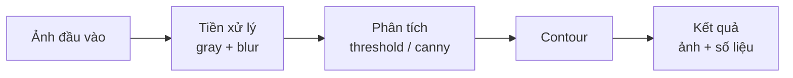
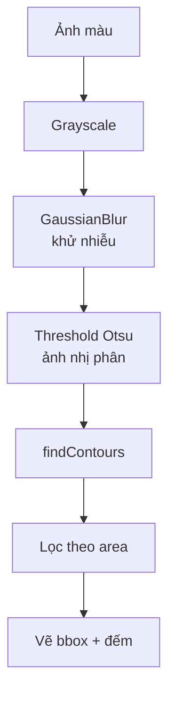

# Project 1: Xử lý ảnh với OpenCV

Project khởi động để xây trực giác nền tảng: **ảnh kỹ thuật số chỉ là một mảng số**, và mọi thao tác xử lý ảnh đều là phép toán trên mảng đó. Project không dùng machine learning, chỉ dùng OpenCV và NumPy.

## Mục tiêu

Sau project này bạn có thể:

- Giải thích ảnh được biểu diễn trong máy tính như thế nào (pixel, kênh màu, dtype).
- Đọc, hiển thị, biến đổi và lưu ảnh bằng OpenCV.
- Chọn đúng phép xử lý (blur, threshold, edge detection, contour) cho một bài toán cụ thể.
- Ghép các phép xử lý thành một pipeline hoàn chỉnh.

## Sản phẩm cuối

Năm task trên web app **CV Playground**: upload ảnh, chỉnh tham số bằng thanh trượt, xem kết quả ngay trên trình duyệt. Mỗi task bọc một phép xử lý:

| Task | Phép xử lý |
|------|------------|
| `p1-grayscale` | Ảnh màu thành ảnh xám |
| `p1-blur` | Gaussian blur |
| `p1-edges` | Canny edge detection |
| `p1-binary` | Threshold (Otsu / adaptive) |
| `p1-count` | Đếm vật thể bằng contour, vẽ bounding box |

Toàn bộ logic xử lý nằm trong module `cvlib/imgtool.py` (các hàm dạng `(img) -> img`), phần đăng ký task nằm trong `tasks/p1_opencv.py`. Cùng module đó cũng chạy được độc lập bằng dòng lệnh khi cần debug nhanh ngoài app.



## Chuẩn bị

- Python 3.10+, biết dùng terminal và pip.
- Vài tấm ảnh bất kỳ để thực hành (chân dung, vật thể, cảnh vật). Nếu chưa có, phần thực hành hướng dẫn tạo ảnh mẫu bằng NumPy.

> [!TIP]
> Cách học hiệu quả: đọc lướt phần lý thuyết dưới đây để nắm ý chính, làm [thực hành](./02-thuc-hanh) đến đâu quay lại đọc kỹ khái niệm đó.

## Nhắc lại Python

Project giả định bạn đã biết Python. Sáu kỹ năng dưới đây là toàn bộ phần Python cần cho xử lý ảnh, và cả sáu đều xuất hiện trong `cvlib/imgtool.py`:

| Kỹ năng | Dùng để |
|---------|---------|
| Venv + pip | Mỗi project một môi trường riêng, tránh xung đột phiên bản |
| Slicing `ndarray` | Cắt vùng, giảm mẫu, tách kênh, đổi BGR↔RGB |
| Tuple unpacking | Nhận nhiều giá trị trả về từ hàm OpenCV |
| Hàm xếp tầng + dict dispatch | Ghép pipeline và thay chuỗi `if/elif` |
| List comprehension | Lọc contour theo diện tích |
| `argparse` | Entry point CLI phụ của `imgtool`, để chạy thử ngoài web app |

> [!TIP]
> Mỗi kỹ năng được giải thích kèm ví dụ và bẫy riêng trong [Python cho Computer Vision](./00-python-for-cv): đọc trang đó nếu bạn chưa quen NumPy hoặc từng bị lỗi "sửa ảnh copy mà ảnh gốc đổi theo".

> [!NOTE]
> Vòng lặp Python chạy trên từng pixel rất chậm. Mọi thao tác ảnh đều gọi hàm của OpenCV hoặc NumPy (bên trong là C++), đó là lý do code thực tế gần như không có `for` trên pixel.

## Hệ sinh thái thư viện CV

| Thư viện | Vai trò | Dùng trong lộ trình |
|----------|---------|---------------------|
| `numpy` | Mảng `ndarray`, nền tảng của mọi thư viện khác | Mọi project |
| `opencv-python` (`cv2`) | Xử lý ảnh truyền thống: đọc/ghi, lọc, threshold, contour | Project 1, 4, 5, 6 |
| `matplotlib` | Hiển thị ảnh, vẽ histogram và biểu đồ | Mọi project |
| `pillow` (PIL) | Đọc/ghi ảnh kiểu RGB, thao tác đơn giản | Xen kẽ, hay gặp khi nạp dataset |
| `scikit-image` | Xử lý ảnh hướng khoa học, nhiều thuật toán OpenCV không có | Tham khảo thêm |
| `torch` + `torchvision` | Deep learning: tensor, CNN, pretrained model | Project 2, 3 |
| `albumentations` | Data augmentation: xoay, lật, đổi sáng ngẫu nhiên | Project 3 |
| `mediapipe` | Pretrained model sẵn dùng: hand, face, pose landmarks | Project 4 |
| `ultralytics` | YOLO object detection | Project 5 |
| `pytesseract`, `paddleocr` | OCR, đọc chữ trong ảnh | Mở rộng |

Phân vai đơn giản: NumPy giữ dữ liệu (ảnh là `ndarray`), OpenCV xử lý trên mảng đó, matplotlib để nhìn kết quả. Khi quy tắc thủ công không còn đủ, PyTorch và các pretrained model tiếp quản.

## Ảnh là ma trận

Ý tưởng gốc của toàn bộ Computer Vision: **một tấm ảnh là một mảng nhiều chiều các số**. Mọi thao tác xử lý ảnh đều là phép toán trên mảng đó.

Ảnh màu kích thước $W \times H$ được OpenCV đọc thành mảng NumPy `shape = (H, W, 3)`:

- Chiều 1: hàng (trục y, từ trên xuống).
- Chiều 2: cột (trục x, từ trái sang).
- Chiều 3: ba kênh màu.

Mỗi phần tử là `uint8` (0 đến 255): 0 là tối nhất, 255 là sáng nhất. Truy cập pixel bằng `img[y, x]` (hàng trước, cột sau), khác với trực giác `(x, y)` trong toán.

**Ứng dụng:** mọi thao tác ảnh đều quy về phép toán trên mảng: crop là slicing `img[y1:y2, x1:x2]`, resize là nội suy, đổi sáng là cộng hằng số, mask là nhân hai mảng. Hiểu "ảnh = `ndarray`" là điều kiện để đọc và debug mọi code CV, từ pipeline thủ công ở project này đến tensor của deep learning sau này.

> [!TIP]
> `cv2.imread` trả về `None` khi đường dẫn sai hoặc file hỏng, và `None.shape` sinh ra `AttributeError` khó đọc. Thói quen của người làm CV: luôn kiểm tra `img is not None` (hoặc `assert img is not None`) ngay sau khi đọc, trước khi đưa vào pipeline.

## OpenCV dùng BGR, không phải RGB

OpenCV đọc ảnh theo thứ tự kênh **Blue-Green-Red**, ngược với hầu hết thư viện khác (Pillow, Matplotlib) dùng RGB. Hiển thị ảnh BGR bằng matplotlib mà không đổi sẽ bị đảo màu. Quy tắc nhớ: `cv2.imread`/`cv2.imwrite` dùng BGR, đổi sang RGB bằng `cv2.cvtColor(img, cv2.COLOR_BGR2RGB)` trước khi đưa cho thư viện khác.

> [!NOTE]
> **Vì sao là BGR mà không phải RGB hay GRB?** Lý do thuần lịch sử: OpenCV ra đời tại Intel khoảng năm 1999, khi camera, frame grabber và định dạng BMP của Windows đều lưu pixel theo thứ tự B-G-R. OpenCV chọn theo phần cứng để khỏi phải đảo kênh mỗi lần nhận frame, rồi giữ nguyên đến nay vì tương thích ngược. Về bản chất đây chỉ là một convention: thứ tự nào cũng chạy được, miễn cả hệ thống thống nhất. GRB không phải chuẩn lưu trữ ảnh; thứ tự dạng đó chỉ xuất hiện trong Bayer pattern của sensor thô (GRBG), trước khi được demosaic thành ảnh màu.
>
> Điểm duy nhất thứ tự kênh thật sự quan trọng là **ranh giới giữa các thư viện**: OpenCV ↔ matplotlib/PIL, và đặc biệt khi đưa ảnh vào pretrained model (torchvision, mediapipe, YOLO) ở các project sau, vì gần như mọi model đều được huấn luyện trên RGB.

> [!TIP]
> Chẩn đoán lệch màu trong 5 giây: mặt người hiện xanh dương và bầu trời hiện da cam nghĩa là ảnh BGR đang bị hiển thị như RGB, thiếu `cv2.cvtColor(img, cv2.COLOR_BGR2RGB)`. Chiều ngược lại cũng đúng: ảnh vẽ bằng matplotlib muốn lưu bằng `cv2.imwrite` thì đổi RGB→BGR trước. Đảo kênh bằng `img[:, :, ::-1]` cũng cho kết quả RGB và rất nhanh, nhưng `cvtColor` diễn đạt rõ ý đồ hơn và tổng quát cho mọi không gian màu.

## Không gian màu

Cùng một ảnh có thể biểu diễn bằng nhiều không gian màu. Chọn đúng không gian màu thường biến bài toán khó thành dễ.

- **Grayscale (xám):** chỉ giữ độ sáng, bỏ màu, giảm dữ liệu còn 1/3. Hầu hết pipeline đều bắt đầu bằng bước này.
- **HSV:** tách thành Hue (loại màu, 0-179), Saturation (độ đậm), Value (độ sáng). Muốn lọc "vật màu đỏ" chỉ cần khoanh kênh H, gần như không bị ảnh hưởng bởi sáng tối, trong khi RGB rất khó khoanh.
- **Mask:** kết quả của `cv2.inRange`, là ảnh nhị phân đánh dấu pixel thỏa điều kiện. Công cụ trung tâm để tách vùng theo màu.

**Ứng dụng:** grayscale là bước mở đầu của OCR, face detection (Haar Cascade chỉ nhận ảnh xám) và template matching vì giảm 2/3 dữ liệu phải xử lý. HSV dùng để lọc màu trong robot (bám line, đuổi bóng), phân loại độ chín của trái cây, tách vùng da, và chroma key. Mask từ `inRange` vừa là đầu vào cho `findContours`, vừa dùng với `cv2.bitwise_and` để trích đúng vùng màu ra khỏi ảnh gốc.

> [!TIP]
> Chuyên gia không đoán dải HSV bằng mắt: họ viết sẵn một tuner nhỏ dùng `cv2.createTrackbar` gắn vào cửa sổ `imshow`, kéo H/S/V min-max và nhìn mask cập nhật trực tiếp, rồi mới chép con số vào code. Một bẫy riêng của màu đỏ: Hue nằm ở hai đầu thang (gần 0 và gần 179), nên cần hai lần `inRange` rồi `bitwise_or` kết quả.

## Histogram

Histogram đếm số pixel ở mỗi mức sáng 0-255, cho biết ảnh thiếu sáng, cháy sáng hay tương phản thấp mà không cần nhìn ảnh. `cv2.equalizeHist` kéo dãn phân bố để tăng tương phản, hữu ích cho ảnh tối nhưng đôi khi khuếch đại nhiễu.

**Ứng dụng:** đánh giá phơi sáng của ảnh chụp (histogram lệch trái là thiếu sáng), tăng tương phản cho ảnh X-quang và ảnh y tế, và là nền tảng của Otsu (tự tìm ngưỡng bằng cách phân tích histogram). Histogram backprojection còn là cơ chế của tracker CamShift dùng để bám vật theo màu.

> [!TIP]
> `equalizeHist` kéo dãn trên toàn ảnh nên dễ "cháy" vùng vốn đã sáng. Lựa chọn phổ biến hơn trong thực tế là CLAHE (`cv2.createCLAHE(clipLimit=2.0, tileGridSize=(8, 8))` rồi `.apply(gray)`): cân bằng theo từng ô lưới nhỏ, tăng tương phản cục bộ mà không phóng đại nhiễu toàn cục.

## Convolution và kernel

Lọc ảnh = trượt một ma trận nhỏ gọi là **kernel** (3x3, 5x5) qua từng vị trí ảnh. Tại mỗi vị trí, pixel mới là tổng có trọng số của các pixel lân cận. Kernel trung bình 3x3:

```math
K = \frac{1}{9}\begin{pmatrix} 1 & 1 & 1 \\ 1 & 1 & 1 \\ 1 & 1 & 1 \end{pmatrix}
```

Đây là phép **convolution**, nền tảng của cả OpenCV filter lẫn tầng Conv trong CNN ở Project 2. Khác biệt cốt lõi: kernel ở đây do người chọn, kernel trong CNN do model tự học.

| Phép lọc | Cơ chế | Dùng khi |
|----------|--------|----------|
| `cv2.blur` | Trung bình khối | Mờ nhanh |
| `cv2.GaussianBlur` | Trọng số Gaussian | Khử nhiễu trước edge detection |
| `cv2.medianBlur` | Trung vị lân cận | Khử nhiễu muối tiêu, giữ biên |
| `cv2.filter2D` | Kernel tự định nghĩa | Sharpen, emboss, hiệu ứng riêng |

**Ứng dụng:** khử nhiễu trước mọi phép phân tích, làm mờ khuôn mặt hoặc biển số khi cần che thông tin, làm nét ảnh scan, phát hiện biên theo một hướng bằng kernel Sobel/Scharr, emboss cho hiệu ứng nổi. Cùng một phép toán này, khi được nhân lên hàng trăm kernel do model tự học, chính là tầng Conv của CNN ở Project 2.

Kernel sharpen kinh điển để làm nét ảnh:

```python
kernel = np.array([[0, -1, 0], [-1, 5, -1], [0, -1, 0]], dtype=np.float32)
sharp = cv2.filter2D(img, -1, kernel)
```

> [!TIP]
> Kích thước kernel luôn là số lẻ (3, 5, 7) vì cần một pixel tâm; `GaussianBlur` báo lỗi nếu truyền số chẵn. Cách chỉnh: bắt đầu từ 3 hoặc 5, tăng khi nhiễu chưa sạch. Kernel càng lớn thì mịn càng mạnh nhưng mất chi tiết và chậm hơn, nên đừng chọn "to nhất có thể".

## Threshold: ảnh xám thành đen trắng

Threshold là phép rẽ nhị phân: pixel sáng hơn ngưỡng thành trắng, ngược lại thành đen. Ba cách chọn ngưỡng:

- **Cố định:** đơn giản, kém khi ánh sáng không đều.
- **Otsu:** tự tìm ngưỡng tối ưu từ histogram.
- **Adaptive:** ngưỡng khác nhau theo vùng, tốt cho ảnh sáng không đều.

Ảnh nhị phân là đầu vào chuẩn cho bước tìm contour.

**Ứng dụng:** số hoá tài liệu trước khi OCR, tách vật khỏi nền để đếm (xu, tế bào, sản phẩm trên băng chuyền), tách chữ khỏi giấy khi scan, tạo mask để cắt vùng quan tâm.

> [!TIP]
> Ảnh nhị phân sau threshold gần như luôn còn chấm nhiễu và lỗ thủng. Trước khi `findContours`, chuyên gia "lau" mask bằng phép hình thái: `cv2.morphologyEx(mask, cv2.MORPH_OPEN, kernel)` xoá chấm nhỏ ngoài nền, `MORPH_CLOSE` bịt lỗ hổng trong vật. Một dòng morphology thường xử lý được vấn đề mà chỉnh ngưỡng mãi không xong.

> [!TIP]
> Thứ tự thử ngưỡng để đỡ mất thời gian: bắt đầu bằng Otsu (một dòng, không cần chọn số), chỉ chuyển sang Adaptive khi ảnh có vùng sáng tối chênh lệch rõ, và chỉ dùng ngưỡng cố định khi bạn kiểm soát được ánh sáng đầu vào.
>
> Mẹo đọc kết quả: nếu contour bị đứt hoặc dính vào nhau, đừng sửa contour: quay lại chỉnh ảnh nhị phân (blur nhiều hơn hoặc đổi ngưỡng). Chất lượng nhị phân quyết định chất lượng contour.

## Biên và contour

- **Canny:** phát hiện biên, nơi độ sáng đổi đột ngột. Hai ngưỡng quyết định biên mạnh/yếu. Luôn blur trước để giảm nhiễu.
- **Contour:** đường cong khép kín nối các pixel biên liên tục cùng màu, tìm bằng `findContours` trên ảnh nhị phân.
- **Độ đo:** `contourArea` (diện tích), `arcLength` (chu vi), `boundingRect` (hộp bao), `approxPolyDP` (xấp xỉ đa giác, nhận biết hình dạng).

**Ứng dụng:** Canny là bước đầu của Hough transform (phát hiện đường thẳng để bám làn đường, phát hiện văn bản nghiêng) và của bài toán đo kích thước trong công nghiệp. Contour dùng để đếm vật, kiểm tra khuyết tật sản phẩm (nứt, thiếu chi tiết), nhận diện hình dạng bằng `approxPolyDP` (3 đỉnh là tam giác, 4 đỉnh là tứ giác), và đo diện tích vùng trên ảnh drone.

> [!TIP]
> `findContours` nhận tham số retrieval mode: `cv2.RETR_EXTERNAL` chỉ lấy contour ngoài cùng (đủ cho bài đếm vật), còn `RETR_TREE` hoặc `RETR_LIST` giữ cả contour lồng nhau (cần khi vật có lỗ hoặc cần quan hệ cha-con). Chọn sai mode là nguyên nhân phổ biến khiến số contour đếm được "nhiều hơn những gì mắt thấy".

> [!TIP]
> `findContours` trong OpenCV 4 trả về **hai** giá trị `contours, hierarchy`, không phải ba như code OpenCV 3 cũ trên mạng. Nếu copy snippet cũ và thấy lỗi unpack, xóa bớt một biến.
>
> Khi đếm vật thể, luôn lọc nhiễu bằng diện tích trước khi tin vào con số: nhiễu hạt và vật thật nằm lẫn trong cùng danh sách `contours`.

> [!WARNING]
> Blur trước Canny không phải tuỳ chọn cho đẹp. Bỏ bước này thì nhiễu hạt cũng được coi là biên, kết quả là hàng nghìn contour rác và thuật toán đếm sai hoàn toàn.

## Pipeline tổng hợp

Pipeline kinh điển của xử lý ảnh truyền thống, ví dụ đếm vật thể:



Giới hạn: mọi quy tắc (ngưỡng, kernel, diện tích tối thiểu) đều do người chọn tay, chỉ hoạt động khi vật và nền tương phản tốt. Khi giả định này sai, cần machine learning, đó là nội dung Project 2.

> [!TIP]
> Quy trình debug của chuyên gia: lưu hoặc `imshow` ảnh sau **từng** bước (gray, blur, binary, edges) thay vì chỉ nhìn kết quả cuối. Khi pipeline sai, dải ảnh trung gian chỉ ra ngay bước hỏng. Đó cũng là lý do project này sinh ra `gray.png`, `binary.png`, `edges.png`, `counted.png` thay vì chỉ một ảnh đầu ra.
>
> Và đừng chỉnh tham số trên một ảnh duy nhất: bộ ngưỡng "đẹp" trên một ảnh thường gãy trên ảnh khác điều kiện sáng. Tập kiểm tra tối thiểu để tin vào một bộ tham số là 5-10 ảnh đa dạng.

## Tổng kết kiến thức phải nắm

Bảng dưới là những gì phải trả lời được **không cần mở lại tài liệu** trước khi sang phần thực hành.

| Chủ đề | Phải nắm | Kiểm tra nhanh |
|--------|----------|----------------|
| Biểu diễn ảnh | Ảnh là `ndarray`, màu có `shape = (H, W, 3)`, `dtype = uint8` (0-255) | `img.shape` cho biết gì? |
| Truy cập pixel | `img[y, x]` (hàng trước, cột sau) | Vì sao `img[x, y]` thường sai? |
| Kênh màu | OpenCV dùng BGR, thư viện khác dùng RGB | Hàm nào đổi BGR↔RGB? |
| Không gian màu | Gray giảm dữ liệu, HSV tách màu khỏi độ sáng | Lọc vật đỏ nên dùng không gian nào? |
| Convolution | Kernel trượt qua ảnh, pixel mới là tổng có trọng số | Blur và sharpen khác nhau ở kernel thế nào? |
| Threshold | Cố định / Otsu / Adaptive; đầu ra là ảnh nhị phân | Khi nào Otsu thất bại? |
| Biên | Canny tìm nơi độ sáng đổi đột ngột, cần blur trước | Hai ngưỡng của Canny để làm gì? |
| Contour | Đường khép kín trên ảnh nhị phân; đo bằng area, arcLength, boundingRect, approxPolyDP | Vì sao contour bị đứt? |
| Pipeline | Gray → Blur → Threshold → Contour → lọc area → vẽ/đếm | Bước nào quyết định chất lượng cuối? |

Ba điều dễ nhầm nhất, ghi thành phản xạ:

1. **Thứ tự trục:** `shape` là `(H, W, C)` nhưng nhiều API (ví dụ `cv2.resize`, `cv2.rectangle`, `boundingRect`) nhận `(width, height)`. Đọc kỹ tài liệu hàm, đừng suy từ `shape`.
2. **`uint8` tràn số:** cộng hai pixel 200 + 100 không ra 300 mà quay về 44. Muốn cộng an toàn, đổi sang `int16`/`float32` hoặc dùng `cv2.add` (tự bão hoà ở 255).
3. **Tham số là công cụ, không phải hằng số:** kernel size, ngưỡng, `minArea` đều phụ thuộc ảnh đầu vào. Pipeline đúng là pipeline có tham số chỉnh được, không phải con số copy từ tutorial.

> [!NOTE]
> Nếu giải thích được pipeline ở trên bằng lời cho một người không biết CV, bạn đã nắm đủ lý thuyết của project này. Phần còn lại là luyện tay để quen với việc chỉnh tham số.

## Quiz tự kiểm tra

Làm hết 6 câu trước khi mở [thực hành](./02-thuc-hanh). Câu nào sai thì quay lại đúng mục tương ứng ở trên.

```quiz
{
  "id": "opencv-co-ban-ly-thuyet",
  "title": "Kiểm tra lý thuyết: OpenCV cơ bản",
  "mode": "exam",
  "questions": [
    {
      "type": "single",
      "question": "`cv2.imread` đọc một ảnh màu thành mảng NumPy có `shape` là gì?",
      "options": ["`(H, W, 3)`", "`(W, H, 3)`", "`(3, H, W)`", "`(H, W)`"],
      "answer": 0,
      "explanation": "OpenCV trả về `(số hàng, số cột, số kênh)` = `(H, W, 3)`. `(3, H, W)` là layout channel-first của PyTorch, còn `(H, W)` là ảnh xám."
    },
    {
      "type": "true-false",
      "question": "OpenCV đọc ảnh theo thứ tự kênh RGB, giống Pillow và Matplotlib.",
      "answer": false,
      "explanation": "OpenCV dùng BGR. Đưa thẳng ảnh BGR cho Matplotlib sẽ bị đảo màu; cần `cv2.cvtColor(img, cv2.COLOR_BGR2RGB)`."
    },
    {
      "type": "single",
      "question": "Bạn cần lọc các vật màu đỏ trong ảnh có ánh sáng thay đổi mạnh. Không gian màu nào phù hợp nhất?",
      "options": ["HSV", "Grayscale", "BGR", "Nhị phân"],
      "answer": 0,
      "explanation": "HSV tách Hue (loại màu) khỏi Value (độ sáng), nên khoanh một dải H là gần như bắt được vật đỏ bất kể sáng tối. Grayscale làm mất thông tin màu, BGR thì màu và độ sáng trộn lẫn vào nhau."
    },
    {
      "type": "single",
      "question": "Phép lọc nào phù hợp nhất để khử nhiễu muối tiêu mà vẫn giữ biên sắc?",
      "options": ["`cv2.medianBlur`", "`cv2.blur`", "`cv2.GaussianBlur`", "`cv2.filter2D` với kernel sharpen"],
      "answer": 0,
      "explanation": "Median lấy trung vị nên loại được điểm nhiễu cực trị mà không làm nhoè biên như trung bình/Gaussian. Kernel sharpen thì càng làm nhiễu nổi bật hơn."
    },
    {
      "type": "multiple",
      "question": "Bước nào giúp giảm nhiễu trước khi chạy Canny? (chọn tất cả đáp án đúng)",
      "options": ["`cv2.GaussianBlur`", "`cv2.medianBlur`", "`cv2.equalizeHist`", "`cv2.filter2D` với kernel làm sắc nét"],
      "answer": [0, 1],
      "explanation": "Gaussian và median đều là lọc làm mờ, giúp Canny không nhận nhiễu hạt là biên. `equalizeHist` chỉ kéo dãn tương phản (có thể khuếch đại nhiễu), còn kernel sharpen làm biên nhiễu mạnh hơn."
    },
    {
      "type": "self-check",
      "question": "Giải thích trong 2-3 câu: khác biệt cốt lõi giữa kernel trong `cv2.filter2D` và kernel trong một tầng Conv của CNN là gì?",
      "answer": "Kernel của `filter2D` do người lập trình chọn tay (ví dụ kernel trung bình, sharpen) và giữ nguyên. Kernel của tầng Conv là tham số **học được** từ dữ liệu bằng lan truyền ngược, nên model tự tìm ra bộ lọc phù hợp với bài toán.",
      "explanation": "Cả hai đều là phép convolution giống nhau về mặt toán. Khác biệt nằm ở nguồn gốc giá trị trong kernel: chọn tay so với tối ưu bằng gradient descent."
    }
  ]
}
```

## Tiếp theo

- [Thực hành](./02-thuc-hanh)
