# Project 2: Nhận diện chữ số viết tay với MNIST

Ở Project 1, mọi quy tắc nhận diện đều do bạn chọn tay (ngưỡng, kernel, diện tích tối thiểu). Project này lật ngược cách làm: **đưa cho máy hàng nghìn ví dụ có nhãn, để nó tự tìm ra quy tắc**. Đây là bản chất của machine learning cho ảnh.

MNIST là dataset kinh điển: 70.000 ảnh xám 28x28 của chữ số viết tay (0-9). Nó đủ sạch để train trên CPU trong vài phút, nhưng vẫn đủ thật để học trọn vẹn pipeline deep learning.

> [!NOTE]
> **Đọc nhanh trong 1 phút:** Dữ liệu có nhãn → CNN trích đặc trưng → so với nhãn đúng để tính loss → chỉnh tham số giảm loss → lặp lại nhiều epoch → chấm điểm trên tập test chưa từng thấy.

## Mục tiêu

Sau project này bạn có thể:

- Giải thích pipeline deep learning: dataset → model → train → evaluate → inference.
- Xây dựng một mạng CNN đơn giản bằng PyTorch.
- Viết training loop, theo dõi loss và accuracy.
- Đánh giá model bằng confusion matrix và phân tích mẫu sai.
- Tiền xử lý ảnh ngoài đời để đưa vào model.

**Kết quả kỳ vọng:** accuracy ~99% trên tập test sau 3-5 epoch, và nhận diện được chữ số bạn tự viết ra giấy.

**Chuẩn bị:**

- Hoàn thành [Project 1](../01-opencv-co-ban/01-ly-thuyet), đặc biệt phần ảnh là mảng NumPy.
- Biết class và hàm trong Python.
- Toán: chỉ cần hiểu trực giác, không yêu cầu tính đạo hàm.

> [!TIP]
> Cách học hiệu quả: đọc lướt các hộp **Ý chính** để nắm bức tranh lớn, làm [thực hành](./02-thuc-hanh) đến đâu quay lại đọc kỹ khái niệm đó.

## Pipeline tổng thể

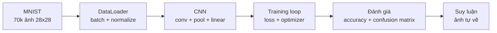

| Bước | Câu hỏi nó trả lời | Công cụ PyTorch |
| --- | --- | --- |
| Dataset | Dữ liệu ở đâu, nhãn là gì? | `datasets.MNIST` |
| DataLoader | Đưa ảnh vào model thế nào? | `DataLoader`, `transforms` |
| Model | Biến ảnh thành dự đoán ra sao? | `nn.Module`, `nn.Conv2d` |
| Training loop | Làm sao model tốt lên? | `loss`, `optimizer` |
| Evaluate | Model có thật sự giỏi không? | test set, confusion matrix |
| Inference | Dùng model cho ảnh mới | tiền xử lý + `softmax` |

## Từ quy tắc chọn tay sang học từ dữ liệu

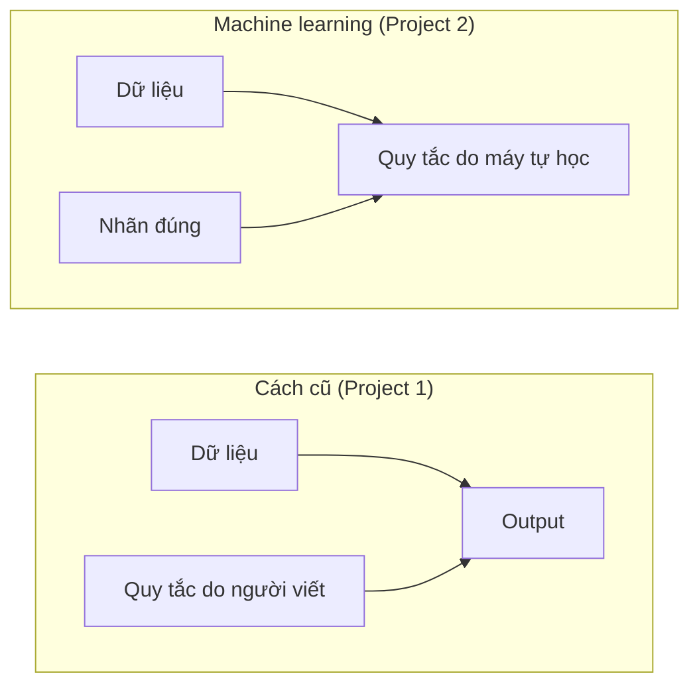

Model "học" nghĩa là **tự điều chỉnh hàng chục nghìn tham số bên trong** sao cho dự đoán khớp nhãn càng nhiều càng tốt. Bạn không viết "chữ 7 có một nét ngang và một nét chéo", model tự khám phá ra điều đó.

> [!NOTE]
> **Ý chính:** Lập trình truyền thống: người viết quy tắc. Machine learning: người cung cấp ví dụ, máy tìm quy tắc.

## MNIST là gì

**MNIST** (Modified National Institute of Standards and Technology) là bộ dữ liệu chữ số viết tay do Yann LeCun, Corinna Cortes và Chris Burges công bố, được dùng làm "bài tập Hello World" của machine learning cho ảnh.

| Đặc điểm | Giá trị |
| --- | --- |
| Nội dung | Chữ số viết tay 0-9 |
| Số lượng | 70.000 ảnh (60.000 train + 10.000 test) |
| Kích thước ảnh | 28x28 pixel, ảnh xám (1 kênh) |
| Giá trị pixel | 0-255 (0 là nền đen, 255 là nét trắng sáng nhất) |
| Nhãn | 1 số nguyên từ 0 đến 9 cho mỗi ảnh |
| Số lớp | 10 |
| Dung lượng | khoảng 11 MB nén |

Chữ số trong MNIST được lấy từ dữ liệu của NIST (viết bởi nhân viên điều tra dân số và học sinh trung học Mỹ), sau đó được xử lý sẵn: thu nhỏ về 28x28, **canh giữa** và để nét chữ trắng trên nền đen. Chính việc "làm sạch sẵn" này khiến MNIST dễ, nhưng cũng là lý do ảnh tự chụp ngoài đời không giống MNIST (xem [Domain shift](#domain-shift)).

Về bản chất, mỗi ảnh chỉ là một bảng 28x28 số:

```text
Ảnh số "7" (rút gọn, mỗi số là độ sáng pixel)

  0   0   0   0   0   0   0
  0 255 255 255 255 255   0
  0   0   0   0  200 120   0
  0   0   0 180 230   0   0
  0   0 150 255   0   0   0
  0   0 255 100   0   0   0
```

Model không "thấy" chữ 7, nó chỉ nhận 784 con số này và phải đoán nhãn.

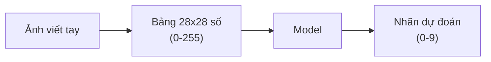

Vì sao MNIST được chọn làm bài học đầu tiên:

- **Nhỏ:** train được trên CPU laptop trong vài phút, không cần GPU.
- **Sạch:** nhãn đúng, ảnh đã chuẩn hóa, ít phải xử lý dữ liệu.
- **Có sẵn:** `torchvision` tải và đọc giúp bằng một dòng code.
- **Chuẩn so sánh:** hàng nghìn bài báo và tutorial dùng nó, dễ đối chiếu kết quả của bạn.

> [!NOTE]
> **Ý chính:** MNIST = 70.000 ảnh chữ số xám 28x28 có nhãn 0-9. Bài toán là **phân loại 10 lớp**: nhìn bảng 784 số, trả lời đó là chữ số nào.

> [!TIP]
> Bài toán phân loại có "10 lớp" nên mạng cuối cùng có 10 neuron đầu ra. Gặp bộ dữ liệu khác có N lớp thì chỉ cần đổi số 10 thành N.

## Dữ liệu: train, test, batch, tensor

### Train/test split

Model học trên tập **train** (60.000 ảnh) và được chấm điểm trên tập **test** (10.000 ảnh) chưa từng thấy.

> [!WARNING]
> Đánh giá trên dữ liệu đã học thì "học thuộc lòng" cũng đạt 100%, con số đó không phản ánh khả năng thật. Luôn báo cáo accuracy trên tập test.

**Hai bộ có trùng nhau không?** Không, chúng được chia sẵn thành 2 file riêng biệt ngay từ đầu: 60.000 ảnh train và 10.000 ảnh test là các chữ viết tay khác nhau, thậm chí khác người viết. Cờ `train=True/False` chỉ chọn đọc file nào, không phải tự split từ một file chung. Hai bộ không trùng ảnh nhưng **cùng phân phối** (đều là chữ viết tay Mỹ) nên việc chấm điểm vẫn công bằng.

Thực hành chuyên nghiệp còn tách thêm **validation set** từ train set (ví dụ 50k train + 10k val) để tune hyperparameter, tránh "nhìn trộm" test set. Bài này đơn giản nên 2 bộ là đủ.

### Tensor

`torch.Tensor` tương tự `np.ndarray` nhưng chạy được trên GPU và hỗ trợ đạo hàm tự động. `images.shape` của một batch trả về `torch.Size([64, 1, 28, 28])`, đọc theo quy ước **NCHW** của PyTorch:

```text
[64,  1,   28,   28 ]
 N    C    H    W
 │    │    │    └─ Width: 28 pixel chiều ngang
 │    │    └─────── Height: 28 pixel chiều dọc
 │    └──────────── Channels: 1 kênh (ảnh xám; ảnh màu RGB là 3)
 └───────────────── N (batch size): 64 ảnh, đúng batch_size=64
```

> [!CAUTION]
> Kênh đứng **trước** chiều cao/rộng, ngược với `(H, W, C)` của OpenCV. Quên đổi thứ tự là lỗi shape phổ biến nhất khi chuyển từ Project 1 sang. TensorFlow/Keras cũng mặc định NHWC (kênh nằm cuối), nên đổi framework là đổi thứ tự chiều.

Vài điểm hay gặp:

- `torch.Size` thực chất là tuple, `images.shape == (64, 1, 28, 28)` trả về `True`. Truy cập từng chiều: `images.shape[0]` → 64.
- Phần tử trong tensor lúc này là `float32` đã qua normalize (giá trị quanh 0), không còn là số nguyên 0-255. Kiểm tra bằng `images.dtype`.
- `images[i, 0]` lấy ra shape `[28, 28]`: bỏ chiều kênh vì `imshow` chỉ cần ma trận 2D cho ảnh xám.
- Đưa vào `nn.Linear` thì phải duỗi phẳng bằng `nn.Flatten()` hoặc `images.view(64, -1)` thành vector 784. CNN thì giữ nguyên 4 chiều.

### Batch

Model học theo nhóm ảnh (ví dụ 64 ảnh mỗi lần) thay vì từng ảnh một. Lý do: nhanh hơn nhiều nhờ tính song song, và gradient trung bình trên cả nhóm ổn định hơn so với gradient của một ảnh đơn lẻ.

### Normalize

Đưa giá trị pixel về quanh 0 giúp training ổn định và nhanh hội tụ. Với MNIST mọi tutorial đều dùng:

```python
transforms.Normalize((0.1307,), (0.3081,))  # mean, std
```

Công thức áp lên từng pixel (gọi là **Z-score standardization**):

$$x' = \frac{x - \text{mean}}{\text{std}} = \frac{x - 0.1307}{0.3081}$$

Trước đó `ToTensor()` đã đưa pixel từ $[0, 255]$ về $[0, 1]$ (chia cho 255). Sau `Normalize`, dữ liệu nằm quanh 0, khoảng $[-0.42, 2.82]$: nền đen (pixel 0) thành $-0.42$, nét sáng nhất (pixel 1) thành $2.82$.

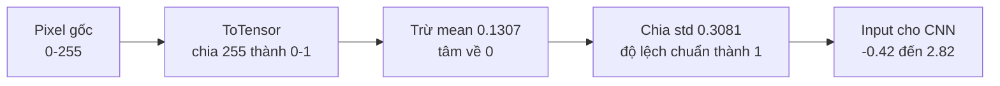

#### Vì sao phải làm bước này

**1. Đưa dữ liệu về zero-mean, unit-variance.**
Ảnh MNIST chủ yếu là nền đen (giá trị 0), nên trung bình toàn bộ pixel bị kéo lệch về gần 0 nhưng vẫn dương (0,1307). Phép trừ `mean` dời tâm phân phối về đúng 0, phép chia `std` co giãn sao cho độ lệch chuẩn bằng 1.

> [!NOTE]
> Chính xác hơn, bước này đưa dữ liệu về **trung bình 0 và độ lệch chuẩn 1**, chưa chắc thành phân phối chuẩn (hình chuông). Phân phối pixel MNIST vẫn có hai đỉnh lớn: nền đen và nét trắng.

**2. Gradient Descent hội tụ nhanh và ổn định hơn.**
Khi input cùng thang đo và có tâm ở 0, bề mặt hàm mất mát (loss landscape) cân đối, gần tròn thay vì méo thành hình elip dẹt. Optimizer (Adam, SGD) đi thẳng về điểm cực tiểu thay vì dao động zig-zag, nên cần ít bước hơn.

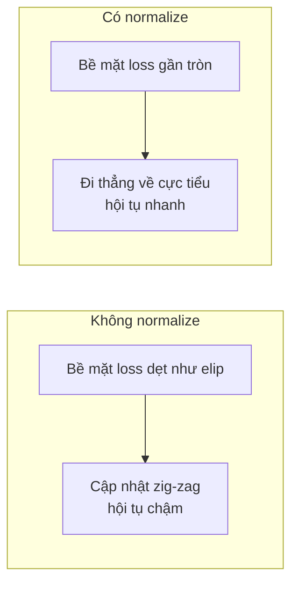

**3. Tránh bão hòa activation và gradient bùng nổ hoặc triệt tiêu.**
Các cách khởi tạo trọng số hiện đại (Kaiming/He, Xavier) được thiết kế dựa trên giả định input có **mean 0 và variance 1**. Nếu giữ nguyên khoảng $[0, 1]$ toàn số dương, gradient truyền ngược qua một neuron sẽ luôn cùng dấu (toàn dương hoặc toàn âm), nên các trọng số của neuron đó chỉ có thể cùng tăng hoặc cùng giảm. Cập nhật kém hiệu quả, dễ đi theo đường zig-zag, và dễ đẩy hàm kích hoạt vào vùng bão hòa.

**4. Giữ tính nhất quán cho cả cộng đồng.**
Hai con số `0.1307` và `0.3081` là mean và std **thống kê sẵn trên 60.000 ảnh train** của MNIST, không phải config tự chọn. Dùng đúng cặp hằng số này là quy ước tiêu chuẩn (best practice) của cộng đồng PyTorch/Computer Vision: mọi model train trên MNIST đều có chung điểm xuất phát về phân phối input, và lúc suy luận cũng **bắt buộc** dùng lại đúng hai con số này để khớp với những gì model đã học.

| Lợi ích | Nếu bỏ qua |
| --- | --- |
| Tâm dữ liệu ở 0 | Gradient dễ cùng dấu, cập nhật kém hiệu quả |
| Cùng thang đo | Loss landscape méo, optimizer zig-zag |
| Khớp giả định khởi tạo | Activation bão hòa, gradient bùng nổ/triệt tiêu |
| Dùng hằng số chuẩn | Model train và suy luận lệch phân phối |

Bạn có thể tự tính lại hai con số để kiểm chứng:

```python
loader = DataLoader(datasets.MNIST("./data", train=True, download=True,
                                   transform=transforms.ToTensor()),
                    batch_size=60000)
data = next(iter(loader))[0]
print(data.mean().item(), data.std().item())   # ~0.1307, ~0.3081
```

Mean/std là tuple chứ không phải số trần vì `Normalize` nhận giá trị **theo từng kênh màu**: ảnh xám 1 kênh nên tuple 1 phần tử, ảnh màu RGB là 3 phần tử, ví dụ `Normalize((0.5, 0.5, 0.5), (0.5, 0.5, 0.5))`.

> [!TIP]
> Bỏ `Normalize` thì model MNIST vẫn train được và vẫn đạt accuracy cao vì bài toán dễ, chỉ chậm hơn và kém ổn định hơn. Với bài toán khó hoặc mạng sâu, thiếu bước này có thể làm training thất bại hẳn.

> [!TIP]
> **Quy tắc vàng:** transform dùng lúc train phải dùng **y hệt** lúc suy luận. Lệch một con số normalize là model đoán sai mà không báo lỗi gì.

## Mạng CNN

### CNN là gì

**CNN (Convolutional Neural Network, mạng nơ-ron tích chập)** là loại mạng nơ-ron được thiết kế riêng cho dữ liệu có cấu trúc lưới như ảnh. Điểm đặc trưng nằm ở chữ "Convolutional": thay vì để mỗi neuron nhìn toàn bộ ảnh, CNN dùng các **bộ lọc nhỏ (kernel) trượt khắp ảnh** để dò mẫu.

Hình dung bằng một thám tử xem ảnh:

- Mạng thường (Linear) giống người nhìn cả bức ảnh một lượt rồi phán đoán, không biết vị trí nào quan trọng.
- CNN giống người cầm **kính lúp nhỏ** quét từng vùng, ghi lại "chỗ này có nét cong, chỗ kia có góc", rồi nhìn các ghi chú đó để kết luận.

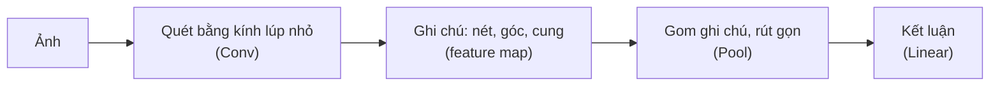

Ba ý tưởng làm nên CNN:

| Ý tưởng | Nghĩa là | Lợi ích |
| --- | --- | --- |
| Kết nối cục bộ | Mỗi neuron chỉ nhìn một vùng nhỏ (ví dụ 3x3) | Bắt đúng bản chất ảnh: pixel gần nhau mới liên quan |
| Chia sẻ trọng số | Một kernel dùng cho mọi vị trí | Dò được mẫu ở bất kỳ đâu, ít tham số |
| Phân cấp đặc trưng | Tầng đầu thấy cạnh, tầng sau ghép thành hình | Hiểu từ chi tiết nhỏ đến khái niệm lớn |

CNN là nền tảng của hầu hết hệ thống thị giác máy tính: nhận diện khuôn mặt, đọc biển số, chẩn đoán ảnh y khoa, xe tự lái. Kiến trúc LeNet-5 của Yann LeCun (thập niên 1990) dùng chính MNIST để đọc chữ số trên séc ngân hàng, và mạng trong bài này là phiên bản thu nhỏ theo cùng ý tưởng.

> [!NOTE]
> **Ý chính:** CNN = mạng nơ-ron + kính lúp trượt trên ảnh. Nó mạnh với ảnh vì tận dụng được việc "pixel gần nhau thì liên quan" và "mẫu giống nhau có thể xuất hiện ở bất kỳ đâu".

### Vì sao không duỗi phẳng ảnh

Duỗi ảnh 28x28 thành vector 784 số phá hủy thông tin không gian: hai pixel cạnh nhau và hai pixel xa nhau được đối xử như nhau, trong khi nét chữ tạo bởi quan hệ giữa các pixel **gần nhau**. CNN giữ cấu trúc 2 chiều, học mẫu cục bộ (nét cong, góc) rồi ghép dần thành khái niệm lớn.

### Kiến trúc dùng trong project

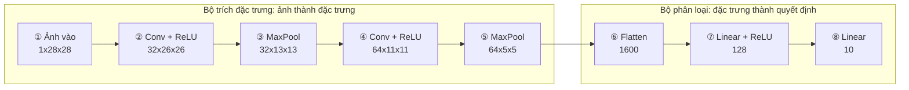

Một CNN chia làm hai phần:

- **Bộ trích đặc trưng (Conv + Pool):** đọc ảnh, rút ra cạnh, góc, vòng cung.
- **Bộ phân loại (Linear):** nhìn bộ đặc trưng đó và quyết định đây là chữ số nào.

#### Chức năng từng block trong sơ đồ

Cách đọc shape: `32x26x26` nghĩa là 32 kênh (feature map), mỗi kênh cao 26 và rộng 26.

| # | Block | Shape ra | Chức năng | Câu hỏi block này trả lời |
| --- | --- | --- | --- | --- |
| ① | Ảnh vào | 1x28x28 | Một ảnh xám đã normalize, 1 kênh, 784 pixel. Chưa có "hiểu biết" nào, chỉ là con số độ sáng | "Dữ liệu thô là gì?" |
| ② | Conv + ReLU | 32x26x26 | 32 kernel 3x3 trượt khắp ảnh, mỗi kernel dò một mẫu đơn giản (cạnh ngang, cạnh dọc, nét chéo...). ReLU giữ lại chỗ có phản ứng, xóa phần âm | "Chỗ nào có cạnh/nét kiểu nào?" |
| ③ | MaxPool | 32x13x13 | Mỗi khối 2x2 chỉ giữ giá trị lớn nhất. Thu nhỏ một nửa, bền với nét lệch vài pixel, không có tham số | "Mẫu có xuất hiện quanh đây không?" |
| ④ | Conv + ReLU | 64x11x11 | 64 kernel nhìn 32 feature map ở ② để **ghép** mẫu nhỏ thành mẫu lớn: cạnh + cạnh thành góc, góc + cung thành vòng, nét cong | "Các nét ghép lại thành hình gì?" |
| ⑤ | MaxPool | 64x5x5 | Nén lần hai. Mỗi ô giờ đại diện cho vùng khá lớn của ảnh gốc, chỉ còn 25 vị trí mỗi kênh | "Tóm gọn lại, hình đó nằm đại khái ở đâu?" |
| ⑥ | Flatten | 1600 | Duỗi 64x5x5 thành một vector 1600 số. Không tính toán gì, chỉ đổi hình dạng để đưa vào tầng Linear | "Chuẩn bị dữ liệu cho bước quyết định" |
| ⑦ | Linear + ReLU | 128 | Mỗi trong 128 neuron nhìn toàn bộ 1600 đặc trưng và học một tổ hợp (ví dụ "vòng trên + nét dọc dưới"). Đây là tầng nhiều tham số nhất (204.928) | "Tổ hợp đặc trưng nào gợi ý chữ số nào?" |
| ⑧ | Linear | 10 | 10 neuron, mỗi neuron cho điểm một chữ số 0-9. Không có ReLU vì cần điểm thô (có thể âm) để đưa vào loss/softmax | "Cuối cùng đây là số mấy?" |

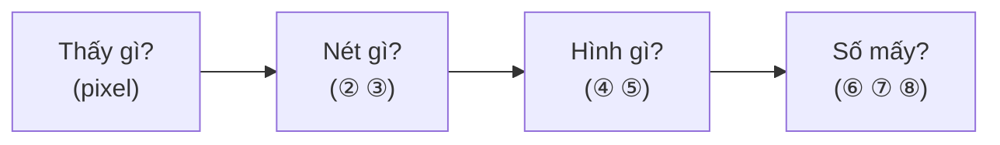

> [!TIP]
> **Quy luật xuyên suốt sơ đồ:** càng đi sâu, **số kênh tăng** (1 → 32 → 64: nhiều loại mẫu hơn) còn **kích thước ảnh giảm** (28 → 13 → 5: ít chi tiết vị trí hơn). Mạng đổi "độ phân giải không gian" lấy "độ phong phú ngữ nghĩa".

> [!NOTE]
> ReLU không có ô riêng vì nó luôn đi ngay sau Conv/Linear và không làm đổi shape. Flatten và MaxPool có ô riêng nhưng đều **không có tham số để học**: chỉ có Conv và Linear mới được cập nhật khi training.

> [!NOTE]
> **Ý chính:** Conv = "tìm mẫu", Pool = "nén lại", Linear = "ra quyết định", ReLU = "bẻ cong để mạng học được quan hệ phức tạp".

### Tầng Conv: trích đặc trưng cục bộ

**Cơ chế:** một kernel 3x3 là ma trận 9 số trượt qua ảnh. Tại mỗi vị trí, nhân từng cặp phần tử của kernel với vùng ảnh bên dưới rồi cộng lại thành một số. Trượt hết ảnh được một bảng số gọi là **feature map** (bản đồ đặc trưng): chỗ nào ảnh giống mẫu của kernel thì số càng lớn.

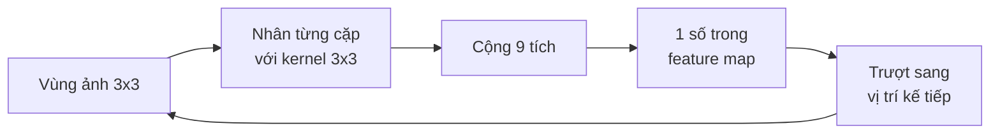

> [!IMPORTANT]
> **Mỗi lần trượt kernel chỉ sinh ra MỘT số duy nhất, không phải một ma trận 3x3.** 9 phép nhân theo cặp rồi cộng hết thành một tổng, tổng đó đi vào đúng một ô của feature map:
>
> ```text
> Vùng ảnh 3x3      Kernel 3x3        Từng tích
> [0  0  9]         [-1  0  1]        [ 0   0   9]
> [0  0  9]    *    [-2  0  2]   =    [ 0   0  18]   -->  y = 36
> [0  0  9]         [-1  0  1]        [ 0   0   9]
> ```
>
> Kernel trên dò cạnh dọc có nét sáng bên phải: vùng chứa cạnh cho số lớn (36), vùng đều màu cho số gần 0. Muốn có feature map 26x26 thì phải trượt kernel qua 26x26 = 676 vị trí, mỗi vị trí sinh đúng một số.

`nn.Conv2d(1, 32, kernel_size=3)` nghĩa là:

| Tham số | Giá trị | Ý nghĩa |
| --- | --- | --- |
| Kênh vào | 1 | Ảnh xám có 1 kênh (ảnh màu là 3) |
| Kênh ra | 32 | Học 32 kernel khác nhau, mỗi kernel chuyên một mẫu. Output là 32 feature map xếp chồng, ghi theo format `(kênh, cao, rộng)` |
| Kernel | 3x3 | Mỗi lần chỉ nhìn vùng 3x3 pixel, đủ để thấy cạnh và góc |

**Vì sao 28x28 thành 26x26?** Kernel chỉ đặt được vào chỗ còn đủ 3x3 pixel nên viền ngoài bị mất. Công thức (không padding, stride 1):

$$n_{out} = n_{in} - k + 1$$

Kiểm tra: $28 - 3 + 1 = 26$. Với tầng conv thứ hai: $13 - 3 + 1 = 11$.

**Điểm mấu chốt: kernel tự học.** Ở Project 1, kernel sharpen do người chọn sẵn. Ở đây 32 kernel khởi tạo ngẫu nhiên, qua training tự biến thành các bộ lọc hữu ích: kernel này phản ứng mạnh với cạnh ngang, kernel kia với cạnh dọc, nét cong, góc gãy.

Tầng conv thứ hai (`nn.Conv2d(32, 64, 3)`) không nhìn pixel nữa mà nhìn 32 feature map của tầng trước, nên học được cách **kết hợp** mẫu nhỏ thành mẫu lớn:

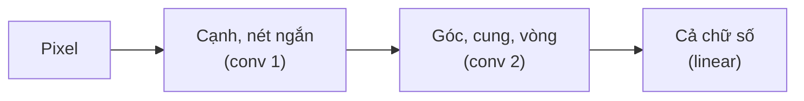

Hai lý do conv mạnh hơn duỗi phẳng:

- **Nhìn cục bộ:** chỉ quan tâm các pixel gần nhau, đúng bản chất nét chữ.
- **Chia sẻ trọng số:** cùng một kernel dùng cho mọi vị trí, nên phát hiện được cạnh ở bất kỳ đâu trong ảnh. Tầng conv đầu chỉ có $3 \times 3 \times 32 + 32 = 320$ tham số, so với hàng trăm nghìn nếu dùng Linear tương đương.

> [!TIP]
> **Mẹo nhớ:** số tham số của Conv2d = `kênh_vào x kênh_ra x k x k + kênh_ra` (phần cộng thêm là bias). Tính thử cho `Conv2d(32, 64, 3)`: $32 \times 64 \times 9 + 64 = 18.496$.

### Tầng MaxPool: nén và bền với dịch chuyển

**Cơ chế:** chia feature map thành các khối 2x2 không chồng lấp, mỗi khối chỉ giữ **giá trị lớn nhất**.

```text
Khối 2x2        Kết quả
[1  3]
[0  2]   --->   3      (giữ max)
```

Feature map 32x26x26 thành 32x13x13: mỗi chiều giảm một nửa, số kênh giữ nguyên, và **không có tham số nào để học**.

Ba tác dụng:

- **Tiết kiệm:** tầng sau xử lý dữ liệu ít hơn 4 lần.
- **Bền với dịch chuyển:** nét chữ lệch 1-2 pixel thì giá trị max trong khối 2x2 gần như không đổi, nên model không cần học riêng số "7" nằm lệch trái hay lệch phải.
- **Nới rộng tầm nhìn:** sau pooling, mỗi ô của feature map đại diện cho vùng lớn hơn trên ảnh gốc, tầng conv tiếp theo nhìn được mẫu to hơn.

> [!NOTE]
> Lấy max thay vì trung bình vì câu hỏi đặt ra là "mẫu này có xuất hiện quanh đây không?". Max giữ lại tín hiệu mạnh nhất, còn trung bình sẽ pha loãng nó.

Với kích thước lẻ, PyTorch làm tròn xuống: $11 / 2 \to 5$ (hàng/cột thừa bị bỏ).

### Tầng Linear: phân loại

Sau hai vòng conv + pool, ảnh đã thành 64 feature map kích thước 5x5. **Flatten** duỗi hết thành một vector $64 \times 5 \times 5 = 1600$ số, đóng vai trò bản "tóm tắt đặc trưng" của ảnh.

- `nn.Linear(1600, 128)`: học tổ hợp các đặc trưng (kiểu "có vòng trên và nét dọc dưới" gợi ý số 9), nén 1600 số còn 128 đặc trưng cô đọng.
- `nn.Linear(128, 10)`: tầng cuối có đúng 10 neuron, mỗi neuron chấm điểm cho một chữ số. Neuron nào cao nhất thì đó là dự đoán.

Đây là chỗ duỗi phẳng hợp lý: đến đây thông tin không gian đã được tóm vào đặc trưng, việc phân loại không cần biết mẫu nằm ở đâu nữa.

> [!TIP]
> **Bài toán 10 lớp thì tầng cuối có 10 neuron.** Đổi sang bài toán 26 chữ cái thì sửa thành 26, các tầng trước giữ nguyên.

### ReLU: hàm kích hoạt

$$\mathrm{ReLU}(x) = \max(0, x)$$

Giữ nguyên số dương, biến số âm thành 0. Đặt sau mỗi tầng Conv và Linear, **trừ tầng Linear cuối cùng** (tầng cuối cần xuất điểm số thô, có thể âm).

**Vì sao bắt buộc phải có?** Nếu không có nó, xếp chồng nhiều phép nhân ma trận chỉ tương đương **một** phép nhân duy nhất (tích của các phép tuyến tính vẫn là tuyến tính): mạng 10 tầng cũng không mạnh hơn mạng 1 tầng. ReLU chèn điểm "gãy" vào giữa các tầng nên mạng học được quan hệ cong, gấp khúc, ví dụ "kích hoạt mạnh khi có đồng thời nét ngang và nét cong" thay vì chỉ cộng dồn tín hiệu.

### Bảng tổng kết các tầng

| Tầng | Shape ra | Tham số học | Vai trò |
| --- | --- | --- | --- |
| Input | 1x28x28 | 0 | Ảnh xám |
| Conv(1, 32, 3) + ReLU | 32x26x26 | 320 | Tìm cạnh, nét ngắn |
| MaxPool(2) | 32x13x13 | 0 | Nén, bền dịch chuyển |
| Conv(32, 64, 3) + ReLU | 64x11x11 | 18.496 | Ghép thành góc, cung |
| MaxPool(2) | 64x5x5 | 0 | Nén tiếp |
| Flatten | 1600 | 0 | Duỗi để phân loại |
| Linear(1600, 128) + ReLU | 128 | 204.928 | Tổ hợp đặc trưng |
| Linear(128, 10) | 10 | 1.290 | Điểm số cho 10 chữ số |

Tổng cộng khoảng **225 nghìn** tham số, hơn 90% nằm ở tầng Linear đầu tiên.

> [!TIP]
> **Mẹo debug shape:** khi gặp lỗi `mat1 and mat2 shapes cannot be multiplied`, gần như chắc chắn số đầu vào của `Linear` đầu tiên sai. Cách chắc ăn: in `x.shape` ngay trước Flatten rồi lấy tích các chiều (trừ batch).

## Huấn luyện hoạt động thế nào

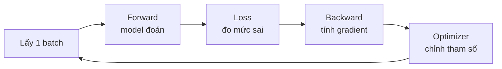

Đúng bốn bước lặp đi lặp lại cho mỗi batch:

1. **Forward:** đưa ảnh qua model, nhận 10 điểm số.
2. **Loss:** `CrossEntropyLoss` so 10 điểm số với nhãn đúng, trả về một số đo mức sai. Càng nhỏ càng tốt.
3. **Backward:** PyTorch tự tính **gradient** của loss theo từng tham số, cho biết chỉnh tham số nào theo hướng nào thì loss giảm.
4. **Step:** `Adam` cập nhật tham số theo hướng giảm loss.

Các thuật ngữ cần nhớ:

| Thuật ngữ | Ý nghĩa |
| --- | --- |
| Epoch | Một lần duyệt hết toàn bộ tập train |
| Learning rate (`lr`) | Độ lớn mỗi bước chỉnh. Quá lớn: nhảy qua đáp án. Quá nhỏ: học chậm |
| Gradient | "La bàn" chỉ hướng làm loss giảm nhanh nhất |
| Optimizer | Thuật toán dùng gradient để cập nhật tham số (Adam, SGD) |

> [!TIP]
> **Hình dung:** training giống xuống núi trong sương mù. Gradient là độ dốc dưới chân, learning rate là độ dài mỗi bước, loss là độ cao hiện tại.

> [!WARNING]
> Trong PyTorch phải gọi `optimizer.zero_grad()` trước mỗi lần `loss.backward()`, nếu không gradient của batch cũ bị cộng dồn vào batch mới và training đi sai hướng.

Muốn hiểu sâu từng bước, xem [Training model: hiểu trọn quá trình huấn luyện](./03-training-model).

### Overfitting

Train accuracy tăng nhưng test accuracy chững hoặc giảm nghĩa là model **học thuộc** dữ liệu train thay vì học quy luật.

| Dấu hiệu | Train acc | Test acc | Chẩn đoán |
| --- | --- | --- | --- |
| Đang học tốt | Tăng | Tăng theo | Bình thường |
| Overfitting | Rất cao | Chững hoặc giảm | Học thuộc, cần regularization/augmentation |
| Underfitting | Thấp | Thấp | Model quá yếu hoặc train chưa đủ |

> [!NOTE]
> Overfitting là cái bẫy trung tâm của ML. Project 3 sẽ đối phó bằng data augmentation.

## Đánh giá

- **Test accuracy:** tỉ lệ đoán đúng trên tập chưa thấy, thước đo công bằng duy nhất.
- **Confusion matrix:** bảng nhãn đúng × nhãn đoán. Đường chéo là đoán đúng, ô ngoài đường chéo cho biết model nhầm theo kiểu nào (MNIST hay nhầm 4↔9, 5↔3).
- **Softmax:** biến 10 điểm số thô thành phân phối xác suất (cộng lại bằng 1).

$$\mathrm{softmax}(z_i) = \frac{e^{z_i}}{\sum_j e^{z_j}}$$

> [!TIP]
> Độ tin cậy softmax thấp thường đi kèm dự đoán sai. Đặt ngưỡng (ví dụ dưới 70% thì trả lời "không chắc") là cách đơn giản để model "biết lúc mình không biết".

> [!TIP]
> Khi accuracy đã 99%, đừng chỉ nhìn con số. Mở ra xem 20 ảnh bị đoán sai: nhiều ảnh trong đó chính con người cũng khó đọc, và nó cho bạn biết điểm yếu thực sự của model.

## Domain shift

Model chỉ giỏi trên dữ liệu **giống** dữ liệu nó học. Ảnh chữ tự chụp khác ảnh MNIST ở nhiều điểm:

| MNIST | Ảnh tự chụp |
| --- | --- |
| Nét trắng trên nền đen | Thường nét đen trên nền trắng |
| 28x28, chữ nằm giữa | Kích thước lớn, lệch vị trí, nghiêng |
| Xám, sạch, không nhiễu | Có bóng đổ, nhiễu, nền giấy |

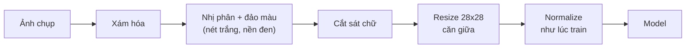

Hiện tượng model giỏi trên tập test nhưng kém trên dữ liệu thật khác phân phối gọi là **domain shift**, một trong những vấn đề lớn nhất khi đem ML ra thực tế.

> [!WARNING]
> Lỗi số một khi test ảnh tự vẽ: quên **đảo màu** (nền trắng, nét đen). Model nhìn thấy "nền sáng" và đoán bừa. Hãy `imshow` ảnh sau tiền xử lý để chắc chắn nó trông giống ảnh MNIST.

## Tổng kết

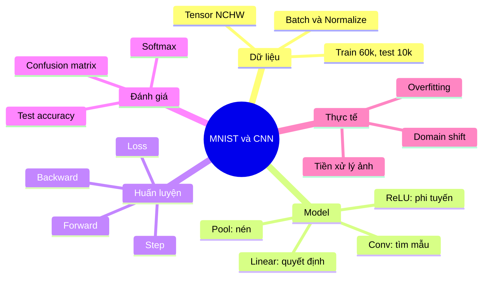

Năm câu để nhớ cả bài:

1. Machine learning là đưa ví dụ có nhãn để máy **tự tìm quy tắc**, thay vì người viết quy tắc.
2. CNN giữ cấu trúc 2 chiều của ảnh: **Conv tìm mẫu, Pool nén, Linear quyết định**.
3. Training là vòng lặp **đoán → đo sai → chỉnh tham số**, lặp qua nhiều batch và epoch.
4. Chỉ **test accuracy** (trên dữ liệu chưa thấy) mới phản ánh năng lực thật.
5. Ngoài đời dữ liệu khác MNIST (domain shift) nên **tiền xử lý phải đưa ảnh về giống MNIST**.

## Kiến thức cần nắm

Tự kiểm tra: nếu giải thích được ngắn gọn bằng lời của mình thì bạn đã nắm.

| Chủ đề | Bạn cần trả lời được |
| --- | --- |
| Dữ liệu | Vì sao tách train/test? `(64, 1, 28, 28)` nghĩa là gì? Vì sao phải normalize? |
| Conv | Kernel làm gì? Vì sao 28 thành 26? Vì sao kernel "tự học" là điểm khác Project 1? |
| Pool | Vì sao lấy max? Pool có tham số không? |
| ReLU | Bỏ ReLU thì mạng 10 tầng khác gì mạng 1 tầng? |
| Linear | Vì sao tầng cuối có đúng 10 neuron và không có ReLU? |
| Training | Loss, gradient, optimizer, learning rate, epoch khác nhau thế nào? |
| Đánh giá | Overfitting nhận ra bằng dấu hiệu nào? Confusion matrix đọc ra sao? |
| Thực tế | Domain shift là gì? Vì sao ảnh tự chụp phải đảo màu và căn giữa? |

> [!TIP]
> Quay lại [Thực hành](./02-thuc-hanh) và thử trả lời từng dòng trong bảng này sau khi chạy xong code. Dòng nào còn mơ hồ thì đọc lại đúng mục đó ở trên.

## Góc chuyên gia

### Hiểu lầm phổ biến

| Hiểu lầm | Sự thật |
| --- | --- |
| "Train accuracy 99% nghĩa là model tốt" | Chỉ test accuracy mới đáng tin. Train cao mà test thấp là overfitting |
| "Nhiều tầng hơn luôn tốt hơn" | Với MNIST, mạng 2 tầng conv đã ~99%. Thêm tầng chỉ tốn thời gian, có khi còn overfit |
| "Softmax 99% nghĩa là model chắc chắn đúng" | Model có thể tự tin sai, nhất là với ảnh lạ khác hẳn dữ liệu train (domain shift) |
| "Model hiểu chữ số như con người" | Nó chỉ khớp mẫu thống kê. Ảnh toàn nhiễu vẫn bị ép phải chọn một trong 10 số |
| "Lỗi là do model" | Phần lớn lỗi nằm ở dữ liệu và tiền xử lý |

### Mẹo và thủ thuật

> [!TIP]
> **Overfit một batch trước.** Trước khi train đầy đủ, thử train trên đúng 1 batch nhỏ nhiều lần. Loss phải về gần 0. Nếu không, code có bug (sai nhãn, quên `step`, sai shape) và train cả dataset cũng vô ích.

> [!TIP]
> **Kiểm tra loss ban đầu.** Với 10 lớp và model chưa học, loss kỳ vọng khoảng $\ln 10 \approx 2.30$. Thấy loss đầu tiên lệch xa con số này (ví dụ 50) thì khởi tạo hoặc normalize đang có vấn đề.

> [!TIP]
> **Đặt seed để tái lập kết quả:** `torch.manual_seed(42)`. Không có seed, mỗi lần chạy accuracy lệch nhẹ vì khởi tạo trọng số và shuffle ngẫu nhiên.

> [!TIP]
> **Luôn nhìn dữ liệu bằng mắt**, cả ảnh đầu vào lẫn ảnh sau tiền xử lý. Phần lớn bug trong computer vision lộ ra ngay khi `imshow`.

### Mở rộng khi bạn muốn đi xa hơn

| Kỹ thuật | Tác dụng | Khi nào dùng |
| --- | --- | --- |
| `padding=1` trong Conv | Giữ nguyên kích thước (28 vẫn là 28), không mất viền | Khi muốn xếp nhiều tầng conv mà ảnh không co nhỏ quá nhanh |
| Dropout | Ngẫu nhiên tắt một phần neuron khi train, giảm học thuộc | Khi test acc thấp hơn train acc rõ rệt |
| Data augmentation | Xoay, dịch, phóng nhẹ ảnh train để tăng đa dạng | Khi dữ liệu ít hoặc cần chịu được ảnh ngoài đời (Project 3) |
| BatchNorm | Chuẩn hóa giữa các tầng, train nhanh và ổn định hơn | Khi mạng sâu hơn |
| LR scheduler | Giảm learning rate dần theo epoch | Khi loss dao động ở cuối quá trình train |
| Transfer learning | Dùng model đã train sẵn rồi tinh chỉnh | Khi bài toán thật, ảnh màu, ít dữ liệu |

> [!NOTE]
> **Receptive field (vùng nhìn):** mỗi ô sau conv đầu nhìn 3x3 pixel, nhưng sau MaxPool và conv thứ hai, mỗi ô nhìn được vùng khoảng 8x8 pixel của ảnh gốc. Đây là lý do xếp nhiều tầng giúp mạng nhìn "to" dần mà kernel vẫn chỉ 3x3.

### Kernel học được gì trong các bài toán CV khác

Ý tưởng "kernel = bộ dò mẫu" vẫn đúng với nhận diện vật thể, nhưng khả năng giải thích giảm dần khi đi sâu vào mạng.

- **Tầng đầu giống nhau ở mọi CNN:** dù train trên MNIST, ImageNet hay ảnh y khoa, kernel đầu tiên đều hội tụ về dò cạnh theo nhiều hướng, dò góc và các mảng màu. Cạnh và màu là cấu trúc phổ quát của ảnh tự nhiên.
- **Tầng sâu ghép dần thành khái niệm:** mỗi kernel nhìn feature map của tầng trước nên dò "tổ hợp của các mẫu".

| Độ sâu | Kernel phản ứng với |
| --- | --- |
| Tầng 1 | Cạnh, góc, mảng màu |
| Tầng 2-3 | Kết cấu: lưới, vân, vảy, lông, họa tiết lặp |
| Tầng 4-5 | Bộ phận: mắt, bánh xe, tai, chữ |
| Tầng cuối | Cả vật thể hoặc cảnh: mặt người, xe, chó |

Vì sao càng sâu càng khó đọc kernel:

- **Nhìn rộng hơn:** nhờ pooling và xếp chồng, mỗi ô tầng sâu có receptive field lớn dù kernel vẫn 3x3.
- **Kernel thật ra là 3x3xC:** ở tầng sâu, mỗi kernel nhìn đồng thời hàng chục đến hàng trăm kênh nên không vẽ ra thành "một hình cạnh" được.
- **Biểu diễn phân tán:** một khái niệm như "bánh xe" thường là tổ hợp nhiều kênh cùng sáng, một kênh cũng có thể tham gia nhiều khái niệm. Hiếm khi có "kernel số 37 = bánh xe".

Với **nhận diện vật thể (object detection)** như YOLO hay Faster R-CNN, phần thân trích đặc trưng (backbone) vẫn là Conv + Pool như trên. Khác biệt nằm ở đầu ra: thay vì Flatten rồi Linear ra 10 điểm, mạng dùng thêm các tầng conv để dự đoán, tại mỗi vị trí trên feature map, hộp bao (x, y, w, h) và nhãn lớp.

Khi không đọc nổi kernel, người ta "nhìn" bên trong mạng bằng:

| Kỹ thuật | Trả lời câu hỏi |
| --- | --- |
| Vẽ feature map từng tầng | Tầng này đang sáng ở đâu trên ảnh? |
| Activation maximization | Ảnh nào làm một kênh sáng nhất? |
| Grad-CAM | Model chọn lớp này vì nhìn vào vùng nào? |

> [!NOTE]
> Với MNIST, mạng nhỏ nên bạn có thể mở trực tiếp 32 kernel tầng đầu ra xem như ảnh 3x3 và thấy ngay cạnh, nét. Đó là lợi thế của bài nhập môn, còn với mạng lớn chỉ làm được ở vài tầng đầu.

### MNIST đã "giải xong"

MNIST là bài toán nhập môn: các mạng hiện đại đạt trên 99,7%, nên chênh lệch 99,0% và 99,3% không còn nhiều ý nghĩa thực tế. Giá trị của nó là **học quy trình**, không phải thi điểm. Khi muốn thử thách thật, chuyển sang Fashion-MNIST (quần áo) hoặc CIFAR-10 (ảnh màu): cùng quy trình nhưng khó hơn nhiều.

> [!WARNING]
> Đừng tune hyperparameter dựa trên điểm test rồi báo cáo chính điểm đó: bạn đang "nhìn trộm" đáp án. Cách đúng là tách thêm tập validation để tune, test chỉ dùng chấm một lần cuối.

## Cheatsheet

| Tình huống | Cần nhớ |
| --- | --- |
| Shape ảnh PyTorch | `(N, C, H, W)` |
| Kích thước sau conv | $n - k + 1$ (không padding, stride 1) |
| Kích thước sau pool 2x2 | chia đôi, làm tròn xuống |
| Tầng cuối bài toán N lớp | `Linear(..., N)`, không ReLU |
| Loss phân loại | `CrossEntropyLoss` (đã gồm softmax, đừng thêm lần nữa) |
| Mỗi batch | `zero_grad` → forward → loss → `backward` → `step` |
| Lúc đánh giá | `model.eval()` và `torch.no_grad()` |
| Transform lúc suy luận | Giống hệt lúc train |

> [!CAUTION]
> `CrossEntropyLoss` đã tích hợp sẵn softmax. Nếu bạn thêm softmax vào cuối model rồi mới đưa vào loss, training vẫn chạy nhưng học kém hiệu quả và rất khó nhận ra lỗi.

## Tiếp theo

- [Thực hành](./02-thuc-hanh)
- [Training model: hiểu trọn quá trình huấn luyện](./03-training-model)
