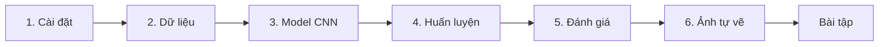
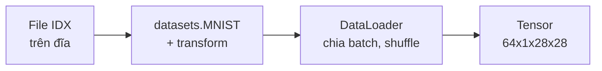
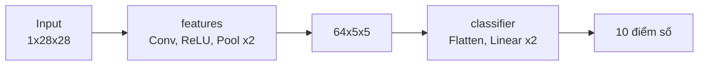
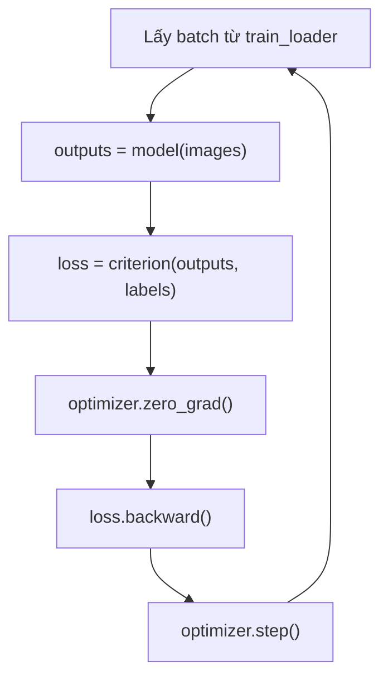
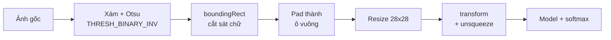

# Thực hành: Nhận diện chữ số viết tay MNIST

Làm theo thứ tự từ trên xuống. Khái niệm chi tiết xem [Lý thuyết](./01-ly-thuyet).

> [!NOTE]
> **Thời gian:** khoảng 45-60 phút trên CPU. **Kết quả:** model ~99% test accuracy và nhận diện được chữ số bạn tự viết.

## Lộ trình thực hành



Một script MNIST đầy đủ gồm 5 phần, tương ứng các mục bên dưới:

| # | Phần | Mục | Điểm cốt lõi |
| --- | --- | --- | --- |
| 1 | Load data | 2 | Dataset + DataLoader, `ToTensor` đưa về `[0, 1]`, `Normalize` đưa về quanh 0 |
| 2 | Định nghĩa model | 3 | Class kế thừa `nn.Module`, gửi lên device bằng `.to(device)` |
| 3 | Loss + optimizer | đầu 4 | `CrossEntropyLoss` cho phân loại 10 lớp, `Adam` hoặc `SGD` |
| 4 | Training loop | 4 | `zero_grad` → forward → `backward` → `step`, lặp theo epoch |
| 5 | Đánh giá | 5 | Trong `torch.no_grad()`, đếm dự đoán đúng trên test set |

> [!TIP]
> Gõ lại code thay vì copy-paste. Mỗi lần gặp lỗi shape hay device là một lần bạn hiểu sâu hơn.

## 1. Cài đặt PyTorch

Tiếp tục làm việc trong **CV Playground**: code model và inference nằm trong `backend/app/cvlib/mnist.py`, script train là `backend/app/cvlib/train.py`, task trên web là `backend/app/tasks/p2_mnist.py`. Venv của playground đã có sẵn `torch` và `torchvision`, chỉ cần cài thêm hai package phục vụ phân tích ngoài app:

```bash
cd cv-playground
python3 -m venv .venv    # bỏ qua nếu đã tạo ở Project 1
source .venv/bin/activate
pip install -r requirements.txt
pip install matplotlib scikit-learn
```

Muốn dùng model tự train thay cho weights mặc định, xem hướng dẫn
[kết nối model với CV Playground](./03-training-model#dung-model-tu-train-trong-cv-playground).
App đọc `mnist_cnn.pt` từ thư mục được cấu hình bằng `CV_MODELS_DIR`; nếu không
có cấu hình hoặc chưa có file, app dùng model mặc định và báo rõ trên UI.

Vai trò từng package:

| Package | Vai trò |
| --- | --- |
| `torch` | Framework deep learning, phần lõi. Cung cấp tensor (mảng nhiều chiều + đạo hàm tự động), tầng mạng (`nn.Conv2d`, `nn.Linear`) và optimizer (`SGD`, `Adam`) |
| `torchvision` | Dataset và transform có sẵn cho computer vision (MNIST, `ToTensor`, `Normalize`) |
| `matplotlib` | Vẽ ảnh và đồ thị, dùng để nhìn dữ liệu và kết quả |
| `scikit-learn` | Machine learning "truyền thống". Ở đây dùng để đánh giá (`accuracy_score`, `confusion_matrix`); cũng có sẵn SVM, RandomForest, KMeans nếu muốn đối chứng với neural net |

Kiểm tra môi trường và chọn thiết bị:

```python
import torch
import torchvision

print("PyTorch:", torch.__version__)

if torch.cuda.is_available():
    device = "cuda"                       # NVIDIA GPU
elif torch.backends.mps.is_available():
    device = "mps"                        # GPU Apple Silicon
else:
    device = "cpu"

print("Device:", device)
```

Với MNIST thì `cpu` đủ nhanh.

> [!WARNING]
> Nhớ `source .venv/bin/activate` mỗi lần mở terminal mới, nếu không `import torch` sẽ báo `ModuleNotFoundError`.

## 2. Dữ liệu MNIST



```python
from torchvision import datasets, transforms
from torch.utils.data import DataLoader

transform = transforms.Compose([
    transforms.ToTensor(),                      # anh -> tensor [0, 1]
    transforms.Normalize((0.1307,), (0.3081,))  # chuan hoa quanh 0
])

train_set = datasets.MNIST("./data", train=True, download=True,
                           transform=transform)
test_set = datasets.MNIST("./data", train=False, download=True,
                          transform=transform)

train_loader = DataLoader(train_set, batch_size=64, shuffle=True)
test_loader = DataLoader(test_set, batch_size=1000, shuffle=False)
```

Vì sao hai loader khác nhau:

| Loader | `batch_size` | `shuffle` | Lý do |
| --- | --- | --- | --- |
| train | 64 | `True` | Trộn thứ tự mỗi epoch để model không học theo thứ tự ảnh |
| test | 1000 | `False` | Chỉ chấm điểm, không có gradient nên batch lớn cho nhanh; thứ tự không quan trọng |

> [!NOTE]
> `0.1307` và `0.3081` là mean và std đã được thống kê sẵn trên toàn bộ 60.000 ảnh train của MNIST, không phải số tự chọn. Chúng nằm trong tuple 1 phần tử vì `Normalize` nhận mean/std theo từng kênh màu: ảnh xám có 1 kênh, ảnh màu RGB sẽ là tuple 3 phần tử.

`download=True` tải 4 file dữ liệu gốc về `./data/MNIST/raw`, mỗi file có bản nén `.gz` và bản đã giải nén. Nếu chạy script từ `backend/app/cvlib`, `./data` chính là `cvlib/data`, đúng convention của repo (dataset đặt trong `cvlib/data`, weights trong `cvlib/models`):

| File | Nội dung |
|---|---|
| `train-images-idx3-ubyte` | 60.000 ảnh train, mỗi ảnh 28x28 pixel |
| `train-labels-idx1-ubyte` | 60.000 nhãn tương ứng (số 0-9) |
| `t10k-images-idx3-ubyte` | 10.000 ảnh test |
| `t10k-labels-idx1-ubyte` | 10.000 nhãn test |

Giải mã tên file: `t10k` = "test 10k"; `idx1`/`idx3` là định dạng nhị phân IDX của MNIST (`idx1` là vector 1 chiều cho nhãn, `idx3` là mảng 3 chiều số ảnh x 28 x 28); `ubyte` = unsigned byte, mỗi pixel/nhãn là 1 byte giá trị 0-255. Kiểm chứng bằng dung lượng: `train-images` nặng đúng 47.040.016 bytes = 16 bytes header + 60.000 x 28 x 28 pixel.

Hai bộ train/test nằm trong 2 file riêng biệt nên **không overlap lẫn nhau**: cờ `train=True/False` chỉ chọn đọc file nào, không phải tự split từ một file chung. Vì sao phải tách biệt xem [Lý thuyết](./01-ly-thuyet).

> [!TIP]
> Chạy lần đầu cần mạng để tải dữ liệu (~11 MB). Từ lần sau, `download=True` tự bỏ qua vì file đã có sẵn trong `./data`.

Xem một batch, **luôn nhìn dữ liệu bằng mắt trước khi train**:

```python
import matplotlib.pyplot as plt

images, labels = next(iter(train_loader))
print(images.shape)   # [64, 1, 28, 28]

fig, axes = plt.subplots(2, 8, figsize=(12, 3))
for i, ax in enumerate(axes.flat):
    ax.imshow(images[i, 0], cmap="gray")
    ax.set_title(int(labels[i]))
    ax.axis("off")
plt.show()
```

Shape `[64, 1, 28, 28]` đọc theo quy ước NCHW của PyTorch: 64 ảnh trong batch, 1 kênh xám, 28x28 pixel. `images[i, 0]` bỏ chiều kênh vì `imshow` chỉ cần ma trận 2D. Chi tiết xem mục Tensor trong [Lý thuyết](./01-ly-thuyet).

> [!NOTE]
> **Kiểm tra bạn làm đúng:** thấy 16 chữ số trắng trên nền đen, nhãn phía trên khớp với hình. Nếu nhãn lệch hình, dữ liệu đang bị sai.

## 3. Xây dựng mạng CNN



```python
import torch.nn as nn


class DigitCNN(nn.Module):
    def __init__(self):
        super().__init__()
        self.features = nn.Sequential(
            nn.Conv2d(1, 32, kernel_size=3),   # 1x28x28 -> 32x26x26
            nn.ReLU(),
            nn.MaxPool2d(2),                    # -> 32x13x13
            nn.Conv2d(32, 64, kernel_size=3),  # -> 64x11x11
            nn.ReLU(),
            nn.MaxPool2d(2),                    # -> 64x5x5
        )
        self.classifier = nn.Sequential(
            nn.Flatten(),                       # -> 1600
            nn.Linear(64 * 5 * 5, 128),
            nn.ReLU(),
            nn.Linear(128, 10),
        )

    def forward(self, x):
        return self.classifier(self.features(x))
```

Kiểm tra shape và số tham số:

```python
model = DigitCNN()
x = torch.randn(1, 1, 28, 28)
print(model(x).shape)                             # [1, 10]
print(sum(p.numel() for p in model.parameters())) # 225034
```

> [!TIP]
> Số tham số tính tay: $320 + 18.496 + 204.928 + 1.290 = 225.034$. Nếu in ra khác con số này, bạn đã sửa kiến trúc ở đâu đó. Cách tính từng tầng xem [Lý thuyết](./01-ly-thuyet).

> [!CAUTION]
> Nếu đổi kernel, thêm/bớt tầng conv hoặc pool, phải tính lại số đầu vào của `nn.Linear(64 * 5 * 5, 128)`. Sai là gặp ngay lỗi `mat1 and mat2 shapes cannot be multiplied`. Cách nhanh nhất: `print(model.features(x).shape)`.

## 4. Huấn luyện



```python
model = DigitCNN().to(device)
criterion = nn.CrossEntropyLoss()
optimizer = torch.optim.Adam(model.parameters(), lr=0.001)

num_epochs = 3
for epoch in range(num_epochs):
    model.train()
    total_loss, correct, seen = 0.0, 0, 0

    for images, labels in train_loader:
        images, labels = images.to(device), labels.to(device)

        outputs = model(images)
        loss = criterion(outputs, labels)

        optimizer.zero_grad()
        loss.backward()
        optimizer.step()

        total_loss += loss.item() * labels.size(0)
        correct += (outputs.argmax(1) == labels).sum().item()
        seen += labels.size(0)

    print(f"Epoch {epoch + 1}/{num_epochs} | "
          f"loss {total_loss / seen:.4f} | "
          f"train acc {correct / seen:.4f}")

torch.save(model.state_dict(), "mnist_cnn.pt")
```

**Kỳ vọng:** loss giảm dần, train accuracy ~98-99% sau 3 epoch. Ví dụ đầu ra hợp lý:

```text
Epoch 1/3 | loss 0.1700 | train acc 0.9480
Epoch 2/3 | loss 0.0500 | train acc 0.9850
Epoch 3/3 | loss 0.0350 | train acc 0.9890
```

(Con số của bạn sẽ lệch chút do khởi tạo ngẫu nhiên.)

> [!NOTE]
> `.to(device)` phải áp cho cả model lẫn dữ liệu, hai bên phải ở cùng thiết bị. `model.train()` bật chế độ huấn luyện, `model.eval()` dùng khi đánh giá.

| Dấu hiệu | Nguyên nhân thường gặp | Cách xử lý |
| --- | --- | --- |
| Loss không giảm, acc ~10% | `lr` quá lớn, hoặc quên `zero_grad`/`step` | Đưa `lr` về `0.001`, kiểm tra 3 dòng cốt lõi |
| Loss thành `nan` | `lr` quá lớn | Giảm `lr` 10 lần |
| `Expected all tensors on the same device` | Model và dữ liệu khác device | Thêm `.to(device)` cho cả hai |
| Chạy rất chậm | Dùng CPU yếu hoặc `batch_size` quá nhỏ | Tăng `batch_size`, hoặc dùng `mps`/`cuda` |

> [!WARNING]
> Đừng bỏ `optimizer.zero_grad()`. Thiếu dòng này, gradient của các batch cộng dồn vào nhau và loss dao động hoặc tăng dần.

> [!TIP]
> Bốn dòng `outputs → loss → zero_grad → backward → step` là khuôn mẫu của **mọi** training loop PyTorch, từ MNIST đến mô hình ngôn ngữ lớn. Thuộc lòng nó là đủ.

## 5. Đánh giá

```python
model.eval()
all_preds, all_labels = [], []

with torch.no_grad():
    for images, labels in test_loader:
        preds = model(images.to(device)).argmax(1).cpu()
        all_preds.extend(preds.tolist())
        all_labels.extend(labels.tolist())

from sklearn.metrics import accuracy_score, confusion_matrix, \
    ConfusionMatrixDisplay

print("Test acc:", accuracy_score(all_labels, all_preds))

cm = confusion_matrix(all_labels, all_preds)
ConfusionMatrixDisplay(cm).plot(cmap="Blues")
plt.show()
```

> [!NOTE]
> `model.eval()` + `torch.no_grad()` là cặp đi cùng nhau: cái đầu chuyển model sang chế độ đánh giá, cái sau tắt tính gradient để nhanh hơn và tiết kiệm bộ nhớ.

**Cách đọc confusion matrix:** hàng là nhãn đúng, cột là nhãn model đoán. Đường chéo là số lần đoán đúng, ô ngoài đường chéo là các cặp bị nhầm. Hãy tìm ô ngoài đường chéo sáng nhất, thường là 4↔9 hoặc 3↔5.

Xem trực tiếp các mẫu sai:

```python
wrong_imgs, wrong_p, wrong_l = [], [], []
with torch.no_grad():
    for images, labels in test_loader:
        preds = model(images.to(device)).argmax(1).cpu()
        mask = preds != labels
        wrong_imgs.extend(images[mask])
        wrong_p.extend(preds[mask].tolist())
        wrong_l.extend(labels[mask].tolist())
        if len(wrong_imgs) >= 16:
            break

fig, axes = plt.subplots(2, 8, figsize=(12, 3))
for i, ax in enumerate(axes.flat):
    ax.imshow(wrong_imgs[i][0], cmap="gray")
    ax.set_title(f"doan {wrong_p[i]}, dung {wrong_l[i]}")
    ax.axis("off")
plt.show()
```

> [!TIP]
> Nhìn các ảnh sai, bạn sẽ thấy nhiều ảnh chính con người cũng đọc nhầm. Đó là dấu hiệu model đã gần chạm giới hạn của dữ liệu, không phải lỗi code.

Lấy độ tin cậy bằng softmax:

```python
probs = torch.softmax(model(image), dim=1)
conf, pred = probs.max(1)
```

## 6. Nhận diện chữ số tự vẽ: task `p2-digit`

Viết một chữ số ra giấy, chụp lại, rồi tiền xử lý cho giống MNIST (xám, 28x28, nền đen chữ trắng, canh giữa):



Trong CV Playground, tiền xử lý và suy luận nằm trong `backend/app/cvlib/mnist.py`, cùng file với `DigitCNN` để mọi nơi dùng chung đúng một bản:

```python
import cv2
import numpy as np
import torch

MNIST_MEAN = 0.1307
MNIST_STD = 0.3081


def preprocess(img, invert="auto", pad=20):
    """BGR ndarray -> 28x28 uint8 giong MNIST (net trang, nen den)."""
    gray = cv2.cvtColor(img, cv2.COLOR_BGR2GRAY)
    _, binary = cv2.threshold(gray, 0, 255,
                              cv2.THRESH_BINARY_INV + cv2.THRESH_OTSU)
    if invert == "always" or (invert == "auto" and (binary > 0).mean() > 0.5):
        binary = cv2.bitwise_not(binary)
    coords = cv2.findNonZero(binary)
    if coords is None:                       # anh trong: bao loi mem
        return cv2.resize(binary, (28, 28))
    x, y, w, h = cv2.boundingRect(coords)
    digit = binary[y:y + h, x:x + w]
    side = max(w, h) + pad
    canvas = np.zeros((side, side), np.uint8)
    canvas[(side - h) // 2:(side - h) // 2 + h,
           (side - w) // 2:(side - w) // 2 + w] = digit
    return cv2.resize(canvas, (28, 28))


def predict(model, img28):
    """28x28 uint8 -> top-3 [{'label': '7', 'prob': 0.98}, ...]."""
    x = torch.tensor(img28, dtype=torch.float32).div(255)
    x = (x - MNIST_MEAN) / MNIST_STD
    with torch.no_grad():
        probs = torch.softmax(model(x[None, None]), dim=1)[0]
    top = probs.topk(3)
    return [{"label": str(int(i)), "prob": round(float(p), 4)}
            for p, i in zip(top.values, top.indices)]
```

Khác bản thử nghiệm trong notebook ở hai điểm: `preprocess` nhận `ndarray` BGR (vì ảnh đến từ upload, không phải đường dẫn), và `predict` tự normalize bằng đúng `MNIST_MEAN`/`MNIST_STD` đã dùng lúc train thay vì phụ thuộc `transform` bên ngoài.

Các điểm đáng chú ý trong `preprocess`:

- **`THRESH_BINARY_INV` + `invert`:** đảo màu nét chữ đen trên giấy trắng thành nét trắng trên nền đen giống MNIST. Chế độ `auto` tự đảo khi phần trắng chiếm quá nửa ảnh, an toàn cho cả ảnh đã đúng chiều.
- **`THRESH_OTSU`:** tự chọn ngưỡng, không cần đoán số.
- **Pad thành ô vuông:** giữ đúng tỉ lệ chữ, nếu resize thẳng từ hình chữ nhật chữ sẽ bị méo.
- **`x[None, None]`:** thêm chiều batch và chiều kênh, model luôn cần `(N, C, H, W)` dù chỉ có 1 ảnh 1 kênh.

### Đăng ký task

`backend/app/tasks/p2_mnist.py` bọc `preprocess` + `predict` thành task `p2-digit`. Model nạp lazy ở lần gọi đầu để không kéo torch (~1-3 s) khi backend khởi động:

```python
@register_task(
    id="p2-digit",
    name="Recognize handwritten digit",
    project="mnist-digits",
    description="Classify a handwritten digit (0-9) with a CNN "
                "trained on MNIST.",
    params=[
        {"name": "invert", "type": "select",
         "options": ["auto", "always", "never"],
         "default": "auto", "label": "Invert polarity"},
    ],
    output="image+data",
    result_tab="output",
    docs=DOCS_DIR / "p2-digit.md",
)
def p2_digit(img, params):
    mnist, model = _get_model()
    img28 = mnist.preprocess(img, invert=params.get("invert", "auto"))
    top3 = mnist.predict(model, img28)
    # show exact 28x28 the model saw, phong to cho de nhin
    view = cv2.resize(img28, (280, 280), interpolation=cv2.INTER_NEAREST)
    return view, {"top3": top3}
```

(Snippet rút gọn: bản đầy đủ trong repo còn param `pad` và trả thêm `note` khi ảnh trống không detect được chữ.)

Chiêu hay của task này: nó trả về **chính ảnh 28x28 model nhìn thấy** (phóng to lên 280x280), nên khi đoán sai bạn nhìn ngay được tiền xử lý đúng hay chưa, thay vì chỉ có con số accuracy.

### Chạy thử

Chạy `./dev.sh`, mở http://localhost:5173, chọn `p2-digit`, upload ảnh chữ số tự chụp. Kết quả gồm ảnh đã tiền xử lý và badge `top3` kèm xác suất.

| Triệu chứng | Nguyên nhân | Cách sửa |
|-------------|-------------|----------|
| Đoán sai, conf cao | Sai polarity, nền trắng chữ đen | Ảnh 28x28 trả về phải là nét sáng/nền tối; thử `invert = always` |
| Conf thấp | Chữ nhỏ, lệch góc | Crop sát + tăng `pad` |
| Kết quả thất thường | Ánh sáng, nét khác MNIST | Viết nét đậm, chụp đủ sáng |

> [!TIP]
> 90% lỗi suy luận nằm ở tiền xử lý chứ không ở model. Task này đã trả ảnh 28x28 về UI nên bạn luôn nhìn được chính xác thứ đưa vào model mà không cần `imshow`.

> [!WARNING]
> Normalize lúc inference phải dùng đúng `MNIST_MEAN`/`MNIST_STD` đã train. Đây chính là domain shift: model chỉ giỏi trên dữ liệu trông giống dữ liệu nó đã học.

## Bài tập

Sắp xếp theo độ khó tăng dần:

| # | Bài tập | Mục đích | Gợi ý |
| --- | --- | --- | --- |
| 1 | Train với `lr=0.1` và `lr=0.00001`, quan sát loss | Hiểu vai trò learning rate | Chỉ đổi một tham số |
| 2 | Vẽ đồ thị loss theo epoch | Biết theo dõi training | Lưu loss mỗi epoch vào list, `plt.plot` |
| 3 | Tính accuracy riêng từng chữ số, chữ nào khó nhất? | Phân tích lỗi | Dùng đường chéo chia tổng hàng của confusion matrix |
| 4 | Thêm `nn.Dropout(0.25)` trước tầng linear cuối, so sánh overfitting | Làm quen regularization | So khoảng cách train acc và test acc |
| 5 | Train trên EMNIST (`split="letters"`) để nhận diện chữ cái | Tự áp dụng sang bài toán mới | Tầng cuối đổi số neuron cho khớp số lớp |
| 6 | Thêm task `p2-fashion` vào CV Playground: train Fashion-MNIST rồi nhận diện qua web | Đưa model thứ hai lên cùng app | Sao chép pattern của `p2-digit`: cvlib module + lazy load + `register_task` |

## Checklist tự đánh giá

- [ ] Vai trò Dataset, DataLoader, batch, shuffle.
- [ ] 3 loại tầng CNN và chức năng từng loại.
- [ ] 5 dòng cốt lõi của training loop.
- [ ] Train acc vs test acc, overfitting là gì.
- [ ] Vì sao phải tiền xử lý ảnh tự vẽ, domain shift là gì.
- [ ] Bọc được `preprocess` + `predict` thành task trên CV Playground trả `image+data`.

## Cheatsheet

| Việc cần làm | Đoạn code |
| --- | --- |
| Chọn device | `cuda` → `mps` → `cpu` |
| Xem shape một batch | `images, labels = next(iter(train_loader))` |
| Chuyển sang chế độ train/eval | `model.train()` / `model.eval()` |
| Tắt gradient khi đánh giá | `with torch.no_grad():` |
| Lấy lớp dự đoán | `outputs.argmax(1)` |
| Lấy xác suất | `torch.softmax(outputs, dim=1)` |
| Lưu / nạp trọng số | `torch.save(model.state_dict(), p)` / `model.load_state_dict(torch.load(p))` |
| Ảnh đơn lẻ vào model | `transform(img).unsqueeze(0)` |

## Tiếp theo

- [Training model: hiểu trọn quá trình huấn luyện](./03-training-model)
- [Project 3: Nhận diện biển báo giao thông](../03-bien-bao-giao-thong/01-ly-thuyet)
