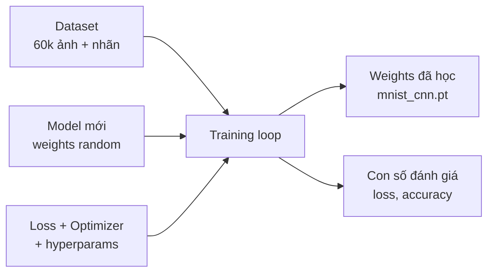

# Training model: hiểu trọn quá trình huấn luyện

Đây là lần đầu bạn train một model thật, nên tài liệu này đi chậm: giải thích training là cái gì, bỏ gì vào, lấy gì ra, đọc kết quả thế nào, rồi mới chạy `backend/app/cvlib/train.py` của CV Playground từng bước một. Khái niệm nền xem [Lý thuyết](./01-ly-thuyet), code mẫu xem [Thực hành](./02-thuc-hanh).

# Phần 1: Hiểu quá trình train

## Train model nghĩa là gì

Hãy tưởng tượng bạn dạy một đứa trẻ nhận biết chữ số. Bạn không giải thích "số 7 là hai nét, một nét ngang một nét chéo". Bạn giơ lên từng tấm thẻ: "đây là số 7", "đây là số 3". Đứa trẻ đoán, sai thì bạn sửa, đúng thì thôi. Lặp lại vài nghìn lần, nó tự rút ra quy luật.

Train model y hệt vậy:

- **Tấm thẻ** = ảnh trong dataset, kèm nhãn đúng.
- **Đứa trẻ đoán** = model chạy forward, ra 10 con số.
- **Bạn sửa** = loss function đo mức sai, optimizer chỉnh weights.
- **Lặp lại vài nghìn lần** = training loop qua từng batch, nhiều epoch.

Điểm khác duy nhất: "đứa trẻ" của bạn chỉ là một cụm ~225.000 con số (weights), và "sửa" là phép trừ gradient. Phần còn lại giống hệt.

## Input của một lần train

Train cần đủ 5 thứ, thiếu cái nào cũng không chạy:

| Thành phần | Trong project này | Vai trò |
|---|---|---|
| Dataset có nhãn | MNIST: 60.000 ảnh train | "Bộ thẻ" để học |
| Kiến trúc model | `DigitCNN` (~225k params) | Bộ khung chứa weights, khởi đầu là số random |
| Loss function | `CrossEntropyLoss` | Thước đo "sai bao nhiêu" |
| Optimizer | `Adam`, lr=0.001 | Cái tay chỉnh weights theo gradient |
| Hyperparameters | epochs=3, batch_size=64 | Các núm vặn bạn chọn bằng tay |



Lưu ý quan trọng: model lúc khởi tạo là **random**. Nó đoán đúng ~10% (đoán mò trong 10 class). Toàn bộ "trí tuệ" của model sau khi train nằm trong weights được cập nhật dần, không có gì khác.

## Output: train xong bạn cầm gì trong tay

### File weights (`.pt`)

`torch.save(model.state_dict(), "mnist_cnn.pt")` lưu ra một file ~0.9 MB. `state_dict` đơn giản là dictionary: tên tầng → tensor weights. Mở thử:

```python
state = torch.load("models/mnist_cnn.pt", weights_only=True)
print(list(state.keys()))  # ['features.0.weight', 'features.0.bias', ...]
```

> [!CAUTION]
> File `.pt` **không phải** model hoàn chỉnh, nó chỉ là đống số. Muốn dùng phải có code kiến trúc khớp từng key (`DigitCNN` trong `cvlib/mnist.py`). Đổi kiến trúc dù chỉ một con số trong `nn.Linear(128, 10)` là file weights cũ vứt đi, phải train lại. Đây là lý do `load_model()` trong `mnist.py` luôn dựng `DigitCNN()` trước rồi mới `load_state_dict()`.

### Con số đánh giá

Train xong bạn có: loss cuối mỗi epoch, train accuracy, và quan trọng nhất là **test accuracy** trên 10.000 ảnh model chưa từng thấy. Con số này quyết định model dùng được hay không, chứ không phải train accuracy.

## Vòng lặp train, phóng to từng dòng

Training loop chỉ có 5 dòng cốt lõi, lặp đi lặp lại:

```python
for images, labels in train_loader:    # 1 batch = 64 anh + 64 nhan dung
    outputs = model(images)            # forward: model doan, ra 10 so/anh
    loss = criterion(outputs, labels)  # loss: do muc sai
    optimizer.zero_grad()              # xoa gradient cu
    loss.backward()                    # tinh gradient: moi weight anh huong the nao toi loss
    optimizer.step()                   # cap nhat weights theo huong giam loss
```

Đếm cho vui: 60.000 ảnh / batch 64 ≈ **938 iterations mỗi epoch**, nhân 3 epoch ≈ **2.800 lần cập nhật weights**. Từ random lên ~99% chỉ sau chưa đầy 3 nghìn bước chỉnh. Đây là lý do gradient descent đáng kinh ngạc.

Ba khái niệm hay nhầm:

- **Iteration (step):** một lần `optimizer.step()`, tức xử lý xong 1 batch.
- **Epoch:** duyệt hết 60.000 ảnh một lần = 938 iterations.
- **Batch:** nhóm ảnh xử lý cùng lúc. Batch 1 thì nhiễu, batch cả dataset thì chậm và tốn RAM; 64 là điểm cân bằng kinh điển.

## Dữ liệu lấy từ đâu

Với MNIST thì nhàn: `datasets.MNIST(root, download=True)` tự tải về, bung 4 file `.gz` (ảnh + nhãn của train và test, bảng tên file xem [Thực hành](./02-thuc-hanh)) vào `data/MNIST/raw`, tổng ~11 MB nén. Lần đầu chạy cần mạng, từ lần sau đọc file local, offline thoải mái.

Khi làm project khác, data đến từ các nguồn:

- **Built-in datasets:** `torchvision.datasets` có sẵn CIFAR-10, Fashion-MNIST, EMNIST... một dòng là có data chuẩn.
- **Hugging Face `datasets` / Kaggle:** kho dataset cộng đồng, từ ảnh đến text đến âm thanh.
- **Tự thu thập:** chụp, crawl, gán nhãn tay. Project 3 (biển báo giao thông) sẽ chạm vào dạng data "ngoài đời" này, lộn xộn hơn nhiều.

> [!TIP]
> Thói quen vàng: **luôn nhìn data bằng mắt trước khi train**. `imshow` vài chục ảnh, kiểm tra nhãn có đúng không. Bug dữ liệu (nhãn lệch, ảnh hỏng, invert ngược) là nguyên nhân số 1 khiến model "học mãi không khôn", và không optimizer nào cứu được data sai.

## Đọc kết quả train: tốt hay chưa?

Log của `train.py` trông thế này:

```
Epoch 1/3 | loss 0.2538 | train acc 0.9206
Epoch 2/3 | loss 0.0730 | train acc 0.9774
Epoch 3/3 | loss 0.0492 | train acc 0.9849
Test acc: 0.9896 (9896/10000)
```

Đọc như thế nào:

- **Loss giảm đều mỗi epoch** = model đang học. Loss đứng yên hoặc nhảy loạn là có vấn đề.
- **Train acc ≈ test acc** = học quy luật thật. Khoảng cách nhỏ (98.5% vs 98.9%) là bình thường.
- **Train acc >> test acc** (ví dụ 99.9% vs 90%) = overfitting, model thuộc lòng tập train.
- **Acc quanh 0.10** = đoán mò, tương đương chưa học gì. Kiểm tra lại code và nhãn.
- **Loss = NaN** = thường do learning rate quá lớn, gradient nổ.

> [!NOTE]
> Mỗi lần chạy kết quả sẽ lệch nhau một chút (weights khởi tạo random, batch shuffle random). Sai số ±0.3% giữa hai lần train là chuyện thường, đừng hoảng.

## Những bẫy người mới hay vấp

- **Quên `model.eval()` + `torch.no_grad()` khi đánh giá:** không có thì model vẫn ở chế độ train và tốn thêm bộ nhớ tính gradient vô ích.
- **Transform khác nhau giữa train và inference:** model học trên ảnh normalize bằng `MNIST_MEAN/STD`, thì lúc predict phải normalize y hệt. Đây là lý do hai hằng số này được export trong `cvlib/mnist.py` để mọi nơi dùng chung.
- **Shuffle test set:** không sai, nhưng vô nghĩa và làm khó so khớp mẫu sai. Chỉ train mới cần shuffle.
- **Chọn hyperparameters theo test acc:** thử 50 bộ tham số rồi lấy bộ có test acc cao nhất nghĩa là bạn đang "fit" cả tập test. Cách chuẩn là tách thêm tập validation (sẽ gặp ở project sau), còn giờ cứ biết cái bẫy này tồn tại.

# Phần 2: Step by step chạy `train.py`

Toàn bộ phần trên đã được đóng gói sẵn trong `backend/app/cvlib/train.py`. Giờ chạy thật.

## Bước 0: Môi trường

Venv của CV Playground đã có sẵn `torch`, `torchvision`, `opencv-python-headless`. Nếu đã theo [Thực hành](./02-thuc-hanh) thì bỏ qua:

```bash
cd cv-playground
python3 -m venv .venv
source .venv/bin/activate
pip install -r requirements.txt
```

## Bước 1: Hiểu cấu trúc project

```
cv-playground/backend/app/
├── cvlib/
│   ├── data/         # MNIST tu download vao day lan chay dau
│   ├── models/       # file .pt output cua train
│   ├── mnist.py      # kien truc DigitCNN + preprocess + load_model + predict
│   └── train.py      # script train standalone, chay bang command line
└── tasks/
    └── p2_mnist.py   # task p2-digit wrap mnist.py cho web app
```

Tách riêng `mnist.py` (định nghĩa + inference) và `train.py` (training) là pattern phổ biến: code dùng model chỉ import phần inference, không lôi theo cả training loop. Task `p2-digit` trên web app cũng chỉ import `mnist.py`.

## Bước 2: Chạy train lần đầu

```bash
.venv/bin/python backend/app/cvlib/train.py
```

Script tự làm hết: tải MNIST về `cvlib/data` nếu chưa có, dựng `DigitCNN`, train 3 epoch trên CPU, chấm điểm trên test set, lưu weights vào `cvlib/models/mnist_cnn.pt`. (Đường dẫn trong script tính theo vị trí file nên chạy từ đâu cũng được; `cd backend/app/cvlib` rồi `python train.py` cũng tương đương.)

> [!NOTE]
> Mặc định `--device cpu`. Nghe ngược đời nhưng có lý do: MNIST nhỏ, CPU train xong trong ~1 phút, và `mps` từng crash với torch 2.15 trên macOS 14 (ghi chú trong help của script). Với dataset nhỏ, CPU ổn định quan trọng hơn GPU nhanh.

## Bước 3: Đọc output

Kết quả mong đợi:

```
PyTorch 2.x.x | device: cpu
train: 60000 imgs | test: 10000 imgs
DigitCNN params: 225,034
Epoch 1/3 | loss 0.2538 | train acc 0.9206
Epoch 2/3 | loss 0.0730 | train acc 0.9774
Epoch 3/3 | loss 0.0492 | train acc 0.9849
Test acc: 0.9896 (9896/10000)
  digit 0: 0.9939 (980 samples)
  digit 1: 0.9956 (1135 samples)
  ...
Saved /path/to/models/mnist_cnn.pt (0.9 MB)
```

Ba điều kiểm tra ngay:

1. **Loss giảm, acc tăng qua từng epoch** → training hoạt động.
2. **Test acc ~0.99** → model dùng được. Dưới 0.95 có gì đó lạ.
3. **Per-digit accuracy** → script in accuracy riêng từng chữ số. Chữ nào thấp bất thường thường là 4, 5, 9 vì dễ nhầm cặp 4↔9, 5↔3.

## Bước 4: Kiểm chứng file output

```bash
ls -lh backend/app/cvlib/models/mnist_cnn.pt   # ~0.9 MB
```

Rồi test "end to end", load lại file và predict thử một ảnh test (chạy python từ `backend/app/cvlib` để import được `mnist`):

```python
import numpy as np
from mnist import load_model, predict
from torchvision import datasets

model = load_model("models/mnist_cnn.pt")

raw = datasets.MNIST("data", train=False)[0][0]   # anh PIL dau tien cua test set
img28 = np.array(raw)                            # 28x28 uint8, san sang cho predict
print(predict(model, img28))
# [{'label': '7', 'prob': 0.9999}, ...]
```

Nếu load được và predict đúng, pipeline train → lưu → load → inference đã khép kín. Đây mới là bài test thật của quá trình train, chứ không phải con số accuracy. File `models/mnist_cnn.pt` vừa sinh ra cũng chính là file task `p2-digit` trong CV Playground nạp lên khi chạy, nên train xong là web app dùng được model mới ngay.

## Bước 5: Thử nghiệm (quan trọng nhất để học)

`train.py` nhận tham số, đừng ngại vặn:

```bash
# chay tu backend/app/cvlib
python train.py --epochs 5                    # train lau hon
python train.py --lr 0.1                      # lr qua lon: xem loss nhay loan
python train.py --lr 0.00001                  # lr qua nho: loss giam i ach
python train.py --batch-size 8                # batch nho: train cham hon, loss nhieu hon
python train.py --out models/mnist_v2.pt      # luu file khac ten, giu lai ban cu
```

Gợi ý thí nghiệm theo thứ tự:

1. `--lr 0.1`: quan sát loss không giảm hoặc tăng, acc dậm chân ~0.10. Đây là cảm giác "lr quá lớn nhảy qua đáp án".
2. `--epochs 10`: test acc có tăng nhiều không? Thường chững quanh 0.99, và train acc bắt đầu vượt test acc = dấu hiệu overfitting sớm.
3. Train lại y hệt hai lần, so sánh test acc: thấy ngay tính random của quá trình.

> [!TIP]
> Mỗi lần thử nghiệm đổi tên file output (`--out`). Giữ lại weights cũ cho phép so sánh, và tránh ghi đè mất model đang chạy tốt.

## Troubleshooting

| Triệu chứng | Nguyên nhân thường gặp | Cách xử lý |
|---|---|---|
| Lỗi download MNIST | Mất mạng, server chặn | Chạy lại, hoặc tải tay 4 file `.gz` bỏ vào `data/MNIST/raw` |
| Loss = NaN | lr quá lớn | Giảm `--lr` xuống 0.001 hoặc nhỏ hơn |
| Acc kẹt quanh 0.10 | Model học được 0 gì: bug forward, nhãn lệch | Kiểm tra shape output `[batch, 10]`, xem lại data bằng mắt |
| Crash trên `mps` | Lỗi torch/macOS đã ghi trong help | `python train.py --device cpu` |
| `load_state_dict` báo key mismatch | Kiến trúc `DigitCNN` đã đổi sau khi train | Phải train lại, weights cũ không dùng được |

## Checklist tự kiểm tra

- [ ] Nêu được 5 input bắt buộc của một lần train.
- [ ] Giải thích được file `.pt` chứa gì và vì sao cần code kiến trúc đi kèm.
- [ ] Phân biệt iteration, batch, epoch.
- [ ] Đọc được log: loss giảm nghĩa là gì, overfitting nhìn ở đâu.
- [ ] Train được từ command line, đổi được `--epochs`, `--lr`, `--out`.
- [ ] Load lại file `.pt` và predict được một ảnh.

## Tiếp theo

- [Project 3: Nhận diện biển báo giao thông](../03-bien-bao-giao-thong/01-ly-thuyet)
