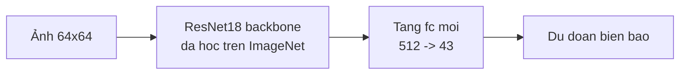

# Project 3: Nhận diện biển báo giao thông

Project cuối đưa pipeline deep learning vào bài toán gần với thực tế: nhận diện **43 loại biển báo giao thông** trên dataset GTSRB (German Traffic Sign Recognition Benchmark), ~50.000 ảnh màu được cắt từ cảnh đường thật.

So với MNIST, mọi thứ khó hơn một bậc:

- Ảnh màu, kích thước không đồng nhất, nhiễu và ánh sáng thật.
- 43 lớp thay vì 10, và số mẫu các lớp **mất cân bằng** (lớp nhiều nhất gấp ~10 lần lớp ít nhất).
- Một số biển báo nhìn rất giống nhau (giới hạn 20/30/50 km/h).

Đổi lại, bạn sẽ học hai kỹ thuật quan trọng nhất của CV hiện đại: **data augmentation** và **transfer learning**.

## Mục tiêu

Sau project này bạn có thể:

- Khám phá và đánh giá chất lượng một dataset ảnh thực tế (EDA).
- Thiết kế pipeline augmentation hợp lý.
- Dùng pretrained model (ResNet18) để đạt accuracy cao với ít dữ liệu và ít code hơn train từ đầu.
- Phân tích lỗi theo từng lớp thay vì chỉ nhìn accuracy tổng.

## Sản phẩm cuối

Script nhận ảnh biển báo bất kỳ, trả về tên biển và top-3 dự đoán kèm độ tin cậy:

```bash
python src/predict.py sign.jpg
# Stop (0.94) | Yield (0.04) | No entry (0.01)
```

## Chuẩn bị

- Hoàn thành [Project 2](../02-mnist-chu-so-viet-tay/01-ly-thuyet): training loop ở đây tái sử dụng gần nguyên xi.
- ~500MB dung lượng cho dataset và pretrained weights.

> [!TIP]
> Cách học hiệu quả: đọc lướt phần lý thuyết dưới đây để nắm ý chính, làm [thực hành](./02-thuc-hanh) đến đâu quay lại đọc kỹ khái niệm đó.

## Dataset thực tế khác MNIST thế nào

GTSRB (German Traffic Sign Recognition Benchmark) gồm ~50.000 ảnh biển báo cắt từ cảnh đường thật, 43 lớp. So với MNIST:

- Ảnh màu, kích thước **không đồng nhất** (~15x15 đến ~250x250).
- Nhiễu và ánh sáng thật: ảnh tối, ngược sáng, biển bị che, chụp nghiêng.
- Số mẫu **mất cân bằng**: lớp nhiều nhất gấp ~10 lần lớp ít nhất.
- Một số lớp nhìn gần giống nhau (cụm giới hạn tốc độ chỉ khác con số).

## EDA: khám phá dữ liệu trước khi model

Với dataset sạch như MNIST có thể bỏ qua, nhưng với dữ liệu thật **EDA quyết định một nửa chất lượng model**. Quy trình:

1. Đếm số mẫu mỗi lớp, phát hiện mất cân bằng.
2. Đo kích thước ảnh, chọn kích thước đầu vào cố định (64x64 là cân bằng tốt).
3. Nhìn mẫu bằng mắt: phát hiện ảnh tối, nghiêng, bị che.
4. Viết nhận xét thành quyết định thiết kế:

| Quan sát | Hệ quả cho model |
|----------|------------------|
| Ảnh tối/ngược sáng | Cần augmentation độ sáng/tương phản |
| Biển chụp nghiêng | Cần augmentation xoay, affine nhẹ |
| Kích thước lộn xộn | Resize cố định, chấp nhận ảnh nhỏ bị mờ |
| Lớp mất cân bằng | Đánh giá per-class, weighted loss/sampler |
| Lớp giống nhau | Cần confusion matrix, top-k accuracy |

## Data augmentation

Augmentation là **biến đổi ảnh train ngẫu nhiên**: xoay nhẹ, tối/sáng, dịch chuyển. Model mỗi epoch thấy phiên bản hơi khác của cùng ảnh nên học đặc trưng bền vững thay vì học thuộc pixel. Đây là cách rẻ nhất để tăng accuracy.

### Nguyên tắc vàng: không phá nhãn

Chỉ dùng phép biến đổi giữ nguyên ý nghĩa ảnh:

- Xoay ±10-15 độ: biển nghiêng vẫn là biển đó. Xoay 90 độ thì mũi tên sai nghĩa.
- ColorJitter sáng/tối/tương phản: an toàn, đúng với ảnh chụp nhiều điều kiện sáng.
- **Không lật ngang** cho dataset này: biển "rẽ trái" lật thành "rẽ phải" là đổi nhãn.

Augmentation **chỉ áp cho train set**. Test set giữ nguyên để đánh giá công bằng.

### Đối phó mất cân bằng

Hai cách phổ biến, dùng một trong hai:

- **WeightedRandomSampler:** mỗi epoch lấy các lớp với tần suất đều nhau (lớp ít mẫu được lặp lại, kèm augmentation nên không trùng hệt).
- **Weighted loss:** `CrossEntropyLoss(weight=...)` phạt nặng hơn khi sai lớp ít mẫu.

## Transfer learning

Train CNN từ đầu cho 43 lớp với ~26k ảnh là khó: model phải tự học mọi thứ từ biên, màu đến hình tròn, con số. Transfer learning đi đường tắt: lấy mạng đã học trên ImageNet (1.2 triệu ảnh, 1000 lớp) nơi các tầng đầu đã biết nhận đặc trưng cơ bản, chỉ cần dạy lại phần cuối.



ResNet là chuỗi khối conv có **skip connection** (đầu ra = đầu vào + hàm đã học), giúp mạng sâu train được không mất gradient. `layer1` đến `layer4` trích đặc trưng độ trừu tượng tăng dần, `fc` là tầng phân loại cuối.

### Hai chiến lược

- **Feature extraction:** đóng băng toàn bộ backbone (`requires_grad=False`), chỉ train tầng `fc` mới. Nhanh, ít overfit, phù hợp bước đầu.
- **Fine-tune:** mở khối cuối (ví dụ `layer4`) train tiếp với lr nhỏ hơn 10 lần. Accuracy cao hơn nhưng chậm và dễ overfit nếu lr cao.

Workflow chuẩn: feature extraction trước, đo accuracy, chưa đạt thì fine-tune `layer4`.

> [!IMPORTANT]
> Model pretrained ImageNet được train với `Normalize(mean=[0.485,0.456,0.406], std=[0.229,0.224,0.225])`. Phải dùng đúng chuẩn hóa đó ở cả train lẫn predict, không thì backbone nhận dữ liệu lệch phân phối.

## Đánh giá theo lớp

Accuracy tổng 96% có thể giấu đi một lớp chỉ đúng 60%. Với nhiều lớp và mất cân bằng, phải:

- Tính **per-class accuracy**, sắp xếp lớp yếu nhất.
- Vẽ confusion matrix theo **cụm hay nhầm** (ví dụ cụm giới hạn tốc độ) thay vì toàn bộ 43x43.
- Phân loại lỗi: lớp ít mẫu yếu → thêm sampler; nhầm trong cụm giống nhau → tăng input size; sai trên ảnh tối → augmentation mạnh hơn.

## Classification vs detection

Model này chỉ **phân loại** ảnh đã cắt sẵn biển báo, không tìm được biển trong ảnh cảnh đường toàn cảnh. Đưa ảnh không phải biển báo vào thì nó vẫn đoán bừa, đôi khi với độ tin cậy cao (bản chất softmax). Tìm vị trí đối tượng trong ảnh lớn là bài toán detection, nội dung của Project 5 trong lộ trình mở rộng.

## Tiếp theo

- [Thực hành](./02-thuc-hanh)
