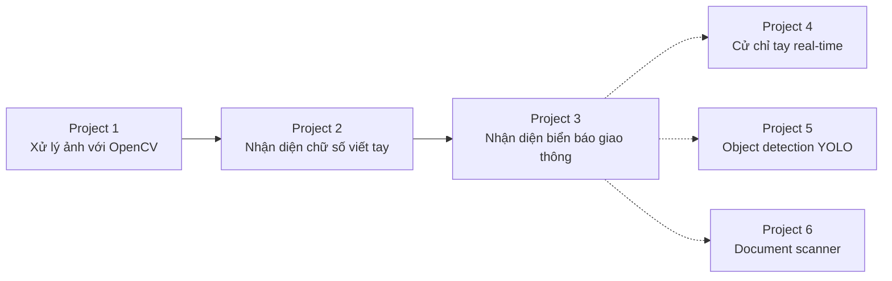
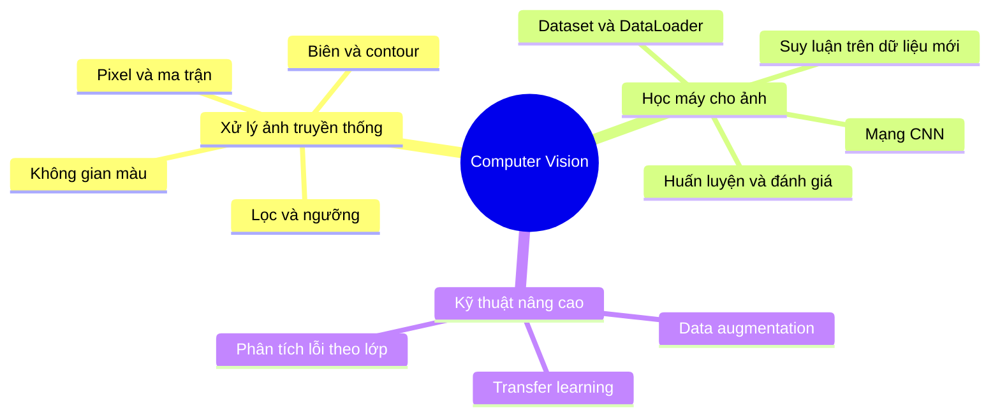

# Học Computer Vision qua project thực hành

Bộ tài liệu này là lộ trình tự học Computer Vision (CV) dành cho người **đã biết Python nhưng chưa từng làm xử lý ảnh hay machine learning**. Thay vì học lý thuyết rời rạc, bạn sẽ học qua project thực hành có độ khó tăng dần, mỗi project đều tạo ra một sản phẩm chạy được.

Computer Vision (thị giác máy tính) là lĩnh vực dạy máy tính "hiểu" ảnh và video. Lộ trình này đi từ thao tác ảnh thủ công (không cần machine learning) đến huấn luyện mạng neuron thực sự, để bạn thấy rõ ranh giới giữa hai thế hệ kỹ thuật. Gồm 6 project: 3 project đầu có docs chi tiết trong bộ tài liệu này, 3 project sau là phần mở rộng để bạn tự triển khai.

## Yêu cầu trước khi bắt đầu

- Python 3.10 trở lên, biết viết hàm, class, dùng pip.
- NumPy ở mức cơ bản (tạo mảng, indexing, slicing). Nếu chưa rành, phần [Ảnh là ma trận](./01-opencv-co-ban/01-ly-thuyet) trong Project 1 sẽ ôn lại trong ngữ cảnh ảnh.
- Máy tính cá nhân. Không cần GPU, cả 3 project đều chạy được trên CPU.

## Bản đồ kiến thức

## Tổng quan 6 project

Ba project đầu có docs chi tiết trong bộ tài liệu này:

| #   | Project                                                                     | Kỹ năng chính                                       | Sản phẩm cuối                  |
| --- | --------------------------------------------------------------------------- | --------------------------------------------------- | ------------------------------ |
| 1   | [Xử lý ảnh với OpenCV](./01-opencv-co-ban/01-ly-thuyet)                | Pixel, color space, filter, edge detection, contour | CLI app xử lý ảnh              |
| 2   | [Nhận diện chữ số viết tay](./02-mnist-chu-so-viet-tay/01-ly-thuyet)   | Dataset, CNN, training loop, evaluation             | Model nhận diện số tự vẽ       |
| 3   | [Nhận diện biển báo giao thông](./03-bien-bao-giao-thong/01-ly-thuyet) | Data augmentation, transfer learning, phân tích lỗi | App nhận diện 43 loại biển báo |

Ba project mở rộng, học sau khi xong 3 project đầu (scope chi tiết ở phần bên dưới):

| #   | Project                         | Kỹ năng chính                                      | Sản phẩm cuối                          |
| --- | ------------------------------- | -------------------------------------------------- | -------------------------------------- |
| 4   | Nhận diện cử chỉ tay qua webcam | Video stream, pretrained model, landmark detection | App điều khiển bằng cử chỉ real-time   |
| 5   | Object detection với YOLO       | Bounding box, pretrained YOLO, fine-tune           | App phát hiện đối tượng trên ảnh/video |
| 6   | Document scanner                | Contour, perspective transform, warp ảnh           | App scan tài liệu từ ảnh chụp          |

## Chi tiết 3 project đầu

### Project 1: Xử lý ảnh với OpenCV

**Vì sao học trước:** mọi pipeline CV, kể cả deep learning, đều bắt đầu và kết thúc bằng xử lý ảnh. Project này cho bạn trực giác "ảnh chỉ là mảng số".

| Mục                | Nội dung                                                                                      |
| ------------------ | --------------------------------------------------------------------------------------------- |
| Kiến thức đạt được | Ảnh là `ndarray`, BGR/RGB/HSV, histogram, kernel convolution, blur, threshold, Canny, contour |
| Sản phẩm           | CLI app nhận ảnh đầu vào, áp dụng phép xử lý, xuất kết quả                                    |
| Không bao gồm      | Machine learning, model, training                                                             |

### Project 2: Nhận diện chữ số viết tay (MNIST)

**Vì sao học tiếp theo:** MNIST là bài toán kinh điển để học toàn bộ pipeline deep learning mà không bị vấn đề dữ liệu làm phân tâm. Dataset sạch, có sẵn trong PyTorch, train trên CPU trong vài phút.

| Mục                | Nội dung                                                                                                                               |
| ------------------ | -------------------------------------------------------------------------------------------------------------------------------------- |
| Kiến thức đạt được | Dataset/DataLoader, tensor, kiến trúc CNN (conv, pooling, linear), loss function, optimizer, training loop, accuracy, confusion matrix |
| Sản phẩm           | Model đạt ~99% accuracy + script nhận diện chữ số bạn tự vẽ                                                                            |
| Không bao gồm      | Augmentation, pretrained model (để dành cho Project 3)                                                                                 |

### Project 3: Nhận diện biển báo giao thông (GTSRB)

**Vì sao học cuối:** đây là bài toán classification "đời thật" với 43 lớp, ảnh màu nhiễu, số mẫu mất cân bằng giữa các lớp. Bạn sẽ dùng lại toàn bộ pipeline của Project 2 và thêm hai kỹ thuật quan trọng nhất trong CV hiện đại.

| Mục                | Nội dung                                                                             |
| ------------------ | ------------------------------------------------------------------------------------ |
| Kiến thức đạt được | EDA cho ảnh, data augmentation, transfer learning với ResNet, đánh giá theo từng lớp |
| Sản phẩm           | App nhận ảnh biển báo, trả về tên biển + độ tin cậy top-3                            |
| Không bao gồm      | Detection (tìm vị trí biển báo trong ảnh lớn), đó là bước tiếp theo                  |

## 3 project mở rộng

Hoàn thành 3 project đầu, bạn đã có đủ nền để tự triển khai 3 project tiếp theo.

### Project 4: Nhận diện cử chỉ tay real-time

| Mục                | Nội dung                                                                                                        |
| ------------------ | --------------------------------------------------------------------------------------------------------------- |
| Kiến thức đạt được | Đọc video stream từ webcam, dùng pretrained model (MediaPipe Hand Landmarks), suy ra cử chỉ từ 21 điểm landmark |
| Sản phẩm           | App nhận diện 4-6 cử chỉ (đếm ngón, nắm/mở tay) điều khiển máy tính: chỉnh volume, lật slide                    |
| Stack              | Python, OpenCV, MediaPipe. Không cần tự thu dữ liệu                                                             |
| Độ khó             | Vừa, nhưng demo trực quan nhất trong cả lộ trình                                                                |

### Project 5: Object detection với YOLO

| Mục                | Nội dung                                                                                                             |
| ------------------ | -------------------------------------------------------------------------------------------------------------------- |
| Kiến thức đạt được | Phân biệt classification vs detection, bounding box, mAP, chạy pretrained YOLOv8, fine-tune trên dataset tự gán nhãn |
| Sản phẩm           | App phát hiện nhiều đối tượng trong ảnh/video/webcam, kèm nhãn và độ tin cậy                                         |
| Stack              | Python, Ultralytics YOLO, OpenCV, Roboflow (gán nhãn)                                                                |
| Độ khó             | Vừa nếu chỉ dùng pretrained, lớn hơn nếu fine-tune. Đây là bước tự nhiên tiếp theo sau Project 3                     |

### Project 6: Document scanner

| Mục                | Nội dung                                                                                                           |
| ------------------ | ------------------------------------------------------------------------------------------------------------------ |
| Kiến thức đạt được | Ứng dụng thực tế của contour 4 đỉnh, `getPerspectiveTransform` + `warpPerspective`, adaptive threshold làm nét chữ |
| Sản phẩm           | App nhận ảnh chụp tờ giấy nghiêng, xuất ảnh "đã scan" phẳng và rõ                                                  |
| Stack              | Python, OpenCV, NumPy. Thuần xử lý ảnh truyền thống, không ML                                                      |
| Độ khó             | Vừa, rất thực dụng, ôn lại toàn bộ Project 1                                                                       |

### Xa hơn nữa

- **Segmentation:** tách nền/người/vật ở mức pixel (U-Net, SAM).
- **OCR:** đọc chữ trong ảnh (PaddleOCR, Tesseract).
- **Theo dõi chuyên sâu:** face recognition, pose estimation, video understanding.

## Cách dùng tài liệu

1. Làm theo thứ tự Project 1 → 2 → 3. Mỗi project có 2 file: `01-ly-thuyet` (giới thiệu + khái niệm) và `02-thuc-hanh` (code, bài tập).
2. Gõ lại code thay vì copy-paste, chạy từng đoạn và thay đổi tham số để quan sát kết quả.
3. Làm bài tập cuối mỗi phần trước khi sang phần mới.

> [!TIP]
> Sau mỗi project, hãy tóm tắt lại bằng lời những gì pipeline làm được. Nếu bạn giải thích được cho người khác, bạn đã thực sự hiểu.

## Bắt đầu

- [Project 1: Xử lý ảnh với OpenCV](./01-opencv-co-ban/01-ly-thuyet)
